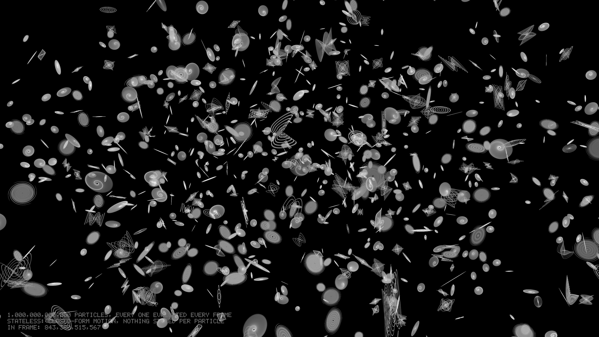
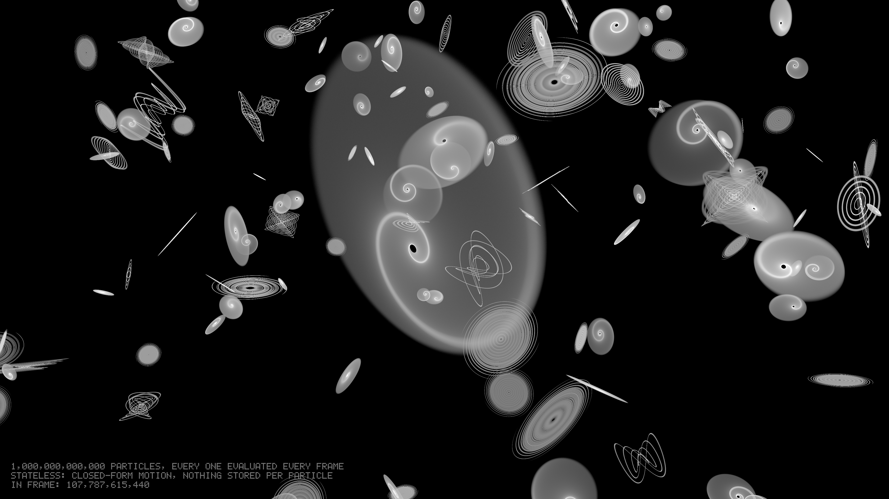

# Strata

**A trillion particles in one 4K frame, on a graphics card from 2018.**

Strata is a particle world that runs in the browser on WebGPU. It is a black
void full of flat sheets, and every sheet runs its own 2D particle system. Turn
the camera and other sheets come into view, so the world always holds more
moving particles than one view can show, and far more than the screen has
pixels. Where particles pile up their light adds up, so density reads as
brightness instead of disappearing behind the nearest dot.

**[Open the live demo](https://aptyll.github.io/Strata/)** ·
[How the rendering works](https://aptyll.github.io/Strata/docs/explainers/rendering.html) ·
[Render the trillion yourself](#render-the-trillion-yourself) ·
[Docs](#docs)



<sub>One 3840x2160 frame from the offline renderer. The positions of all
1,000,000,000,000 particles were computed for this frame, and about 843 billion
of them land in view. Rendered on an RTX 2070 (8 GB) in under a minute. More
frames in [docs/record](docs/record).</sub>

## The numbers

Measured on one RTX 2070 (8 GB, 2018) on 2026-11-19.

| | particles | what happens to each particle | speed |
| --- | ---: | --- | --- |
| Realtime, simulated | 100,000,000 | stepped and drawn every frame | 111 fps |
| Realtime, simulated | 800,000,000 | stepped and drawn every frame | 15 fps, or 54 fps with culling and LOD |
| Offline, rendered | 1,000,000,000,000 | position computed from its id and the time; in view, it adds light to the grid (exactly one unit with count weighting; a share of a unit that falls with distance with flux weighting) | per 4K frame: about 160 to 193 s with count weighting; 172 to 205 s with flux when the sheets fill the frame (composition A); 26 to 52 s with the first stills' quick flux, where most far particles add no light |

The realtime rows come from the benchmark page at 1920x1080 without vsync, and
the full table is in [docs/perf.md](docs/perf.md). The brute force path moves
about 11.6 billion particles per second, with every particle simulated and
drawn in every frame.

### Rendered, not simulated

The trillion is **rendered**, not simulated, and the video says so on screen.

A trillion particles cannot be stored: at 4 bytes each they would need 4 TB,
and the card has 8 GB. So the offline renderer keeps no state per particle.
Each particle's position is the closed-form solution of an equation of motion
(Kepler orbits, a vortex shear flow, Lissajous oscillators), computed from the
particle's index, its sheet's seed and the time. For every frame, the positions
of all 10^12 particles are computed, exactly 1,000,000,000,000 evaluations.
Each particle that lands in view is added into a 64-bit accumulation grid; for
the ones that fall off screen or behind the camera, only that final add is
skipped. Nothing about any particle is kept for the next frame. They follow
their laws exactly, but they do not interact with each other.

How long a 4K frame takes on the RTX 2070 depends on the shot and the weighting:

| shot | weighting | seconds per 4K frame |
| --- | --- | ---: |
| sheets cover part of the frame (wide and medium stills) | flux, quick (16-bit weights) | 26 to 52 |
| sheets fill the frame (composition A close-up) | flux | 172 to 205 |
| proof shots and the far opener | count | about 160 to 193 |

The record stills were most likely rendered with flux weighting as it first
was: a far particle's weight was rounded at random to one unit of 1/65536 or to
nothing, usually nothing, so they were drawn by a random share of the particles
in view. Skipping those adds is why they were quick. Flux weighting now stores
weights finely enough that every particle in view adds light, and the frame's
label says so from a GPU count. That costs an atomic add per particle, as
count weighting does, so expect such frames to take about as long as count
frames; this has not been timed on the 2070 yet. With count weighting every
particle in view adds exactly one unit of light.



<sub>Closer in, fewer particles land in the picture: 107,787,615,440 here. The
rest are still computed; they just fall outside the frame.</sub>

The realtime rows are true simulations. Every particle's position and velocity
live in GPU memory and are stepped forward every frame.

## Controls

The site opens straight into the simulation. Everything else sits behind a key.

| input | action |
| --- | --- |
| Left drag | orbit |
| Right drag, or Shift + drag | pan |
| Wheel or pinch | zoom toward the cursor |
| Double click | fly to that sheet |
| `W` `A` `S` `D`, `Q` `E` | fly, hold Shift to go faster |
| `,` `.` | previous or next sheet |
| `R` | roll the dice: new behaviors, new system |
| `H` | stats: particles, time, fps |
| `Esc` | settings |
| `F` | fullscreen |
| `?` | every key |
| `[` `]` | halve or double the particle count |
| `-` `=` | dimmer or brighter |
| `G` | go to the nearest sheet |
| `P` | screenshot |
| `V` | record a video |
| Space | idle drift on or off |
| Home | fly home |

You need a browser with WebGPU, such as current Chrome or Edge on desktop.
Without it the page explains what is missing instead of rendering.

## Pages

| page | link |
| --- | --- |
| The world | [`/`](https://aptyll.github.io/Strata/) |
| Challenge mode: the most particles your GPU holds at your frame rate (`C` copies the result) | [`/?challenge`](https://aptyll.github.io/Strata/?challenge) |
| Offline renderer: up to a trillion particles per frame, to MP4 | [`/src/offline/web/`](https://aptyll.github.io/Strata/src/offline/web/) |
| Benchmark sweep, 1M to 800M particles | [`/src/perf/bench/?bench=1`](https://aptyll.github.io/Strata/src/perf/bench/?bench=1) |

URL options for the world: `?behaviors=flow,galaxy` to pick behaviors,
`?world=<seed>` for the endless seeded world, `?intro=0` to skip the opening,
`?adaptive=1` for the adaptive particle budget, `?depth=1` and `?parallax=1`
for the experimental depth cues.

## Render the trillion yourself

In the browser, open the
[offline renderer](https://aptyll.github.io/Strata/src/offline/web/), pick a
preset, **choose folder** (Chrome or Edge, so frames go to disk and a render
survives a reload), then **render**, then **export mp4**. Export encodes in the
browser with WebCodecs, so it needs no ffmpeg.

For renders that take hours, use the Node runner, which a background tab
cannot throttle:

```sh
cd src/offline
npm install
npx tsx node/cli.mjs bench                       # particles per second on your GPU
npx tsx node/cli.mjs render --preset trillion    # 1e12 particles per frame, 4K60, 10 s
npx tsx node/cli.mjs encode --out out/trillion   # needs ffmpeg on the PATH
```

Integer adds commute, so a frame is bit-identical however it is batched, and a
stopped render continues exactly where it left off. Presets, sharding across
machines and the frame format are in [src/offline/README.md](src/offline/README.md).

## Run it locally

```sh
npm install
npm run dev       # then open the printed URL in a WebGPU browser
npm run build     # type check and production build into dist/
npm run preview   # serve the production build
```

Every push to `main` builds the site and publishes it to GitHub Pages, see
[.github/workflows/pages.yml](.github/workflows/pages.yml).

## Docs

| doc | what it covers |
| --- | --- |
| [Rendering field guide](https://aptyll.github.io/Strata/docs/explainers/rendering.html) | interactive explainer: from one particle to one pixel, the memory wall, atomics, tone mapping, render time ([source](docs/explainers/rendering.html)) |
| [architecture.md](docs/architecture.md) | the frame graph, the shared contracts and the GPU memory layouts |
| [perf.md](docs/perf.md) | the 8-byte particle path, culling, LOD and the measured RTX 2070 numbers |
| [gpu-scale.md](docs/gpu-scale.md) | rules for shaders at very large particle counts |
| [render.md](docs/render.md) | density beyond screen resolution: accumulation, trails, bloom, tone mapping |
| [behaviors.md](docs/behaviors.md) · [behavior-library.md](docs/behavior-library.md) | how a particle rule is written, and the built-in ones |
| [world.md](docs/world.md) | sheet layouts and streaming sheets in and out around the camera |
| [interplane.md](docs/interplane.md) | particles that leave one sheet and land on another |
| [depth.md](docs/depth.md) | depth cues that make the void read as deep |
| [capture.md](docs/capture.md) | PNG stills and MP4 video |
| [ux/](docs/ux) | camera, HUD, first-run experience and the dice |
| [src/challenge/README.md](src/challenge/README.md) | Challenge mode and how it counts |
| [src/offline/README.md](src/offline/README.md) | the stateless trillion-particle renderer |

## Build on it

Shared types live in [src/core/contracts.ts](src/core/contracts.ts). New
pieces are new files that register themselves by name:

- a behavior is `src/behaviors/<id>.behavior.ts`, one WGSL `update` function
  per particle (see [docs/behaviors.md](docs/behaviors.md));
- a render pass is `src/passes/<name>.pass.ts`, and its stage decides when it
  runs;
- a UI panel is `src/ui/<id>.panel.ts`.

Each frame runs its passes in a fixed order: `simulate`, `interplane`,
`rasterize`, `depth`, `tonemap`, `ui`, `capture`.

## Privacy

Strata has no analytics, no cookies, no ads and no third-party requests. Every
page carries a Content-Security-Policy that only lets it load from, and send
to, the site's own address, so your browser enforces this itself: a tracker or
a font from someone else's server would be refused. Your settings and the
frames you render stay in your own browser's storage, or in the folder you
pick. The site is hosted on GitHub Pages, and GitHub, like any web host, sees
your IP address when it serves you a page. How it is done:
[src/site](src/site/README.md#the-privacy-lock).

## License

[MIT](LICENSE)
