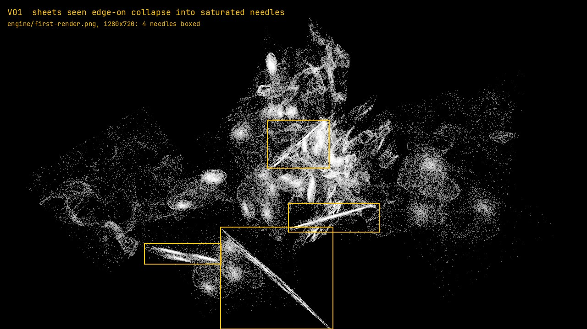

# V01: sheets seen edge-on collapse into saturated needles

Severity: medium, and a **look decision for Noah** (see "Decision" below). It looks like a bug in stills, and it crawls on camera motion.
Affects: every renderer (app, Challenge, 1T).
Lines are as of main `665a6cb`.



## Evidence

- `engine/first-render.png` (project files): four sheets seen nearly edge-on show as white needles (boxed). Lit pixels elsewhere sit at 117 to 217 of 255 (1 to 6 hits), while the needles reach 255. The frame has 1,972 saturated pixels.
- `trillion-still-f0.png`, `trillion-key1-f0.png`, `trillion-key2-f0.png` (project files, 1T path): the brightest marks in every frame are the edge-on slivers.
- `trillion-A.png` (project files, 1T hero close-up): one edge-on sheet crosses the whole frame as a bright needle, over both main sheets.

## What is wrong

A sheet's particles are spread over its area. Seen at angle θ from its normal, that area projects to `cos θ` of its face-on size, so hits per pixel grow as `1 / cos θ`. Edge-on, a whole sheet lands on a line one pixel wide.

For example, 62,500 particles (2M over 32 planes) on a 500 px line is 125 hits per pixel, which is full white. The same sheet face-on over 500 x 500 px gives 0.25 hits per pixel. The line is about 500 times brighter, and it aliases as the camera turns.

The critiques call the edge-on line of light a signature motif (artist and first-time-viewer threads). So keep the line, but cap its gain.

## Likely cause in code

No renderer has a view-angle term. Each one weights a hit by brightness, and at most by distance:

| renderer | line |
| --- | --- |
| app default, compute raster | `src/perf/atomicRasterPass.ts:49` `light = plane.brightness * LIGHT_ONE` |
| points | `src/passes/points.pass.ts:18` |
| sub-pixel splats | `src/render/passes.ts:148` |
| depth sprites | `src/depth/sprite-pass.ts:110` |
| Challenge | `src/challenge/shaders.ts:107` weight `a.x / w^2` (distance only), set at `src/challenge/engine.ts:745` |
| 1T offline | `src/offline/core/shaders.ts:119,133` flux `min(1, ref^2 / z^2)` (distance only; `weighting=count` has none) |

## Decision

This is a look choice, not a bug fix. An edge-on sheet really does put more particles on each pixel, so the needle is true density, and the project's rule is that density reads as brightness. Capping it trades some of that for a calmer image (the challenge and perf review thread raised this). Until Noah chooses, keep true density, with no change. The fix below is for when he chooses a cap.

## Proposed fix (if Noah chooses a cap)

Multiply each sheet's weight by an angle gain, computed once per sheet per frame on the CPU:

```
c    = |dot(sheetNormal, normalize(eye - sheetCentre))|
gain = min(1, c / C0)        // C0 = 0.2: an edge-on line is at most 5x a face-on sheet
```

- **App:** fold `gain` into the per-plane brightness the rasterizers already read (`plane.brightness`), without touching `desc.brightness`. World streaming fades also use that field, so multiply the two rather than overwrite.
- **Challenge and offline:** both already build a per-sheet homography (`planeHomography`, Batch `c0..c2`), so put `gain` in the per-sheet weight numerator. The exact per-particle version is `|det J|` of the homography, which removes both distance and angle. The per-sheet `cos` is enough unless a sheet is very close and large.
- **Make it a setting**, with the default set by Noah's choice. The "Video: edge-on lines of light" thread uses edge-on sheets as a look, so keep a way to turn the gain off.
- **Offline count mode:** the honest tally counts hits, not weights. Keep the count exact and apply `gain` only to the light grid, or run the gain in grade. Do not let it change the "in frame" number.

## How to confirm

1. App: orbit until one sheet is edge-on. It should read as a thin, crisp line, a few times brighter than the face-on sheets, not 255. Check with `python3 docs/briefs/visual/image-stats.py shot.png`: the saturated share should not jump when a sheet turns edge-on.
2. Turn slowly past edge-on. The line should fade in and out smoothly, with no flicker.
3. 1T: in a re-render of key1, the slivers should no longer be the brightest marks in the frame.

## Owner

- `src/perf`, `src/challenge`: written by the "Scale to tens of millions of particles" and "Build challenge mode for record particle counts" threads. The challenge and perf review thread reviews PRs there.
- `src/render`, `src/passes`, `src/depth`: the rendering and 1T cleanup thread.
- `src/offline`: offline renderer thread. Not before the record render: this changes pixels, so it needs a re-render.
