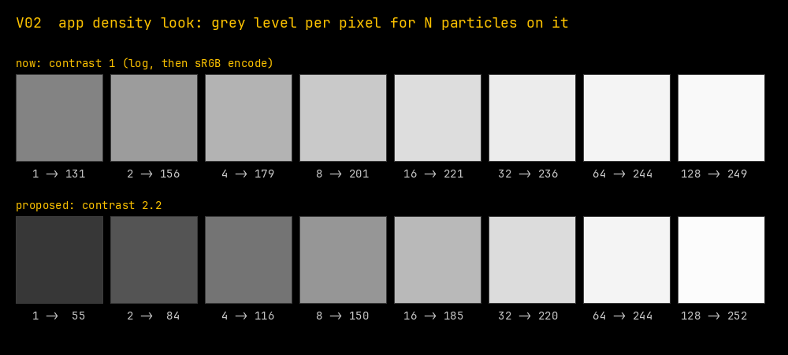

# V02: realtime tone curves lift one particle to mid-grey and squeeze dense structure

Severity: medium (it sets the whole look of the app and Challenge mode).
Affects: the app's density look, the `?tonemap=basic` curve and the Challenge resolve. The 1T grade is not affected.
Lines are as of main `793eefc`.

## Evidence

- The app's density look (exposure 2, white 128, log, soft shoulder, sRGB encode) maps 1 / 2 / 4 / 8 / 16 / 32 / 64 hits on a pixel to 131 / 156 / 179 / 201 / 221 / 236 / 244. One particle is already 51% grey, and six doublings share the top 113 levels. This is arithmetic from the shader.
- `render/density-demo-1M.png` (project files): lit pixels have a median of 175, a 95th percentile of 233, and 27% of them are at 200 or above. Dense cores read as a milky wash.
- `render/counts-auto-exposure.png`: the middle of the disc uses only 205 to 245 (see V03).
- `engine/first-render.png` (basic curve, brightness 0.2): 1 hit gives 117, 2 hits give 154, and 5 hits are already near white.

## What is wrong

A log curve is already perceptual: each doubling of density adds the same step. The result is then treated as linear light and sRGB-encoded (gamma about 1/2.2), which lifts it a second time. Mid-tones float up, and the top of the range is shared by everything dense.

The 1T grade (`src/offline/core/grade.ts`) does not encode (gamma 1), so the same scene looks darker and more contrasty in the 1T video than in the app. Realtime captures and 1T shots won't match when cut together.

## Likely cause in code

- `src/render/tonemap.ts:57` `var e = srgb(v);` encodes every display value. On an `-srgb` canvas, `:63` hands back the linear value so the hardware encodes it instead (`:147` picks the case). Either way, the screen shows the sRGB encode of the log luma.
- `src/passes/tonemap.pass.ts:35` `exposure: 2, white: 128` ("one particle is a clear grey dot").
- `src/gpu/wgsl.ts:68` `basicTone` (the `?tonemap=basic` curve) and `src/challenge/shaders.ts:330`: an exp or log curve followed by `pow(x, 1/2.2)`.

## Proposed fix

1. App: set `tone.contrast` (it already exists and is applied at `src/render/common.ts:56`) to about 2.2 for the log curve in `tonemap.pass.ts`. That cancels the second lift, giving 55 / 84 / 116 / 150 / 185 / 220 / 244 for 1 to 64 hits (bottom row of the image). 1.6 is a softer middle ground (86 / 115 / 144 / 174 / 202 / 229 / 244).
2. Expose it as a "contrast" range (1 to 3) in the Esc menu's look group next to "white point" (`src/app/hud.ts:105`, where `white` is registered), so Noah can tune it on his display.
3. Challenge uses the same chain (log curve, soft shoulder, then `pow(…, 1/2.2)`). Change both curves in one PR, or the app and Challenge will stop matching. Drop the `pow` after the log curve, or apply it only to non-log curves.
4. Match the 1T grade: both should mean "log output is the display value".

## How to confirm

- Default app view, `P` screenshot, `python3 docs/briefs/visual/image-stats.py shot.png`: the median lit pixel should drop from about 130 to 180 into roughly 70 to 120, with the 99th percentile still at 240 or above.
- Isolated particles stay visible as dim grey dots, and dense cores separate into 4x / 16x / 64x steps instead of one bright wash.
- A realtime capture and a 1T still of similar density look alike side by side.

## Owner

- `src/render`, `src/passes`: the rendering and 1T cleanup thread (the design came from the "Render density beyond screen resolution" thread).
- `src/challenge`: change it in the same PR as `src/render`, which is the render owner's call. The challenge and perf review thread reviews it.

Related: `docs/briefs/accumulation-and-tonemap.md` step 1 ("make the tone mappers agree").
