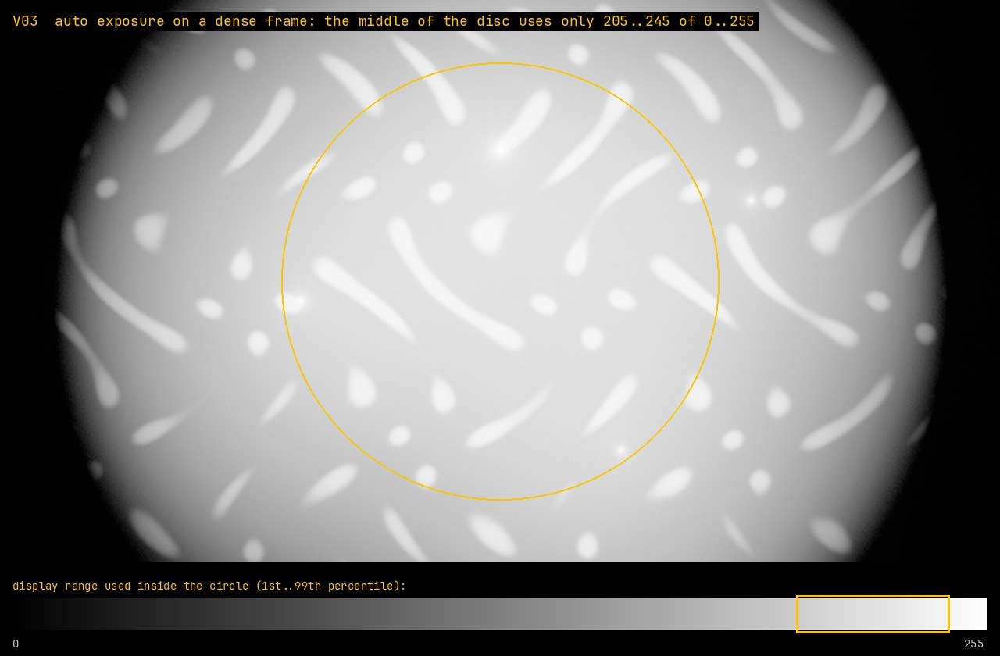

# V03: dense frames come out flat: auto exposure has no black floor

Severity: high for the 1T video (partly addressed), medium for `CountToneMapper`.
Lines are as of main `793eefc`.

## Evidence

- `render/counts-auto-exposure.png` (synthetic, 120,000 mean hits per pixel): inside the circle, the 1st to 99th percentile is 205 to 245 and the darkest pixel is 199. Dense structure gets 16% of the display range, and nothing inside the disc comes near black.
- `trillion-still-f0.png`, `trillion-key1-f0.png`, `trillion-key2-f0.png` (1T, 4K): half of all lit pixels sit between about 105 and 153, and each sheet reads as a flat grey disc with faint spirals. See each image's `.notes.md` in the project files.

## What is wrong

Both auto exposures set a white point and a toe, but no floor. On the log curve `L = log(1 + c/toe) / log(1 + white/toe)`, a frame whose lit pixels all hold many hits never maps anything near 0. Uniform sheet interiors land mid-curve, and the structure inside them gets only a few grey levels.

## Likely cause in code

- `src/render/counts.ts:116-119`: `black` (5th percentile) is used as the toe scale, not as a floor. With `minRange` 64, a pixel at the black point still maps to `log 2 / log 65 = 0.17`, which is 115/255 after sRGB encode (see V02).
- `src/offline/core/grade.ts:36` `contrast: 4096`, a 12-stop curve, and `:87` `toe = white / contrast`. A pixel 6 stops below white still gets 128/255.

## Done so far

Noah chose a re-grade at **contrast 256** for the 1T video (decision card, 2026-11-19 01:39 UTC), after seeing a preview: `visual-notes/trillion-still-f0-regrade.jpg` in the project files. It moves the median lit pixel of frame 0 from 125 to 70. The offline renderer thread made 256 the default (`DEFAULT_LOOK.contrast`) in PR #67, which merges after the 7:55 PM freeze. It is grade-only, with no re-render.

## Proposed fix (what remains)

1. `CountToneMapper`: add a real floor. `L = clamp(log(c / b) / log(w / b), 0, 1)` between a low percentile `b` (2 to 5%) and the white point, with a short soft toe below `b` so outskirts fade instead of clipping.
2. Offline grade: optionally add the same `blackPercentile` to `Look`, off by default now that 256 is chosen. Watch the tradeoff from `docs/briefs/accumulation-and-tonemap.md` point 3: 1T's advantage over 1B is in the faint regions, so a floor must not crush halos and tails to black.
3. For video, keep the existing smoothing (`blend` in counts, `smoothFrames` in grade) so a floor does not pump.

## How to confirm

- Counts demo: inside the disc the 5th percentile should be at or below about 60 and the 95th at or above about 230, with the streaks clearly separated from the background.
- 1T: on the re-graded frames, sheet interiors show spirals and rings at a glance in a 1080p downscale, and faint outskirts are still visible (not 0).

## Owner

- `src/render/counts.ts`: the rendering and 1T cleanup thread (written by the "Render density beyond screen resolution" thread).
- `src/offline/core/grade.ts`: offline renderer thread.
