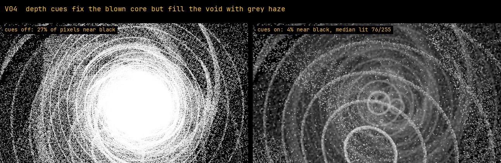

# V04: depth cues fix the blown core but fill the void with grey haze

Status: **step 1 done** in PR #136 (aperture 3, `maxCocPx` 12). Steps 2 and 3 below (a floor in depth mode, stronger fog) are still open.

Severity: medium (`?depth=1` and the "depth sprites" rasterizer only; off by default).
Lines are as of main `793eefc`.

## Evidence

From `docs/depth/cues-off.jpg` and `docs/depth/cues-on.jpg` (same scene):

| | near-black pixels (< 8) | median lit pixel | saturated (>= 250) |
| --- | --- | --- | --- |
| cues off | 27% | 206 | 17% |
| cues on | 4% | 76 | 0% |

Cues on removes the blowout, which is the point. But the black void becomes a grey veil over the whole frame. The vision is a black void, and the artist review asks that "bloom and fog must never lift the black".

## What is wrong

Defocus is energy conserving: an out-of-focus particle spreads the same light over a disc of up to `maxCocPx` radius. Millions of such discs sum to a smooth, nearly uniform floor. The fog is too weak to remove it: transmittance is still `e^-1` at three world radii. The 'soft' display has no toe, so the floor shows as grey.

## Likely cause in code

- `src/depth/params.ts:51-52`: `aperture: 7`, `maxCocPx: 40`. Near sheets become 40 px discs.
- `src/depth/sprite-pass.ts:31`: `fogDensity: 1 / (3 * r)` with `fogPower: 2`.
- `src/render/tonemap.ts`: the 'soft' display (identity below 0.75) passes any floor straight through (see V02).

The depth sprite pass now honours per-plane brightness. That was fixed in PR #51, so world fades work with `?depth=1`.

## Proposed fix

1. Smaller defaults: `maxCocPx` about 12 and `aperture` about 3. Keep the large bokeh for a deliberate close-up, as the artist review suggests.
2. A floor for depth mode: either the filmic display (it has a toe) when depth sprites are on, or the floor from V03 applied to the HDR target.
3. Optionally, stronger fog (`fogDensity: 1 / (1.5 * r)`) so the far side dims into black instead of grey.

## How to confirm

`/?depth=1` default view, `P` screenshot, `python3 docs/briefs/visual/image-stats.py shot.png`: near-black pixels should be back to about 20% or more, with no saturated cores. Black should be visible between sheets while the focused sheet stays sharp.

## Owner

`src/depth`: the rendering and 1T cleanup thread (written by the "Add depth cues for vast scale" thread).
