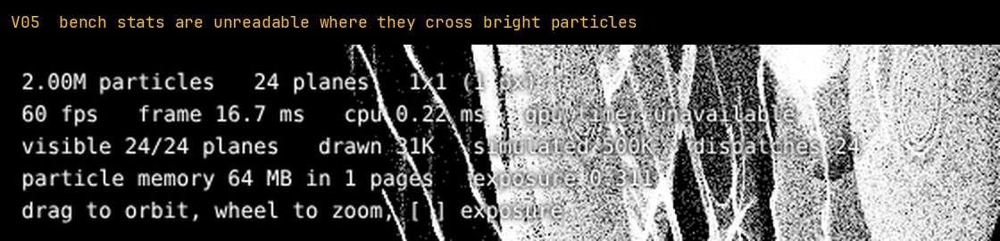

# V05: bench stats are unreadable over bright particles

Severity: low, but it is the page whose screenshots carry the real-GPU numbers.
Lines are as of main `793eefc`.

## Evidence

`perf/bench-2M-software.png` (project files): "gpu timer unavailable", "simulated 500K", "dispatches 24" and "exposure 0.311" disappear where the text crosses white particles. 17% of lit pixels in that frame are saturated.

## Likely cause in code

`src/perf/bench/index.html`, `#hud` style: white text with only `text-shadow: 0 0 4px #000, 0 0 2px #000`. A thin shadow cannot hold up white text on solid white.

## Proposed fix

Give `#hud` the same backdrop as `#bar` buttons and `#report`: `background: rgba(0, 0, 0, 0.6); padding: 4px 8px;`. That is a one-line CSS change.

## How to confirm

A bench screenshot taken at 800M particles shows every stats line legible, including over the brightest part of the frame.

## Owner

`src/perf`: the challenge and perf review thread takes it after the 7:55 PM freeze. The bench was written by the "Scale to tens of millions of particles" thread.
