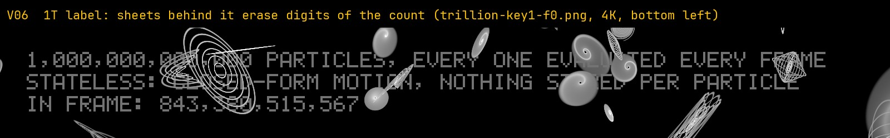

# V06: the 1T honesty label is erased where bright sheets sit behind it

Status: **done** in PR #67. See "Status" below.

Severity: high for the video. The label is the main proof device for the count.
Lines are as of main `793eefc`.

## Evidence

`trillion-key1-f0.png` (project files, 4K): the trillion reads "1,000,000,00?,?00", "EVALUATED" is half covered, and IN FRAME reads "843,3??,515,567". In `trillion-key2-f0.png` the label happens to sit on black and is fine.

## Likely cause in code

`src/offline/core/grade.ts:198` in `drawLabel`: `if (frame[i] < value) frame[i] = value`. A glyph pixel becomes max(background, 115). On a sheet brighter than 115 the glyphs vanish, and the sheet still shows between the strokes. `src/record/index.ts` uses the same grade, so the in-app record path has the same problem.

## Proposed fix

Before drawing a line of text, scale every pixel in its text box (glyph rows plus about `2 * scale` px of padding) to about 20% of its value. Then draw the glyphs at `value` as now. This is grade-only: no re-render, deterministic, about 10 lines. An alternative is a `1 * scale` px black outline around each lit glyph pixel, which hides less of the image.

## How to confirm

Re-grade key1 and check that every digit of both counts is readable at 1080p. Then check frame 0 and key2 again: the label should look the same as before where it already sat on black.

## Status

Fixed in PR #67 (branch `feat/offline-hero-compositions`): `drawLabel` darkens each line's box to 20% before drawing the glyphs. It merges after the 7:55 PM freeze. It is grade-only, so existing frames can be re-graded from their stored 16-bit frames with no re-render. `trillion-C.png` shows the same problem and needs the re-grade too.

## Owner

`src/offline`: offline renderer thread, told 2026-11-19 01:41 UTC.
