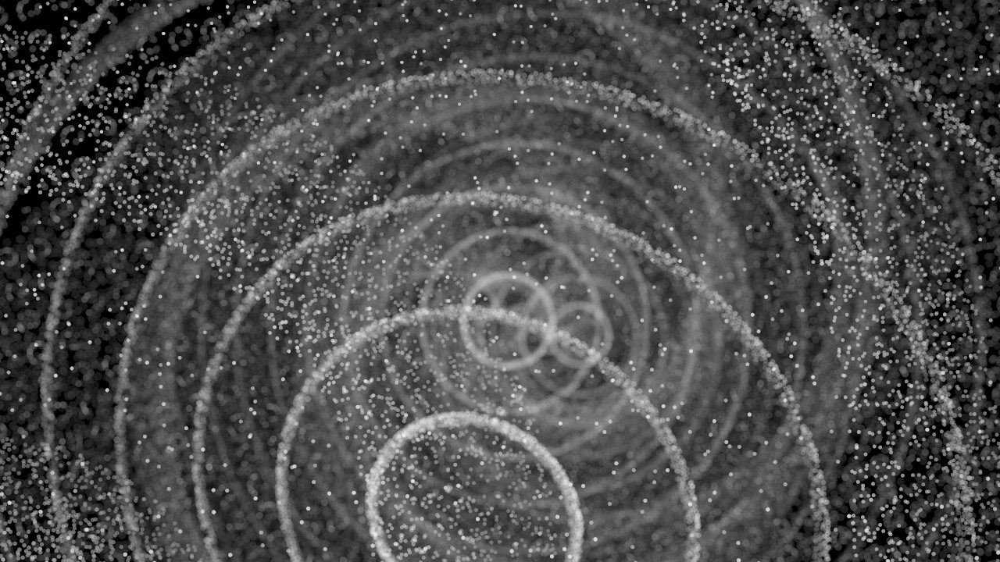
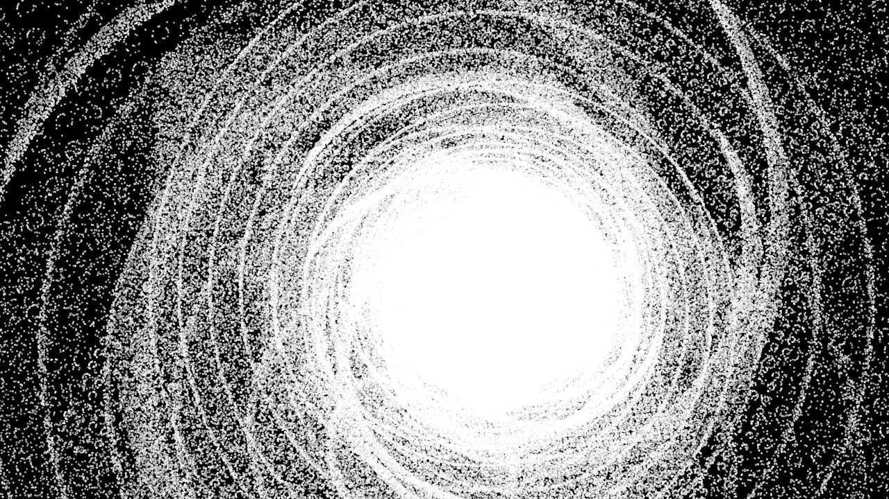
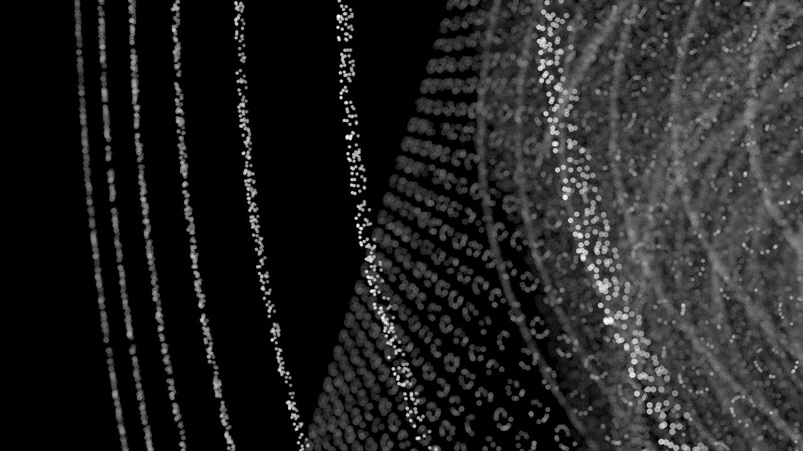

# Depth cues

Everything that makes the void read as deep rather than flat lives in
`src/depth/`. Monochrome only: every function returns a scalar intensity.

| Cues on | Cues off |
| --- | --- |
|  |  |

Same frame, 2 million particles on 64 planes. Looking off axis:



## The four cues

1. **Fog into black.** Transmittance `exp(-(d * fogDensity) ^ fogPower)`.
   Far planes do not pile up into a white blob, they sink into the void.
2. **Depth of field.** Each particle is a sprite whose radius grows with its
   circle of confusion, `aperture * (|z - focus| - focusRange) / z`. The light
   is spread over the disc, so a blurred plane becomes a soft haze. Focus
   follows the nearest plane on the view axis (`FocusTracker`) and eases in log
   space, so flying through a plane racks focus onto the next one.
3. **Atmospheric perspective.** Particle size follows perspective
   (`sizeAttenuation`, 0 = constant pixels, 1 = true perspective). Below
   `minPx` a particle stops shrinking and dims instead, which is what makes
   distant planes faint without aliasing. `distDim` adds extra dimming on top.
4. **Parallax.** `ParallaxRig` slides the eye sideways (idle drift plus
   pointer) while it keeps looking at the focus point, so the focused plane
   holds still and every other plane slides against it.

All of it is energy conserving: a particle carries the same light whether it
is sharp, blurred or smaller than a pixel.

## Files

| file | what |
| --- | --- |
| `depth.wgsl.ts` | `depthWGSL`, a WGSL string to put in front of any shader. `DepthParams` struct plus `depth_fog`, `depth_coc_px`, `depth_sprite`, `depth_bokeh`, `depth_point_intensity`, quad helpers. |
| `params.ts` | `DepthParams`: defaults, cue switches, `pack()` into the 80 byte uniform, CPU mirrors `fogAt`, `cocAt`, `fogCullDistance`. |
| `focus.ts` | `FocusTracker`, `nearestPlaneDistance`, `focusPlaneFromDesc` (from a `PlaneDesc`). |
| `parallax.ts` | `ParallaxRig`. |
| `parallax-camera.ts` | `createParallaxCamera(camera)`: wraps any `CameraController` and adds pointer parallax. |
| `sprite-pass.ts` | `createDepthSpritePass(gpu)`: a `rasterize` stage `Pass` built on `src/core/contracts.ts`. |
| `demo/` | Standalone page with its own tiny renderer. |
| `test/` | Unit tests for the CPU side: `node src/depth/test/run.mjs`. |

## Demo

`npm run dev`, then open `/src/depth/demo/`. It does not use the engine: it
generates particles procedurally on an endless corridor of tilted planes.

Keys 1 to 5 toggle fog, depth of field, size and brightness, parallax and
autofocus. Drag to look, space pauses, H hides the panel. The same switches
work as URL parameters (`?dof=0&count=8000000&time=12&paused=1&ui=0`), see the
top of `demo/demo.ts`. `?offscreen=1` skips presenting and renders only through
`window.__depthDemo.readPixels()`, for headless capture.

## In the engine

`src/passes/sprites.pass.ts` registers the pass. It is off by default: open
the app with `?depth=1`, or set `enabled` on the pass named `depth-sprites`.

While it is on it replaces the one pixel points: it runs after the points pass
and clears the HDR target. It draws each plane's particle buffer as instanced
quads and reads only what the contracts promise (Globals, the plane uniform,
the particle buffer). Settings are sized to the world on the first frame
(`depthSettingsForWorld`), and can be changed live:

```ts
const pass = strata.passes.find((p) => p.name === 'depth-sprites') as DepthSpritePass;
pass.enabled = true;
pass.params.aperture = 12;      // stronger blur
pass.params.fogDensity *= 2;    // fog closes in
pass.params.dof = false;        // switch one cue off
pass.autofocus = false;
pass.params.focusDist = 40;
pass.fitWorld(strata.planes);   // after the world changes scale
```

Planes that fog has fully erased are not submitted at all
(`pass.culledPlanes`), so fog also buys performance.

### Parallax

`src/main.ts` draws through `createParallaxCamera(camera)`. With `?parallax=1`
or the "pointer parallax" toggle in the HUD, the eye slides sideways with the
pointer while the focus distance holds still on screen, so nearer planes slide
against the pointer and farther planes with it. Travel is a fraction of the
focus distance (`pointerAmount`, default 0.03), so it looks the same at any
world scale. The focus distance is the sprite pass's focus when sprites are
on, otherwise the camera's orbit distance.

### Using the library in another shader

```wgsl
// vertex stage, perspective projection
let clip = globals.viewProj * world;
let s = depth_sprite(clip.w, distance(world.xyz, eye), dp);
// s.radiusPx, s.intensity, s.defocus
```

## Offline and record scale renderers

A renderer that draws every particle as a single sample (points, compute
splats, an accumulation buffer) cannot grow a sprite. It gets the same cues
from two calls per particle:

```wgsl
// dp: DepthParams uniform, packed by DepthParams.pack() on the CPU
let clip = viewProj * world;
let viewZ = clip.w;
let weight = depth_point_weight(viewZ, distance(world.xyz, eye), dp); // fog, near fade, size gain
let u = vec2f(rand(i, 0u), rand(i, 1u));                              // two uniform numbers per particle
let ndc = clip.xy / clip.w + depth_lens_jitter_ndc(viewZ, u, viewport, dp);
// splat `weight` at `ndc`
```

Depth of field here is lens sampling: each particle lands on a random point
inside its circle of confusion. With one sample per particle a sparse plane
looks grainy, a dense one already looks blurred, and at record counts or with
accumulated frames it converges to the same bokeh the sprite pass draws. It
costs two random numbers per particle and no extra fill. Use a different `u`
each frame if frames are accumulated or motion blurred, and the same `u` each
frame if single frames must not shimmer.

A CPU renderer has the same functions on `DepthParams`: `pointWeight(viewZ,
dist)`, `lensJitterPx(viewZ, u1, u2)`, `fogAt`, `cocAt`. `setLens(radius,
camera)` sets the aperture from a physical lens radius in world units.

If only brightness can change, `depth_point_intensity(clip.w, dist, dp)` keeps
fog, size dimming and the energy loss of defocus, without drawing the blur.

## Cost and limits

- Sprites are six vertices per particle instead of one, and blurred sprites
  cover many pixels. `maxCocPx` caps the radius and `cullIntensity` drops
  sprites too dim to see. Expect the sprite path to hold fewer particles at 60
  fps than points. How many fewer has not been measured on a real GPU yet.
- The engine pass has only been exercised headlessly on a software renderer
  with stand-in planes shaped like the contracts. It has not been run inside
  the live app. The world-sized defaults in `depthSettingsForWorld` are a first
  guess and will want tuning by eye.
- While `depth-sprites` is on, the points pass still runs and its output is
  cleared. Disabling `points` at the same time saves that work.
- Pointer parallax in the app is off by default (`?parallax=1` or the HUD
  toggle). Idle drift is left to the camera rig, which already has its own.
- The lens sampling functions are unit tested on the CPU side only. No
  renderer on main calls them yet.
- The demo's tone map is a placeholder.
