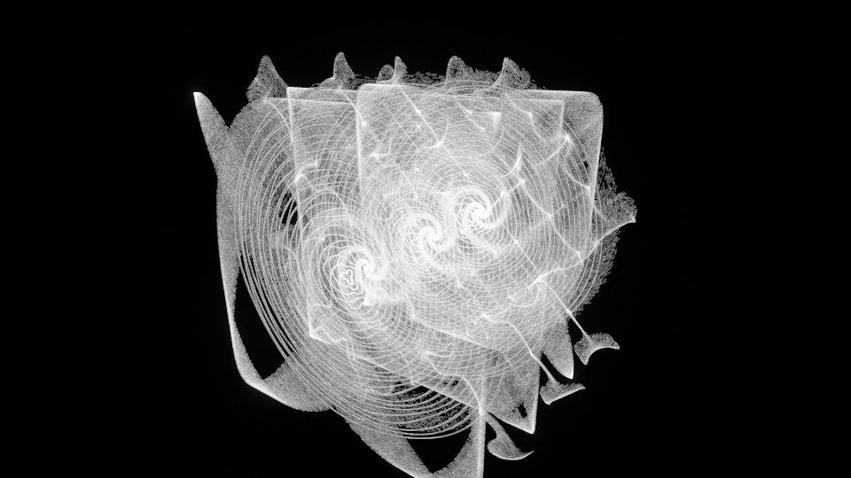
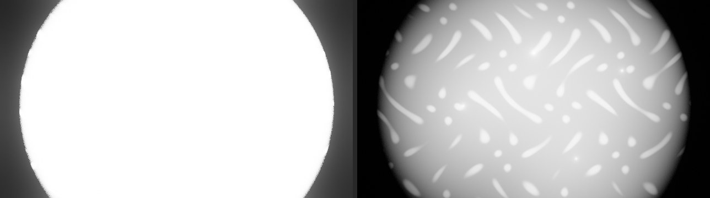
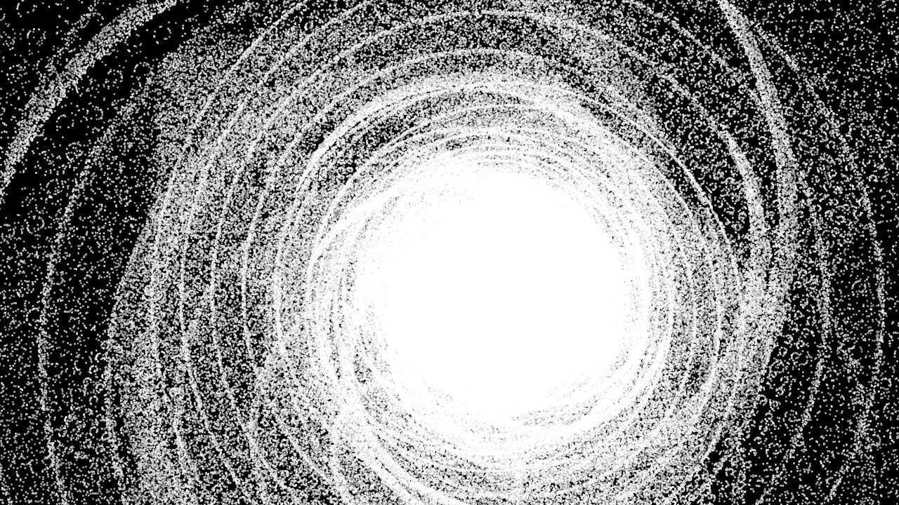
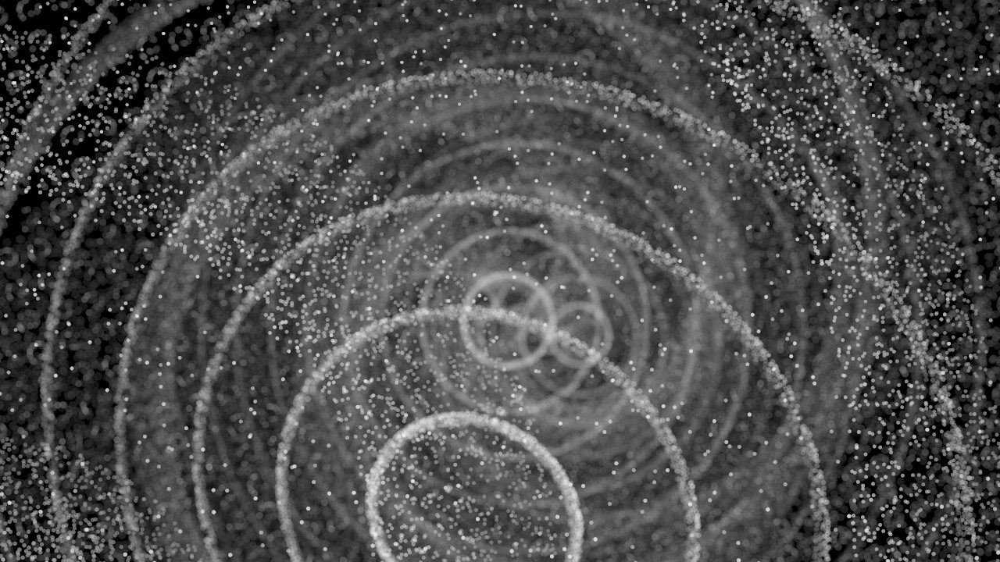
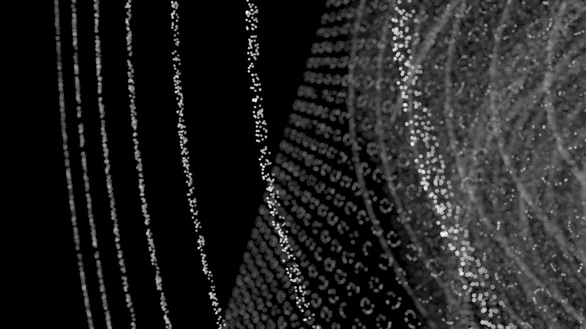
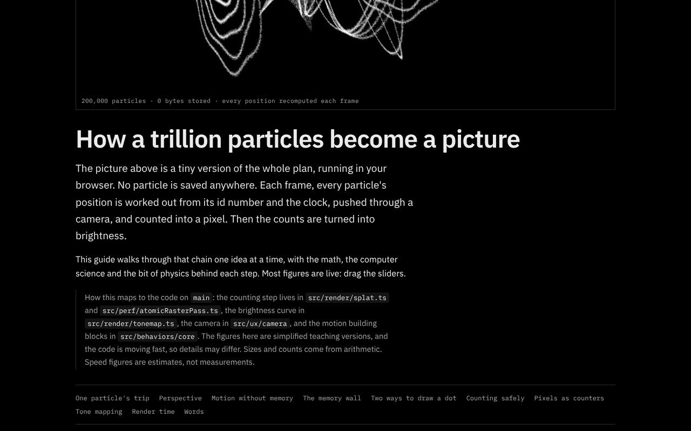
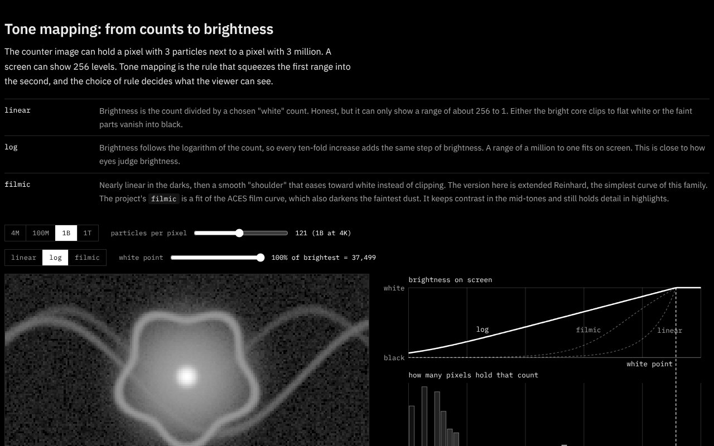

# 01. Density look and depth cues

| | |
| --- | --- |
| Date | Nov 18, 2026 (US Central; Nov 19 in UTC) |
| Covers | 7:16 PM to 8:20 PM |
| Code | [`src/render`](../../../src/render/README.md), `src/depth`, `src/hue`, `docs/explainers` |
| Reference docs | [docs/render.md](../../render.md), [docs/depth.md](../../depth.md) |
| Status as of | 8:20 PM |

[Back to the rendering journal](README.md)

Strata shows more particles than the screen has pixels, so a pixel is not
"on" or "off". It holds a count, and the look comes from how counts become
grey levels. This page records the pieces that do that in the realtime app,
plus the depth cues and the explainer page.

## What was built

**The density pipeline** ([#20](https://github.com/Aptyll/Strata/pull/20)).
Particles deposit energy into a one-channel float buffer with no clamp. A
tone mapper turns that density into white on black afterwards, so dense
regions read as gradients, not flat white.

```
particles -> splat -> density -> trails -> bloom -> tone map -> target
```

- `splat.ts`: three ways to deposit. `point` (point list), `quad` (instanced
  tent kernel, smooth sub-pixel motion), `compute` (atomic add into a
  per-pixel `u32` grid, cost independent of overdraw).
- `trails.ts`: accumulation over time on density, as phosphor (`max`) or long
  exposure (`ema`), independent of frame rate.
- `bloom.ts`: bloom on the tone-curved brightness, up to six octaves.
- `tonemap.ts`: log, power or linear density curve, a display shoulder, sRGB
  encode and dither.
- `post.ts`: `DensityPost`, the trails, bloom and tone map chain on any
  density texture.

**Into the app** ([#26](https://github.com/Aptyll/Strata/pull/26),
[#28](https://github.com/Aptyll/Strata/pull/28),
[#30](https://github.com/Aptyll/Strata/pull/30)). The registered `tonemap`
pass became the density look: log curve, subtle bloom, short trails, dither.
`?tonemap=basic` keeps the earlier exponential curve for comparison. Starting
values were exposure 2, white 128 and a trail half life of 0.08 s. The PR says
plainly that these came from the maths and were not tuned by eye.

**Tone mapping from integer counters**
([#39](https://github.com/Aptyll/Strata/pull/39)). `CountToneMapper` reads a
`u32` or 64-bit counter buffer directly, so a kernel that counts hits with
`atomicAdd` never touches a float target. Auto exposure comes from a GPU
histogram of log2(count): 256 bins, a 1 KiB readback, black at the 5th
percentile of lit pixels and white at the 99.9th with 1.5x headroom. This is
the tone mapper built for frames with about 120,000 hits per pixel.

**Black stays black** ([#74](https://github.com/Aptyll/Strata/pull/74)). A
partner review found that the dither lit about 13% of the empty void to code
value 1, in a new pattern every frame. The fix limits the dither to the
distance from black and from white.

**Depth cues** ([#15](https://github.com/Aptyll/Strata/pull/15),
[#24](https://github.com/Aptyll/Strata/pull/24),
[#40](https://github.com/Aptyll/Strata/pull/40),
[#46](https://github.com/Aptyll/Strata/pull/46),
[#51](https://github.com/Aptyll/Strata/pull/51)). Fog, depth of field, size
falloff and parallax, as a WGSL library plus a sprite rasterizer. Off by
default: `?depth=1` for sprites, `?parallax=1` for pointer parallax.

**One hue per sheet** ([#91](https://github.com/Aptyll/Strata/pull/91)). An
optional rasterizer (`?raster=hue`) that draws every sheet in its own color.
The red channel stays plain density, so the density tone map is untouched.

**Rendering field guide** ([#31](https://github.com/Aptyll/Strata/pull/31)).
[`docs/explainers/rendering.html`](../../explainers/rendering.html), a
self-contained interactive page: one particle's trip to a pixel, stateless
motion, the memory wall, render pipeline against compute rasterizer, atomics
and counter precision, a tone mapping lab and a render time calculator.

**Cleanup** ([#54](https://github.com/Aptyll/Strata/pull/54),
[#76](https://github.com/Aptyll/Strata/pull/76),
[#109](https://github.com/Aptyll/Strata/pull/109)). One counter resolve in
place of two, uniform layouts written down with byte offsets, shared WGSL
snippets and matrix helpers in place of hand copies. Nothing renders
differently.

## Pull requests

| PR | title | merged (Central) | state |
| --- | --- | --- | --- |
| [#15](https://github.com/Aptyll/Strata/pull/15) | Add depth cues: fog, depth of field, size falloff, parallax | 7:16 PM | merged |
| [#20](https://github.com/Aptyll/Strata/pull/20) | Add density render pipeline: HDR splatting, trails, bloom, log tone mapping | 7:16 PM | merged |
| [#24](https://github.com/Aptyll/Strata/pull/24) | Use the HUD's own settings, smooth dice rolls, and add depth sprites as a rasterizer | 7:18 PM | merged |
| [#26](https://github.com/Aptyll/Strata/pull/26) | Use the density tone mapper in the app | 7:18 PM | merged |
| [#28](https://github.com/Aptyll/Strata/pull/28) | Wire capture, density render passes and plane crossings into the app | 7:19 PM | merged |
| [#30](https://github.com/Aptyll/Strata/pull/30) | Use the tonemap pass's density look instead of a second copy | 7:20 PM | merged |
| [#31](https://github.com/Aptyll/Strata/pull/31) | Add rendering field guide explainer | 7:21 PM | merged |
| [#39](https://github.com/Aptyll/Strata/pull/39) | Add CountToneMapper: tone mapping straight from u32 or u64 hit counters | 7:24 PM | merged |
| [#40](https://github.com/Aptyll/Strata/pull/40) | Depth: pointer parallax in the app, lens sampling for point renderers | 7:25 PM | merged |
| [#46](https://github.com/Aptyll/Strata/pull/46) | Depth: keep lens rim pick and angle independent | 7:33 PM | merged |
| [#51](https://github.com/Aptyll/Strata/pull/51) | Fix dispatch overshoot and depth sprite brightness | 7:35 PM | merged |
| [#54](https://github.com/Aptyll/Strata/pull/54) | Make the render module easier to read: one counter resolve, documented buffers and uniform layouts | 7:37 PM | merged |
| [#74](https://github.com/Aptyll/Strata/pull/74) | Keep black exactly black in the tone map dither | 7:42 PM | merged |
| [#76](https://github.com/Aptyll/Strata/pull/76) | Use the shared WGSL snippets and engine structs in render, depth and verify instead of hand copies | 7:43 PM | merged |
| [#91](https://github.com/Aptyll/Strata/pull/91) | Color each sheet its own hue (new rasterizer option) | 8:00 PM | merged |
| [#109](https://github.com/Aptyll/Strata/pull/109) | Use the shared matrix helpers in render and the render and depth demos | 8:01 PM | merged |
| [#131](https://github.com/Aptyll/Strata/pull/131) | Add a contrast slider to the Esc menu's look settings, default look unchanged | 8:09 PM | merged |
| [#136](https://github.com/Aptyll/Strata/pull/136) | Depth mode: smaller default blur so out-of-focus sheets stop filling the void with grey | 8:11 PM | merged |
| [#139](https://github.com/Aptyll/Strata/pull/139) | Darker default tone curve in the app and Challenge, so one particle is a dim dot and dense cores show steps | 8:20 PM | merged |

## Measured

Everything here ran on a software GPU (SwiftShader) in the cloud. It shows
that the code is correct. It says nothing about speed.

| what | result | source |
| --- | --- | --- |
| Density pipeline, 1M particles at 960x540 | `compute` and `quad` modes agree to within 0.01 of mean 8-bit brightness; output strictly monochrome; 0.01% of pixels saturated | [#20](https://github.com/Aptyll/Strata/pull/20) |
| `CountToneMapper`, 640x360, mean 120,000 hits per pixel | `u32` and `u64` counters give the same image; auto exposure saturates 0% of pixels, a fixed white of 64 saturates 81% | [#39](https://github.com/Aptyll/Strata/pull/39) |
| Dither on an empty black frame, `rgba8unorm` | mean output code 0.13 before the fix, exactly 0 after | [#74](https://github.com/Aptyll/Strata/pull/74) |
| Dither on an empty black frame, `rgba8unorm-srgb` | mean 2.16 and max 13 before, exactly 0 after | [#74](https://github.com/Aptyll/Strata/pull/74) |
| Depth cues | 8 unit tests pass; the demo rendered at 2M particles | [#15](https://github.com/Aptyll/Strata/pull/15) |
| Render verify cases | 4 new cases pass, and pass on the code they replaced | [#54](https://github.com/Aptyll/Strata/pull/54) |

One limit is arithmetic, not a measurement: the app's shared HDR target is
`rgba16float`, which stops counting near 2048 overlapping particles per pixel
at brightness 1. That is why the trillion path uses integer grids
(see [page 03](2026-11-18-03-offline-stateless-renderer.md)).

## Pictures



*The `src/render` demo page at 1M particles, software GPU. The stripes and
rings are deliberate stress patterns. Original: `render/density-demo-1M.png`
in the project files.*



*`CountToneMapper` on a synthetic image with a mean of 120,000 hits per pixel.
Left: a fixed white point of 64 saturates most of the frame. Right: auto
exposure from the histogram. Originals: `render/counts-fixed-white-64.png` and
`render/counts-auto-exposure.png` in the project files.*

| depth cues off | depth cues on | off axis |
| --- | --- | --- |
|  |  |  |

*The depth demo at 2M particles on a software renderer, from
[docs/depth.md](../../depth.md).*

[](../../explainers/rendering.html)

[](../../explainers/rendering.html)

*Two screenshots of the rendering field guide. Speed figures on that page are
labelled as estimates.*

## Checked and not checked

- Checked: type check and production build for every PR; headless runs on a
  software GPU as listed above.
- Not checked on the RTX 2070 when this was written: the density look's
  starting values (white 128, trail length), the depth sprite pass inside the
  live app, the per-sheet hue rasterizer.

## Open

- The realtime tone curve lifts a single particle to mid grey and squeezes
  dense structure (visual brief V02).
  [#131](https://github.com/Aptyll/Strata/pull/131) added a contrast slider to
  the Esc menu, and [#139](https://github.com/Aptyll/Strata/pull/139) made the
  default curve darker at 8:20 PM. Neither had been judged on the 2070.
- `CountToneMapper` auto exposure has no black floor, so dense frames come out
  flat (visual brief V03).
- Depth cues fix the blown core but fill the void with grey haze (visual
  brief V04). [#136](https://github.com/Aptyll/Strata/pull/136) made the
  default blur smaller for this at 8:11 PM. Not yet looked at on the 2070.

These are described on [page 08](2026-11-18-08-visual-review-and-open-work.md).
