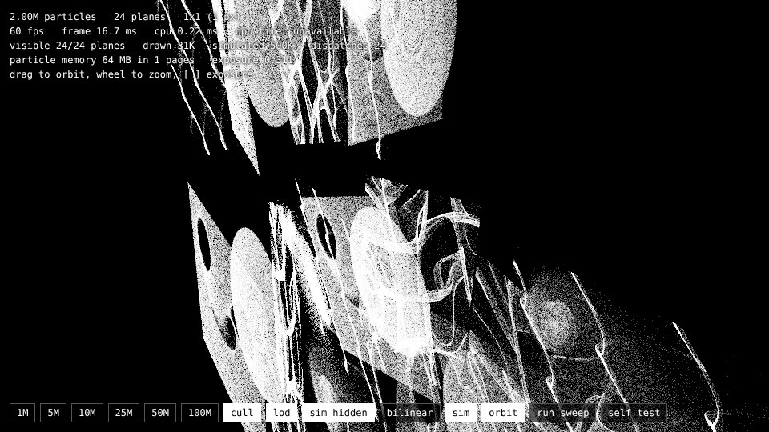

# 02. Compute rasterizer and realtime numbers

| | |
| --- | --- |
| Date | Nov 18, 2026 (US Central; Nov 19 in UTC) |
| Covers | 7:12 PM to 8:13 PM |
| Code | [`src/perf`](../../../src/perf/README.md), `src/verify`, `src/gpu` |
| Reference docs | [docs/perf.md](../../perf.md), [docs/gpu-scale.md](../../gpu-scale.md) |
| Status as of | 8:20 PM |

[Back to the rendering journal](README.md)

This is the **realtime, simulated** side: every particle has stored state
that is stepped and drawn every frame. The numbers on this page are the ones
behind "100 million particles at 111 fps".

## What was built

**The perf path** ([#8](https://github.com/Aptyll/Strata/pull/8)). Three
ideas, all in `src/perf`:

- **8 bytes per particle.** Position is two `u16` (unorm over the sheet's
  square), velocity is two `i16` (snorm, scaled by the plane's maximum
  velocity). Half the size of two `vec2f`. At this scale a frame is limited
  by memory traffic, so bytes per particle is the main lever.
- **A compute rasterizer.** Particles are added to a per-pixel counter with
  `atomicAdd` from a compute shader, so the cost does not depend on overdraw.
- **Culling and LOD.** Planes out of view are skipped and far planes are
  thinned and stepped less often.

**Default in the app** ([#13](https://github.com/Aptyll/Strata/pull/13)). The
compute rasterizer became the app's default rasterize pass. The point pass
stays selectable with `?raster=points`. "Hold frame rate" (`?adaptive=1`)
adjusts the particle count to a target fps, and
[#71](https://github.com/Aptyll/Strata/pull/71) stopped that governor from
collapsing the count.

**Shared behaviors at 8 bytes** ([#34](https://github.com/Aptyll/Strata/pull/34)).
`PerfEngine` runs the same behaviors and planes as the main engine. Its
compute shader is derived from the core one with only the storage swapped, and
it throws if the core shader changes shape. The same PR fixed a dithering bug
so particles at rest stay exactly at rest.

**Shader checks** ([#18](https://github.com/Aptyll/Strata/pull/18),
[#60](https://github.com/Aptyll/Strata/pull/60),
[#93](https://github.com/Aptyll/Strata/pull/93)). `src/verify` compiles
shaders with the real WGSL compiler, runs them on a WebGPU device and compares
with a CPU reference. `npm run verify` started with 22 cases that run in about
a second, and later compiles every production shader.

**Real numbers and profiling switches**
([#44](https://github.com/Aptyll/Strata/pull/44)). The first RTX 2070 table
went into `docs/perf.md`, and the bench gained `draw=0` (simulate only) and
`modes=brute` so the next run could split simulation cost from raster cost.

**Shared code** ([#53](https://github.com/Aptyll/Strata/pull/53),
[#100](https://github.com/Aptyll/Strata/pull/100),
[#111](https://github.com/Aptyll/Strata/pull/111)). One shader prelude, one
matrix module, one device request and one pipeline helper for the engine and
the perf path.

**Decisions written down** ([#128](https://github.com/Aptyll/Strata/pull/128),
first opened as #84). The compute rasterizer is named as the one default, the
other rasterizers are labelled "debug" in the settings menu, and `docs/perf.md`
records that `PerfEngine` stays bench-only for now and that `src/offline` is
the film's 1T kernel. [#125](https://github.com/Aptyll/Strata/pull/125) runs
the shader checks in CI on a software GPU.

**Bench fixes** ([#108](https://github.com/Aptyll/Strata/pull/108),
[#122](https://github.com/Aptyll/Strata/pull/122)). A sim-only bench run with
hidden planes off used to simulate no visible plane at all while the stats
line looked normal. That is fixed, and the stats line got a dark backdrop so
it stays readable over bright particles.

## Pull requests

| PR | title | merged (Central) | state |
| --- | --- | --- | --- |
| [#8](https://github.com/Aptyll/Strata/pull/8) | Add perf path: packed 8-byte particles, compute rasterizer, culling and LOD | 7:12 PM | merged |
| [#13](https://github.com/Aptyll/Strata/pull/13) | Wire camera rig, HUD, compute rasterizer and adaptive budget into the app | 7:15 PM | merged |
| [#18](https://github.com/Aptyll/Strata/pull/18) | Add shader verify harness and GPU scale guide | 7:16 PM | merged |
| [#34](https://github.com/Aptyll/Strata/pull/34) | Perf engine runs the shared behaviors and planes at 8 bytes per particle | 7:22 PM | merged |
| [#44](https://github.com/Aptyll/Strata/pull/44) | Record RTX 2070 numbers, add profiling switches to the perf bench | 7:31 PM | merged |
| [#53](https://github.com/Aptyll/Strata/pull/53) | Share one shader prelude between the engine and the perf path | 7:36 PM | merged |
| [#60](https://github.com/Aptyll/Strata/pull/60) | Keep the attractor's angle inside the packed velocity range; compile every production shader in verify | 7:38 PM | merged |
| [#71](https://github.com/Aptyll/Strata/pull/71) | Hold frame rate: stop the governor from collapsing the particle count | 7:41 PM | merged |
| [#93](https://github.com/Aptyll/Strata/pull/93) | Keep one list of production shader compile checks | 7:49 PM | merged |
| [#100](https://github.com/Aptyll/Strata/pull/100) | One matrix module, one device request and one pipeline helper for the engine and perf path | 7:54 PM | merged |
| [#108](https://github.com/Aptyll/Strata/pull/108) | Perf: keep simulating visible planes when drawing is off, and make the bench stats readable | 8:01 PM | merged |
| [#111](https://github.com/Aptyll/Strata/pull/111) | Pack the engine's Globals and Plane uniforms in one place | 8:01 PM | merged |
| [#122](https://github.com/Aptyll/Strata/pull/122) | Perf: adding planes mid-frame no longer breaks the frame, and GPU timings work through encode() | 8:06 PM | merged |
| [#125](https://github.com/Aptyll/Strata/pull/125) | Run the shader checks in CI on a software GPU | 8:08 PM | merged |
| [#128](https://github.com/Aptyll/Strata/pull/128) | Make the compute rasterizer the named default, mark the others debug, and record the engine and 1T kernel decisions | 8:08 PM | merged |
| [#132](https://github.com/Aptyll/Strata/pull/132) | Let tools watch the frame graph, and turn on GPU timestamps in the app | 8:13 PM | merged |

## Measured on the RTX 2070

From [docs/perf.md](../../perf.md): RTX 2070 (8 GB), 1920x1080,
`/src/perf/bench/?bench=1`, milliseconds per frame without vsync. The bench
submits frames back to back and waits for the GPU, so this is real headroom
and not a capped 60 fps. The perf self test passed 25 of 25 checks on the same
device.

| particles (simulated) | culling + LOD | brute force | brute force as fps |
| ---: | ---: | ---: | ---: |
| 1M | 0.65 ms | 0.57 ms | |
| 10M | 1.37 ms | 1.40 ms | |
| 50M | 3.02 ms | 4.73 ms | |
| 100M | 4.39 ms | 8.99 ms | about 111 |
| 200M | 6.92 ms | 17.33 ms | about 58 |
| 400M | 11.39 ms | 34.92 ms | about 29 |
| 800M | 18.53 ms | 68.25 ms | about 15 |

The fps column is arithmetic (1000 / ms). Brute force means every particle is
simulated and splatted every frame.

What the table says, as written in `docs/perf.md`:

- **Brute force is linear** at about 85 picoseconds per particle, which is
  11.6 billion particles per second. 60 fps holds up to about 190M.
- **With culling and LOD, 800M runs at 54 fps.** Memory is the cap before
  speed: the 8 GB card holds about 900M particles at 8 bytes each.
- **Particle traffic is about 41% of peak memory bandwidth** (16 bytes per
  particle at 11.6 billion per second is about 185 of 448 GB/s). The rest is
  not explained yet. The doc's guess, marked as a guess: the random
  `atomicAdd` into an 8.3 MB framebuffer that is twice the card's 4 MB L2
  cache.

Adapter facts from the same run: 2 GiB storage buffer bindings, subgroups,
`shader-f16`, `timestamp-query`. 800M particles (6.4 GB) allocate fine.

For scale: Noah's own best before this project was 4 million particles.

## Measured on a software GPU

| what | result | source |
| --- | --- | --- |
| Perf self test | 25 of 25 pass, including all 5 registered behaviors running packed with exact particle conservation | [#34](https://github.com/Aptyll/Strata/pull/34) |
| `npm run verify` | 22 cases in about one second at first; 68 cases by 7:43 PM | [#18](https://github.com/Aptyll/Strata/pull/18), [#76](https://github.com/Aptyll/Strata/pull/76) |

## Pictures

*The bench page at 2M particles on a software GPU. The frame times in this
picture mean nothing: it only shows the page. The stats text over the bright
sheet is hard to read here, which became visual brief V05 and was fixed in
[#108](https://github.com/Aptyll/Strata/pull/108). Original:
`perf/bench-2M-software.png` in the project files.*

## Checked and not checked

- Checked on the RTX 2070: the bench sweep above and the perf self test.
- Run on the RTX 2070 but not yet written down in the repo: four profiling
  runs at 200M (brute force, `draw=0`, `sim=0`, and a 640x360 framebuffer that
  fits in L2). They were run to split simulation cost from raster cost. Their
  numbers were not in `docs/perf.md` when this page was written.
- Not checked on a GPU: the new self test check from
  [#108](https://github.com/Aptyll/Strata/pull/108).

## Open

- The unexplained 59% of frame time in the brute force path. The 200M
  profiling runs exist to answer it.
- `PerfEngine` stays bench-only for now. The app's default rasterizer is the
  compute pass of the main engine, and the reasons are in the "Decisions"
  section of [docs/perf.md](../../perf.md).
