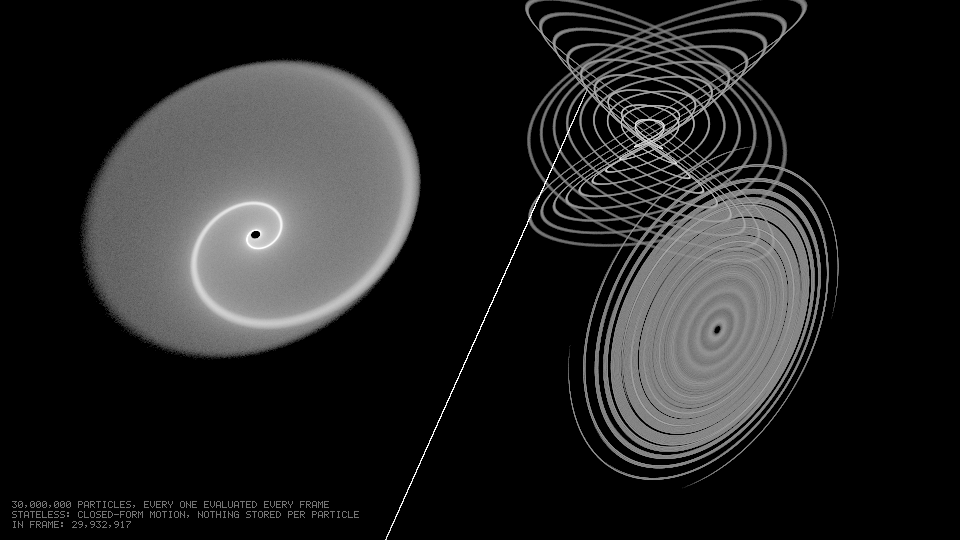
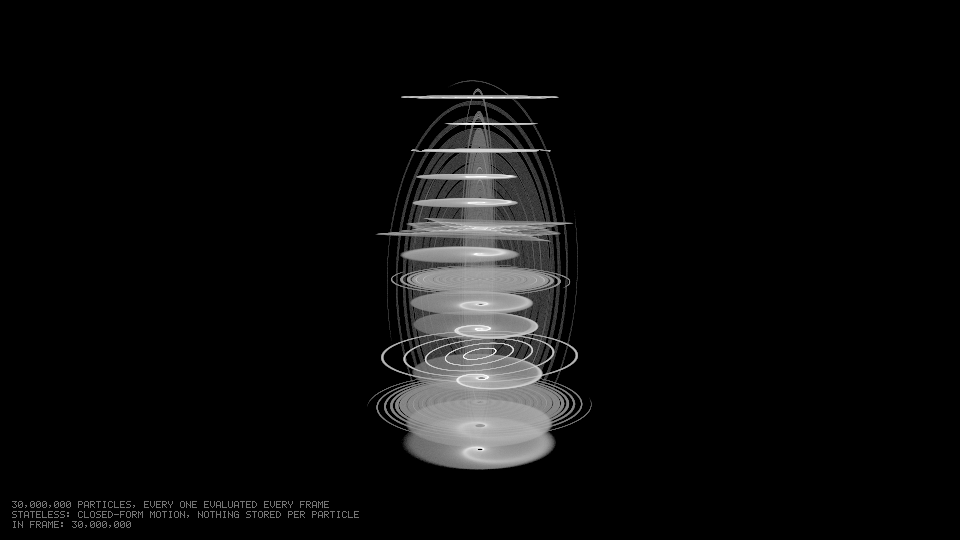
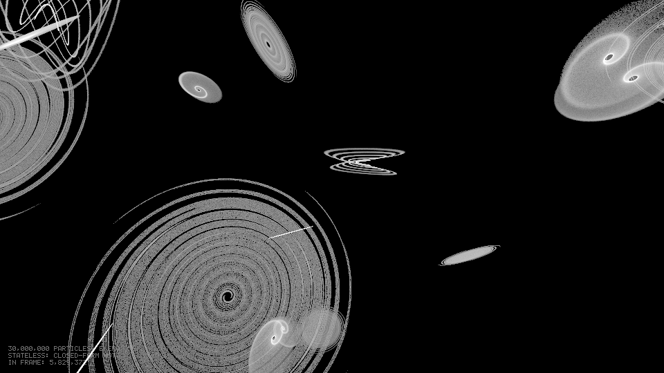
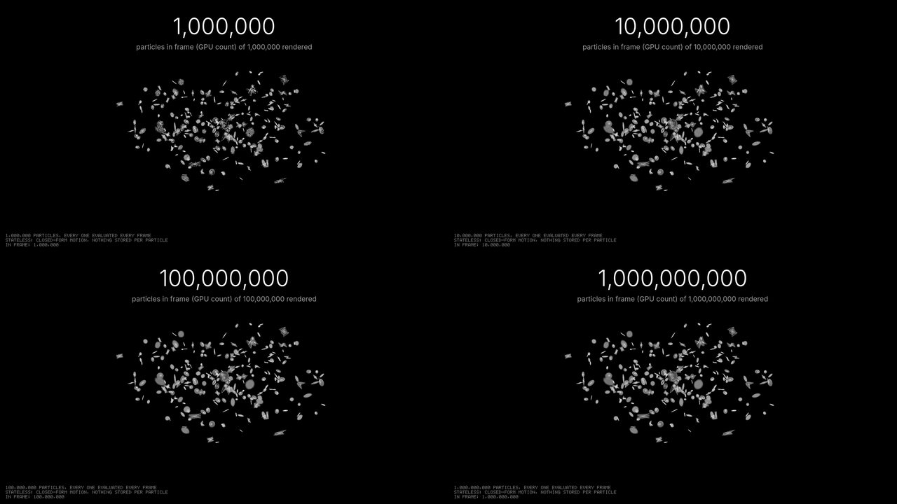

# 03. Offline stateless renderer

| | |
| --- | --- |
| Date | Nov 18, 2026 (US Central; Nov 19 in UTC) |
| Covers | 7:27 PM to 8:19 PM |
| Code | [`src/offline`](../../../src/offline/README.md) (`core/`, `web/`, `node/`) |
| Status as of | 8:20 PM |

[Back to the rendering journal](README.md)

This is the **offline, rendered** side, and the renderer behind every
trillion-particle frame in this journal. Nothing is stored per particle and
nothing is stepped. The word for it is "rendered", never "simulated".

## How a frame is made

1. **Key.** Every particle has a 64-bit key made from its sheet's seed and its
   index ([page 04](2026-11-18-04-particle-keys-and-honest-counting.md)).
2. **Law.** The particle's position on its sheet is a closed-form function of
   the key and the time. Three laws: Kepler orbits with spiral density waves,
   tracers in a circular shear flow (vortex), and 2D harmonic oscillators
   (Lissajous figures). Each exists as WGSL and as a double-precision
   TypeScript mirror for cross-checks.
3. **Splat.** The position is projected through the sheet's homography. If it
   falls inside the frame, the particle adds light to a 64-bit integer grid:
   two `u32` arrays with an exact carry. A full-weight particle adds
   `ONE` = 65,536 units.
4. **Tally.** The GPU counts how many particles it evaluated and how many
   landed inside the frame, with one atomic per workgroup.
5. **Develop.** The grid is saved as a 16-bit log PNG plus a stats JSON per
   frame.
6. **Grade and label.** On the CPU: auto exposure, a log tone curve, dither,
   and a burned-in label that says the frame is stateless.
7. **Encode.** MP4 through ffmpeg in Node, or through `src/capture` in the
   browser.

Integer adds commute, so a frame is bit-identical however it is batched, and
an interrupted frame resumes exactly from its checkpoint.

Two settings matter for what the numbers mean:

| setting | values | default |
| --- | --- | --- |
| splat | `point` (one pixel per particle), `bilinear` (4 pixels, integer weights) | `point` above 2e10 particles, `bilinear` below |
| weighting | `count` (every particle in view adds exactly one unit), `flux` (a far particle gets a smaller weight, randomly rounded, often zero) | `flux` |

The `trillion` preset is 3840x2160, 10^12 particles on 1024 sheets (about 977
million per sheet), 600 frames at 60 fps.

## What was built

- **The renderer** ([#41](https://github.com/Aptyll/Strata/pull/41)): laws,
  exact accumulation, checkpoints every 5 minutes, `--shard i/n` to split a
  clip across machines, grade and encode, a Node CLI and a browser page at
  `/src/offline/web/`. It was 3,408 lines in 21 files, according to the
  [story doc](../../story/how-it-was-built.md).
- **In the production build** ([#42](https://github.com/Aptyll/Strata/pull/42)).
- **Exact in-frame tally, cancel, unique seeds**
  ([#43](https://github.com/Aptyll/Strata/pull/43)). The label gained
  "In frame: N".
- **Shared 64-bit keys** ([#47](https://github.com/Aptyll/Strata/pull/47)).
- **Evaluated counted on the GPU**
  ([#52](https://github.com/Aptyll/Strata/pull/52)). `renderJob` refuses to
  save a frame whose GPU evaluated count differs from the world's particle
  count.
- **Scale ladder** ([#59](https://github.com/Aptyll/Strata/pull/59)): one
  frozen shot rendered at 1M, 100M, 10B and 1T with a timing report. Sheets,
  seeds, laws and camera stay identical, and the rungs are nested: every
  particle of a small rung is in the larger ones. Exposure is locked per
  particle, so brightness holds and only the grain changes.
- **Write combining** ([#65](https://github.com/Aptyll/Strata/pull/65)): a
  shader invocation keeps a running (pixel, weight) pair and issues one atomic
  add per run of particles on the same pixel. Bit-identical result, up to 64x
  fewer atomics where everything lands on one pixel.
- **Hero compositions** ([#67](https://github.com/Aptyll/Strata/pull/67)):
  `heroA` (close, four sheets fill the frame, one exactly edge-on), `heroB`
  (a tower of 15 twisting floors), `heroC` (the eye inside a cloud of 72
  sheets). Also: a cancelled frame saves a checkpoint first, and the grade
  default became contrast 256.
- **Two kernels** ([#80](https://github.com/Aptyll/Strata/pull/80)):
  `--kernel offline|trillion`, so the trillion splat kernel
  ([page 05](2026-11-18-05-trillion-kernel.md)) can run behind the same job
  format, checkpoints and grade.
- **Camera motion blur** ([#92](https://github.com/Aptyll/Strata/pull/92)):
  the shutter now moves the camera as well as the particles. A look-test clip
  had shown fast camera moves stuttering at about 200 pixels per frame.
- **Review fixes** ([#98](https://github.com/Aptyll/Strata/pull/98)):
  checkpoints (66 MB each at 4K) are deleted after their frame, bilinear flux
  weights are rounded far more finely, and world seeds above about 4 million
  no longer collide.
- **More laws** ([#137](https://github.com/Aptyll/Strata/pull/137),
  [#149](https://github.com/Aptyll/Strata/pull/149)): four new stateless laws
  (veil, galaxy, web, ribbons) that jobs can use by id on both kernels, with
  `alive_preview` and `alive_trillion` presets. None of them had been timed on
  a real GPU.
- **Honest frame times** ([#143](https://github.com/Aptyll/Strata/pull/143)):
  a frame that was stopped and continued reports its whole time, not only the
  last run.
- **Honest wording** ([#117](https://github.com/Aptyll/Strata/pull/117),
  [#118](https://github.com/Aptyll/Strata/pull/118),
  [#123](https://github.com/Aptyll/Strata/pull/123)): see
  [page 04](2026-11-18-04-particle-keys-and-honest-counting.md).

## Pull requests

| PR | title | merged (Central) | state |
| --- | --- | --- | --- |
| [#41](https://github.com/Aptyll/Strata/pull/41) | Add the offline stateless renderer for the 1 trillion particle video | 7:27 PM | merged |
| [#42](https://github.com/Aptyll/Strata/pull/42) | Ship challenge, offline renderer, bench and verify pages in the production build | 7:30 PM | merged |
| [#43](https://github.com/Aptyll/Strata/pull/43) | Offline renderer: exact in-frame tally, cancel via AbortSignal, unique seed check | 7:30 PM | merged |
| [#47](https://github.com/Aptyll/Strata/pull/47) | Offline renderer: use the shared 64-bit particle keys from src/stateless | 7:33 PM | merged |
| [#52](https://github.com/Aptyll/Strata/pull/52) | Count evaluated particles on the GPU and refuse frames that miss any | 7:35 PM | merged |
| [#59](https://github.com/Aptyll/Strata/pull/59) | Offline renderer: scale ladder renders one shot at 1M, 100M, 10B and 1T | 7:38 PM | merged |
| [#65](https://github.com/Aptyll/Strata/pull/65) | Offline renderer: combine consecutive point splats on one pixel into one atomic | 7:39 PM | merged |
| [#67](https://github.com/Aptyll/Strata/pull/67) | Add three hero compositions for 1 trillion particle stills, and keep progress when a render is cancelled | 7:58 PM | merged |
| [#80](https://github.com/Aptyll/Strata/pull/80) | Offline: run the trillion splat kernel behind the same renderer, selectable | 7:59 PM | merged |
| [#92](https://github.com/Aptyll/Strata/pull/92) | Blur camera moves in offline renders, not just particle motion | 7:59 PM | merged |
| [#98](https://github.com/Aptyll/Strata/pull/98) | Offline renderer: delete checkpoints after each frame, finer bilinear flux weights, safe plane seeds | 8:03 PM | merged |
| [#117](https://github.com/Aptyll/Strata/pull/117) | Say what landed means under flux weighting; fix count-up frame time | 8:03 PM | merged |
| [#118](https://github.com/Aptyll/Strata/pull/118) | Offline: say dispatched, not evaluated, when the host counted | 8:04 PM | merged |
| [#123](https://github.com/Aptyll/Strata/pull/123) | Say the trillion record stills used flux weighting, and give count-weighted frame times | 8:05 PM | merged |
| [#143](https://github.com/Aptyll/Strata/pull/143) | Offline: a stopped and continued frame reports its whole time, not only the last run | 8:16 PM | merged |
| [#149](https://github.com/Aptyll/Strata/pull/149) | Offline renders can use the new stateless laws, and the trillion kernel's evaluated count now comes from the GPU | 8:19 PM | merged |

`src/offline` and `src/record` were frozen until 7:55 PM (01:55 UTC) while the
desktop rendered the record frames, which is why #67, #80, #92 and #98 all
merged in the minutes after it.

## Measured on a software GPU

All of these ran in the cloud on SwiftShader. They prove exactness, not speed.

| check | result | source |
| --- | --- | --- |
| Conservation | 937,035 of 937,035 particles counted, point and bilinear | [#41](https://github.com/Aptyll/Strata/pull/41) |
| Batch invariance | 20 batches and 3 batches give identical grids | [#41](https://github.com/Aptyll/Strata/pull/41) |
| CPU cross-check, all three laws | about 0.086% of particles land one pixel over (f32 against f64) | [#41](https://github.com/Aptyll/Strata/pull/41) |
| Resume from a checkpoint | identical grid | [#41](https://github.com/Aptyll/Strata/pull/41) |
| In-frame tally | equals the grid count with 414,826 of 937,035 particles in frame | [#43](https://github.com/Aptyll/Strata/pull/43) |
| 64-bit carry | every particle on one pixel, high word reaches 3 | [#65](https://github.com/Aptyll/Strata/pull/65) |
| Camera blur | cross-check 0.085 to 0.098% one pixel off with the blur mirrored; it failed at 2.5 to 14% before the mirror, which shows the blur is applied | [#92](https://github.com/Aptyll/Strata/pull/92) |
| Trillion kernel behind the renderer | 18 checks pass; in-frame count within 0.001% of the offline kernel | [#80](https://github.com/Aptyll/Strata/pull/80) |
| Bilinear flux rounding noise at 1/1,000 brightness | 2.2x a particle's own weight before, 0.02x after (CPU mirror of the shader math) | [#98](https://github.com/Aptyll/Strata/pull/98) |
| Speed on SwiftShader | about 25 million particles per second, which would be about 11 hours per 1T frame | [#41](https://github.com/Aptyll/Strata/pull/41) |

## Measured on the RTX 2070

The Node CLI could not run on Noah's desktop (Windows Application Control
blocks the native Dawn module), so everything ran in Chrome at
`/src/offline/web/`.

| what | result | kind |
| --- | --- | --- |
| Bench, one sheet filling the frame, point splat | 3.3 billion particles per second | reported at 7:31 PM |
| What that implies for a 1T frame | about 303 s (5 minutes) | arithmetic |
| First real 1T 4K frame (far view of the whole cluster) | 28.9 s, about 35 billion particles per second | reported at 7:32 PM |

The gap between the bench and the first real frame is the cache. The far view
lights only 4% of the 4K frame, so its hits stay inside the card's 4 MB L2
cache, while a sheet that fills the frame spreads hits over the whole 66 MB
grid. Frame times for every 1T frame are on
[page 07](2026-11-18-07-first-trillion-frames.md).

## Pictures

| heroA, 30M preview | heroB, 30M preview | heroC, 30M preview |
| --- | --- | --- |
|  |  |  |

*Framing checks of the three hero compositions at 30 million particles,
960x540, on a software GPU ([#67](https://github.com/Aptyll/Strata/pull/67)).
At 1T the same frames are about 33,000 times denser.*

*Four moments from the scale ladder video: the same frozen shot at 1M, 10M,
100M and 1B rendered particles (1920x1080, bilinear splat, flux weighting,
software GPU, where the 1B rung took 59 s). Every rung landed 100% in frame by
the GPU tally. Original: `media/videos/scale-ladder-1M-to-1B_1080p.mp4` in the
project files, with its `ladder.md` report beside it.*

A 40 million particle look test of the moving camera is in the project files
as `offline/look-test-40M-720p.mp4`. Its notes file is where the camera
stutter that led to [#92](https://github.com/Aptyll/Strata/pull/92) was
written down.

## Checked and not checked

- Checked: the Node self test on a software GPU for each PR (12 checks at
  first, 18 after [#80](https://github.com/Aptyll/Strata/pull/80)), type check
  and build.
- Not measured on the RTX 2070 when this was written: write combining before
  and after ([#65](https://github.com/Aptyll/Strata/pull/65)), the two
  kernels side by side through `bench --kernel both`
  ([#80](https://github.com/Aptyll/Strata/pull/80)), camera blur
  ([#92](https://github.com/Aptyll/Strata/pull/92)), the scale ladder at
  10B and 1T.

## Open

- The `trillion` kernel option runs the kernel's plain path, not its coherent
  fast path, and has no camera blur yet
  ([page 05](2026-11-18-05-trillion-kernel.md)).
- The batch-size controller only learns from full-size batches. At 1T every
  batch covers a whole sheet, so the browser's 120 ms target is not enforced.
  Fine on the 2070, where sheets take 25 to 50 ms, but a slower GPU could hit
  the 2 second watchdog ([#98](https://github.com/Aptyll/Strata/pull/98)).
- The full 10 second 1T clip. Noah chose to hold it until the faster kernel
  is ready ([page 07](2026-11-18-07-first-trillion-frames.md)).
