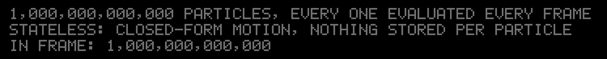
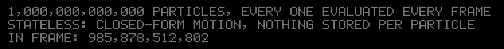
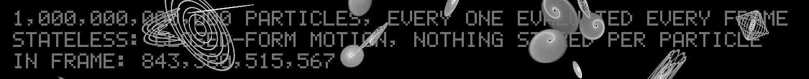
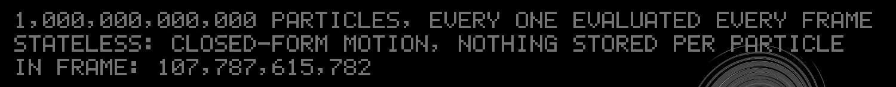

# 04. Particle keys and honest counting

| | |
| --- | --- |
| Date | Nov 18, 2026 (US Central; Nov 19 in UTC) |
| Covers | 7:30 PM to 8:19 PM |
| Code | [`src/stateless`](../../../src/stateless/README.md), [`src/manifest`](../../../src/manifest/README.md), tallies in `src/offline` and `src/trillion` |
| Reference docs | [honest counting brief](../../briefs/honest-counting.md), [64-bit ids brief](../../briefs/64-bit-ids.md) |
| Status as of | 8:20 PM |

[Back to the rendering journal](README.md)

"One trillion particles" is only worth saying if each of them is a different
particle and the count comes from the GPU. This page records how both were
made true, and one correction to the wording that happened along the way.

## The 32-bit trap

A stateless particle is its key: every random choice it makes is drawn from
it. The first offline renderer made the key as `pcg(pcg(index) + seed)`, which
is 32 bits. Every sheet drew from the same 2^32 keys, so a 4-billion-particle
sheet was a reshuffle of every other one. A skeptic could fairly have said the
"trillion" was about 4.3 billion particles shown 233 times
(10^12 / 2^32 = 232.8).

It was found within minutes. The key fix merged five minutes after the
renderer, and the renderer switched to it one minute after that (7:33:33 PM).

One consequence should be said plainly. The very first trillion still
(`trillion-still-f0.png`) was already in the project files at 7:32:15 PM,
before that switch was on main, so it was almost certainly rendered with the
old 32-bit keys. Its two-line label, without the "in frame" line that
[#43](https://github.com/Aptyll/Strata/pull/43) added at 7:30 PM, says the
same: it came from an early build. Which commit each later frame was rendered
from was not recorded. The two closer stills were already rendering at
7:34 PM, so the same question applies to them. A render manifest (below)
records the commit, and none exists for these frames yet.

## The 64-bit key

[#45](https://github.com/Aptyll/Strata/pull/45) added
`particleKey(index, seed)` in `src/stateless/rng.ts`: a 3-round Feistel
network on the 64-bit word `(seed, index)`. A Feistel network is invertible
whatever its round function, so distinct identities get distinct keys by
construction. Sheet seeds are unique (the job validator rejects duplicates),
so all 10^12 keys are distinct.

- `draw(key, 0)` and `draw(key, 1)` are the two key words, so all 64 bits
  reach the motion law. Draws 0 to 5 belong to the laws, 6 and 7 to the
  offline runner (6 is the shutter time).
- A bit-exact TypeScript mirror exists, plus `keyIdentity`, the inverse.
- Cost: about 10 integer operations per particle.

The offline renderer switched to it in
[#47](https://github.com/Aptyll/Strata/pull/47) and the trillion kernel in
[#58](https://github.com/Aptyll/Strata/pull/58).

## Three counts, and what each one means

| count | meaning | who counts it |
| --- | --- | --- |
| **evaluated** | particles whose position was computed for this frame | the GPU, one atomic per workgroup ([#52](https://github.com/Aptyll/Strata/pull/52)). The renderer refuses to save a frame where it differs from the world's particle count |
| **landed**, shown as "in frame" | particles whose position fell inside the frame | the GPU, one atomic per workgroup ([#43](https://github.com/Aptyll/Strata/pull/43)) |
| **units of light** | the sum of the accumulation grid | the grid itself |

How the last two relate depends on the weighting:

- **Count weighting with point splats.** Every particle in the frame adds
  exactly one unit to exactly one pixel. The grid sum divided by one unit
  equals `landed` exactly, so the picture itself proves the count. The proof
  shots use this.
- **Flux weighting.** A far particle gets a smaller weight, which is randomly
  rounded and is often zero. It still counts as "in frame", but it is drawn
  only on average. The in-frame number is then an exact count of positions
  inside the frame, not of units of light added.

One more case: when the trillion splat kernel runs behind the offline
renderer, the runner at first summed `evaluated` from dispatch sizes on the
host. From [#118](https://github.com/Aptyll/Strata/pull/118) the label said
"dispatched" in that case, not "evaluated". At 8:19 PM
[#149](https://github.com/Aptyll/Strata/pull/149) made the runner read the
kernel's own GPU count, so both kernels now count evaluated and landed on the
GPU.

## The correction

At 8:03 PM [#117](https://github.com/Aptyll/Strata/pull/117) tightened the
wording so that "exactly one unit per particle" is only claimed for count
weighting. It also said the record stills were count weighted, going by their
notes files.

That was wrong, and [#123](https://github.com/Aptyll/Strata/pull/123)
corrected it two minutes later. The record stills were **most likely flux
weighted**:

- `/src/offline/web/`, where they were rendered, has no weighting control and
  its presets default to flux.
- Their 26 to 52 second frame times match flux speed. Count weighting takes
  about 160 to 193 seconds per 4K frame on the 2070.

This is not confirmed. Each frame's `job.json` on the desktop records the
weighting, and nobody had read those files when this page was written. The
README, `CLAUDE.md`, [docs/record](../../record/README.md) and the story docs
now say the stills are flux weighted and that only the proof shots claim
exactly one unit per particle.

[#117](https://github.com/Aptyll/Strata/pull/117) also added a third label
line that depends on the weighting. Count: "Each particle in frame adds
exactly one unit of light". Flux: "Far particles dimmed by random rounding:
drawn on average, not each". The stills in this journal were rendered before
that line existed.

## The render manifest

[#94](https://github.com/Aptyll/Strata/pull/94) added `src/manifest` and
`npm run record`:

- `buildManifest` copies, per frame, the GPU-written `evaluated` and `landed`,
  the exact grid sum, lit pixels, GPU seconds, a hash of the grid-determined
  fields (the same on any GPU and any batching) and a sha256 of the 16-bit
  PNG. It also records the commit, the full job, seeds, camera keys, grade,
  the GPU adapter and `mode: "rendered-stateless"`.
- `npm run record make <dir>` builds a manifest from a finished render folder
  with no GPU, so it works on Noah's desktop.
- `npm run record check` compares two manifests frame by frame and exits 1 on
  a mismatch. `render` re-renders a range on Node and checks it.
- Since [#117](https://github.com/Aptyll/Strata/pull/117) the manifest records
  the weighting, and for count weighting with point splats it checks, frame by
  frame, that every landed particle added exactly one unit.

Challenge mode (the realtime, simulated record) got the same treatment in
[#97](https://github.com/Aptyll/Strata/pull/97): it counts particles on the
GPU and refuses a tier when the count is off. That belongs to the app and UX
journal.

## Pull requests

| PR | title | merged (Central) | state |
| --- | --- | --- | --- |
| [#43](https://github.com/Aptyll/Strata/pull/43) | Offline renderer: exact in-frame tally, cancel via AbortSignal, unique seed check | 7:30 PM | merged |
| [#45](https://github.com/Aptyll/Strata/pull/45) | Give every stateless particle its own 64-bit key | 7:32 PM | merged |
| [#47](https://github.com/Aptyll/Strata/pull/47) | Offline renderer: use the shared 64-bit particle keys from src/stateless | 7:33 PM | merged |
| [#52](https://github.com/Aptyll/Strata/pull/52) | Count evaluated particles on the GPU and refuse frames that miss any | 7:35 PM | merged |
| [#58](https://github.com/Aptyll/Strata/pull/58) | Trillion kernel: shared stateless keys, offline laws, culling off by default | 7:37 PM | merged |
| [#97](https://github.com/Aptyll/Strata/pull/97) | Challenge mode: count particles on the GPU and refuse a tier when the count is off | 7:55 PM | merged |
| [#94](https://github.com/Aptyll/Strata/pull/94) | Save an honest render manifest per render, and add npm run record | 7:56 PM | merged |
| [#117](https://github.com/Aptyll/Strata/pull/117) | Say what landed means under flux weighting; fix count-up frame time | 8:03 PM | merged |
| [#118](https://github.com/Aptyll/Strata/pull/118) | Offline: say dispatched, not evaluated, when the host counted | 8:04 PM | merged |
| [#123](https://github.com/Aptyll/Strata/pull/123) | Say the trillion record stills used flux weighting, and give count-weighted frame times | 8:05 PM | merged |
| [#137](https://github.com/Aptyll/Strata/pull/137) | Add four stateless motion laws (veil, galaxy, web, ribbons) with a demo page | 8:14 PM | merged |
| [#149](https://github.com/Aptyll/Strata/pull/149) | Offline renders can use the new stateless laws, and the trillion kernel's evaluated count now comes from the GPU | 8:19 PM | merged |

## Measured

| check | result | where it ran | source |
| --- | --- | --- | --- |
| `keyIdentity` inverts `particleKey` | on 1 million random identities and edge values | CPU, about 2 s | [#45](https://github.com/Aptyll/Strata/pull/45) |
| Duplicate keys | zero among 16.7 million particles across 4 sheets, counted directly | CPU | [#45](https://github.com/Aptyll/Strata/pull/45) |
| The old 32-bit scheme | every sampled particle had an exact twin on another sheet | CPU | [#45](https://github.com/Aptyll/Strata/pull/45) |
| Evaluated equals N | asserted in the conservation check; a 3-frame smoke render writes `"evaluated":"4000000"` | software GPU | [#52](https://github.com/Aptyll/Strata/pull/52) |
| Evaluated on the real frames | 1,000,000,000,000 in every trillion frame, from the frame stats relayed at 7:39 PM. For the first three stills this was most likely the job's total, not a GPU count: they were rendered or already rendering before [#52](https://github.com/Aptyll/Strata/pull/52) merged | RTX 2070 | [story doc](../../story/how-it-was-built.md), [page 07](2026-11-18-07-first-trillion-frames.md) |

## Pictures: the label is the count

The label is burned in by the renderer. These are 100% crops of 3840x2160
frames from the RTX 2070.

*The far view: every sheet is in frame, so all 10^12 positions land in it.*

*Composition A, a close-up: 985,878,512,802 in frame.*

*key1: a bright sheet sits behind the label and hides two digits, so the docs
say "about 843 billion" and do not guess. This is visual brief V06, fixed for
later renders in [#67](https://github.com/Aptyll/Strata/pull/67).*

*Frame 0 of the first moving clip. The in-frame count changes on every frame
of the clip (107,787,615,782 on the first, 107,743,038,598 on the last), which
is what a real per-frame tally looks like.*

## Open

- **No GPU count of evaluated particles for the first stills.** They were
  rendered before, or while, [#52](https://github.com/Aptyll/Strata/pull/52)
  merged ([page 07](2026-11-18-07-first-trillion-frames.md)).
- **No stats JSON beside the stills.** The per-frame stats files of the
  record stills stayed on the desktop. In the repo and the project files, the
  burned-in label is the only record of their counts.
- **No manifest for the record stills yet.** `npm run record make` on the
  desktop's render folders would produce one, and would also settle the
  weighting question above.
- **No exact GPU count of light additions under flux weighting.** It would
  mean changing the shader, the checkpoint format and the trillion kernel, and
  was deliberately skipped before the video
  ([#117](https://github.com/Aptyll/Strata/pull/117)).
