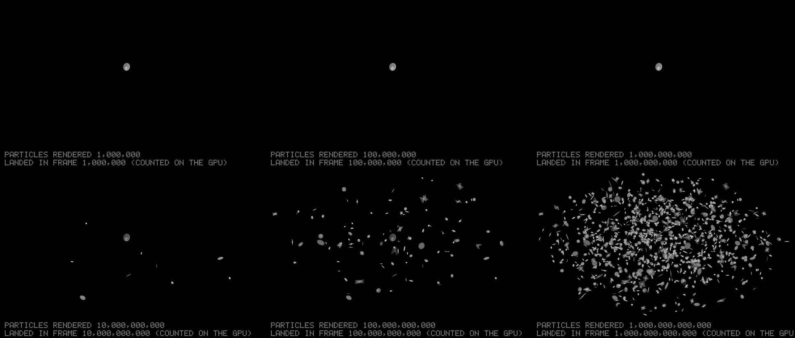
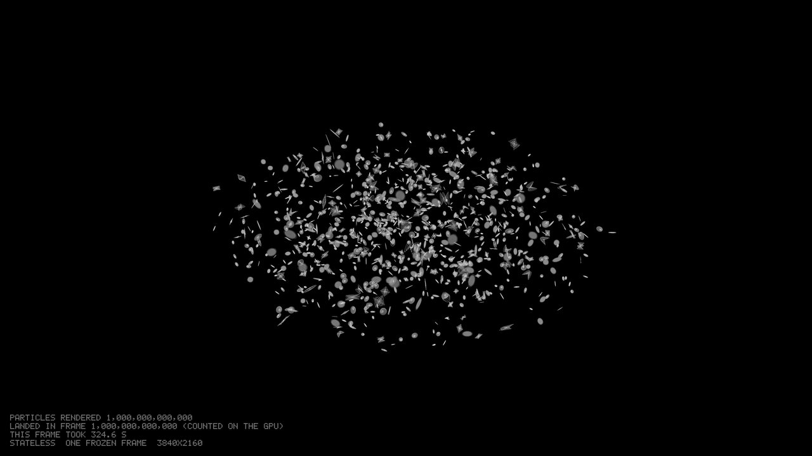
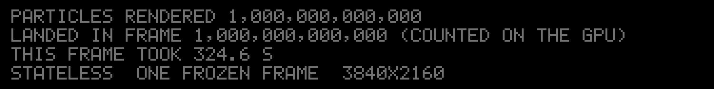
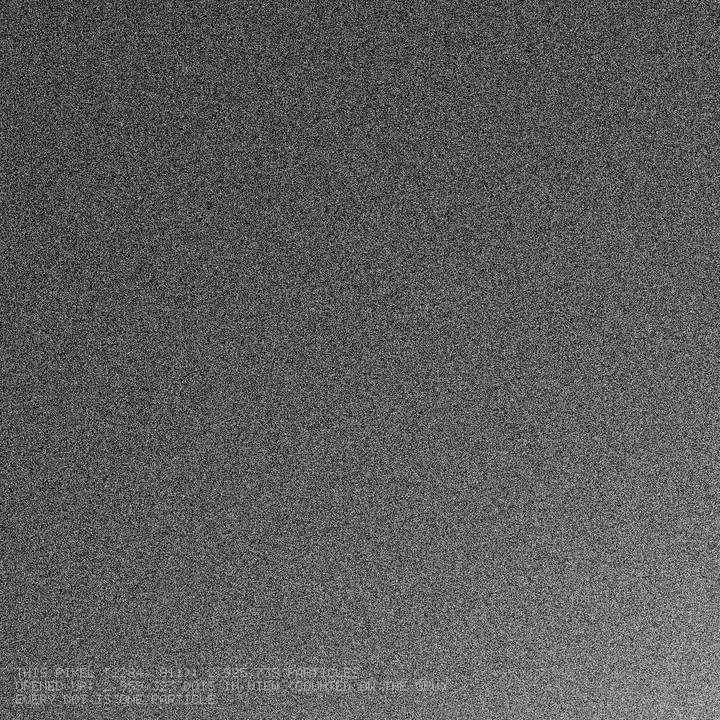
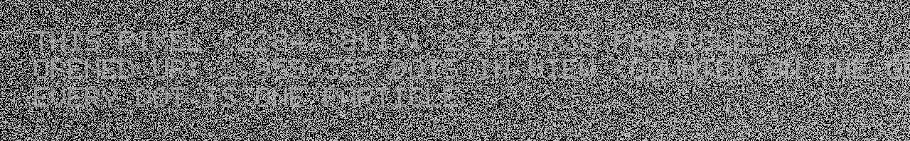

# 06. Record entry and proof shots

| | |
| --- | --- |
| Date | Nov 18, 2026 (US Central; Nov 19 in UTC) |
| Covers | 7:34 PM to 8:18 PM |
| Code | [`src/record`](../../../src/record/README.md), [`src/proof`](../../../src/proof/README.md) |
| Status as of | 8:20 PM |

[Back to the rendering journal](README.md)

Two thin wrappers around the offline renderer
([page 03](2026-11-18-03-offline-stateless-renderer.md)). `src/record` starts
a record-scale render from inside the app. `src/proof` renders short shots
whose only job is to make a trillion believable. Two of them were rendered at
1T on the RTX 2070 this evening.

## What was built

**`?record`** ([#48](https://github.com/Aptyll/Strata/pull/48)). Opening
`/?record` renders one 1T still at 4K as soon as the app is up. The Esc menu
has the same job under capture. Options ride on the URL: `?record=10B`,
`&size=1080p`, `&frames=300`, `&weighting=count|flux`. Frames and 60 second
checkpoints are stored in the browser's private file system, so reopening the
same URL continues where it stopped. Count weighting is the default here, so
every particle in the frame adds exactly one unit. While the job runs the
world stops drawing, so the render has the GPU to itself.

**Storage fallback** ([#57](https://github.com/Aptyll/Strata/pull/57)). A 4K
checkpoint is about 66 MB and a private window or a full disk can refuse it.
The store now falls back to memory and warns that the render will no longer
survive a reload.

**Live preview** ([#116](https://github.com/Aptyll/Strata/pull/116)). Until
this change `?record` showed only a progress line until a whole 1T frame was
done. Now the partial grid is developed and graded every 15 seconds and drawn
over the app, with a caption that is the GPU's own running tally. It also
added `?record&shot=heroA` (or `heroB`, `heroC`).

**Proof shots** ([#49](https://github.com/Aptyll/Strata/pull/49),
[#86](https://github.com/Aptyll/Strata/pull/86),
[#79](https://github.com/Aptyll/Strata/pull/79)). A page at
`/src/proof/web/` that renders each shot into a folder and exports an MP4
with GPU-counted numbers burned in. All shots use count weighting and point
splats, so every number is an exact GPU count.

| shot | what it shows | cost at 1T |
| --- | --- | --- |
| count-up | one frozen frame built from 1 particle to all, 3 steps per decade | about 1.7 trillion-frames |
| pull-back | from one particle to the whole world | about 11 trillion-frames for 10 s at 30 fps |
| loupe | one dice-chosen pixel, its exact 64-bit count, then that pixel opened up | 2 trillion-frames |
| dive | unbroken log zoom from the whole world to a few dots | every frame is a full trillion-frame |
| find | fly to particle #N and hold on it | every frame is a full trillion-frame |
| ladder | the same frozen frame at 1M, 100M, 10B and 1T, exposure locked per particle | about 1.01 trillion-frames |
| collapse | time frozen, the whole world shrinks into the center pixel | every frame is a full trillion-frame |

**Fixes after the first 1T runs** ([#127](https://github.com/Aptyll/Strata/pull/127),
[#146](https://github.com/Aptyll/Strata/pull/146),
[#148](https://github.com/Aptyll/Strata/pull/148)). After the first 1T loupe
came back as static (below), the dice was changed to pick a pixel holding
10,000 to 50,000 particles, labels got a solid box, the opened-up window was
made exact, and dots are drawn as 3x3 squares. The count-up now fills every
sheet at once.

## Pull requests

| PR | title | merged (Central) | state |
| --- | --- | --- | --- |
| [#48](https://github.com/Aptyll/Strata/pull/48) | Launch a 1 trillion particle 4K still or clip from the Esc menu or ?record | 7:34 PM | merged |
| [#49](https://github.com/Aptyll/Strata/pull/49) | Add trillion proof shots: count-up, pull-back, loupe, dive, find particle #N | 7:34 PM | merged |
| [#57](https://github.com/Aptyll/Strata/pull/57) | Record: keep rendering when browser storage refuses a write | 7:37 PM | merged |
| [#86](https://github.com/Aptyll/Strata/pull/86) | Ship the trillion proof-shots page in the production build | 7:47 PM | merged |
| [#79](https://github.com/Aptyll/Strata/pull/79) | Add the 1M-to-1T ladder and the collapse-into-one-pixel ending to the proof shots page | 8:04 PM | merged |
| [#116](https://github.com/Aptyll/Strata/pull/116) | Record: watch the trillion frame sharpen while it renders, with the GPU's running count | 8:05 PM | merged |
| [#127](https://github.com/Aptyll/Strata/pull/127) | Loupe: pick a 10k to 50k particle pixel so its dots stand apart, and draw labels on a solid box | 8:07 PM | merged |
| [#146](https://github.com/Aptyll/Strata/pull/146) | Loupe: exact off-axis window so the dots are the pixel's particles; pick sheet-interior pixels; label at the top | 8:17 PM | merged |
| [#148](https://github.com/Aptyll/Strata/pull/148) | Proof: count-up fills every sheet at once; loupe draws dots as 3x3 squares | 8:18 PM | merged |

## Rendered on the RTX 2070

Both shots first passed a quick 1 billion particle test, then ran at 1T and
4K right after the 7:55 PM freeze lifted.

### Count-up, reported at 8:02 PM

| | |
| --- | --- |
| File | `proof-countUp-1T.mp4` in the project files (1.5 MB), last frame `proof-countUp-1T-last.png` |
| Format | 3840x2160, 30 fps, 14.8 s, 444 frames, H.264 |
| Passes | 37: 1, 2, 5, 10, 20, 50 and so on up to 1,000,000,000,000 |
| Label on the last frame | PARTICLES RENDERED 1,000,000,000,000 / LANDED IN FRAME 1,000,000,000,000 (COUNTED ON THE GPU) / THIS FRAME TOOK 324.6 S / STATELESS ONE FROZEN FRAME 3840X2160 |
| Time | 324.6 s is all 37 passes added up. The last pass alone, the full trillion with count weighting, took about 193 s |

The "THIS FRAME TOOK 324.6 S" line is therefore misleading on this file. The
label code was fixed in [#117](https://github.com/Aptyll/Strata/pull/117) to
show the last pass's own time and the total separately, after this clip was
rendered.

*Six moments of the count-up, cropped to the cluster, each with its own
burned-in label. Left to right, top to bottom: 1M, 100M, 1B, 10B, 100B, 1T.*

*The last frame, and its label at 100%.*

What the contact sheet shows is also the shot's weakness, written down in the
visual review: the count fills the sheets in order, so up to a billion
particles the picture is one small sheet, and the cluster only appears in the
last second. The proposed fix was to take the same fraction from every sheet,
so each step shows the whole cluster getting denser. That merged at 8:18 PM
([#148](https://github.com/Aptyll/Strata/pull/148)). This clip was rendered
before it.

### Loupe, reported at 8:07 PM

| | |
| --- | --- |
| File | `proof-loupe-1T.mp4` in the project files (12.4 MB), last frame `proof-loupe-1T-last.png` |
| Format | 2160x2160, 30 fps, 5 s, 150 frames, H.264 |
| The picked pixel | holds 2,925,738 particles by the GPU's exact count |

*The loupe's last frame, downsized. With 2.9 million dots in view, 46% of the
pixels are lit, and it reads as television static, not as countable
particles.*

*Its label at 100%. It was drawn straight onto the dots with no backdrop.*

This is the honest record of a shot that did not work the first time. The
count is exact, and the picture does not show it. The agent on the desktop
suggested a dimmer pixel, [#127](https://github.com/Aptyll/Strata/pull/127)
made the dice pick one, and a rerun was done by 8:14 PM. The rerun's files
were not in the project files when this page was written.

## Measured on a software GPU

| check | result | source |
| --- | --- | --- |
| Collapse at 4M particles, 640x360, 30 frames | the last frame has exactly 1 lit pixel, at (320, 180), holding 4,000,000 particles: landed equals evaluated equals grid sum divided by one unit | [#79](https://github.com/Aptyll/Strata/pull/79) |

## Checked and not checked

- Rendered at 1T on the RTX 2070: count-up and loupe.
- Not yet rendered at 1T: pull-back, dive, find, ladder and collapse.
- `?record` itself had not been run on the 2070 as far as the record shows.
  The stills came from the offline page
  ([page 07](2026-11-18-07-first-trillion-frames.md)).

## Open

- Count-up: render it again with [#148](https://github.com/Aptyll/Strata/pull/148),
  so the picture changes through the whole clip.
- Loupe: confirm on a rerun that the dots stand apart.
- A render manifest for these two clips
  ([page 04](2026-11-18-04-particle-keys-and-honest-counting.md)).
