# 07. The first trillion frames

| | |
| --- | --- |
| Date | Nov 18, 2026 (US Central; Nov 19 in UTC) |
| Covers | 7:22 PM to 7:54 PM |
| Machine | Noah's desktop: RTX 2070 (8 GB), Windows 11, Chrome 157 |
| Renderer | `src/offline` in the browser, at `/src/offline/web/` ([page 03](2026-11-18-03-offline-stateless-renderer.md)) |
| Status as of | 8:20 PM |

[Back to the rendering journal](README.md)

Every frame on this page is 3840x2160 and has 1,000,000,000,000 stateless
particles: the position of each one was computed for the frame, and the ones
that landed in view were added into a 64-bit integer grid. They are
**rendered**, not simulated. Nothing is stored per particle and nothing is
kept between frames.

## How the evening went on the desktop

| time (Central) | what happened |
| --- | --- |
| 7:22 PM | The repo is cloned on the desktop. The dev server runs on Vite's WASM build, because Windows Application Control blocks the native module |
| 7:27 PM | The perf self test passes 25 of 25 on the 2070. The realtime bench sweep starts ([page 02](2026-11-18-02-compute-raster-and-perf.md)) |
| 7:27 PM | The offline renderer merges ([#41](https://github.com/Aptyll/Strata/pull/41)) |
| 7:31 PM | The Node CLI cannot run (its native GPU module is blocked), so the bench runs in Chrome: 3.3 billion particles per second on one sheet filling the frame. By arithmetic that is about 5 minutes per 1T frame |
| 7:32 PM | **The first 1T 4K frame: 28.9 seconds**, about 35 billion particles per second, no GPU errors |
| 7:33 PM | Noah decides on a card: a better hero still first, then a short 1T clip if time allows |
| 7:34 PM | Two closer framings are rendering |
| 7:35 PM | Noah asks for three hero compositions: A (close, one sheet edge-on), B (a cathedral of stacked sheets), C (inside the cloud) |
| 7:38 PM | key1 (52 s) and key2 (26 s) are done. A, B and C start |
| 7:39 PM | Noah picks the grade: contrast 256. The frame stats confirm exactly 1,000,000,000,000 evaluated in every frame |
| 7:40 PM | The first three frames are in the repo ([#70](https://github.com/Aptyll/Strata/pull/70)) and the README's frame time is corrected from "about 5 minutes" to 26 to 52 seconds |
| 7:41 PM | Noah picks key1 to open the video |
| 7:42 PM | A is done: 172 s, default grade, because it started before the contrast pick |
| 7:43 PM | C is done: 48 s, contrast 256 |
| 7:44 PM | B is done: 59 s, contrast 256 |
| 7:48 PM | A is done again at contrast 256: 205 s. A, B and C are in the repo ([#90](https://github.com/Aptyll/Strata/pull/90)). Noah decides: render the short clip now |
| 7:50 PM | The clip is rendering. Frame 0 took 32 s |
| 7:53 PM | **The first moving 1T clip: 8 frames**, encoded to MP4 in the browser |
| 7:54 PM | Noah decides: hold the full 10 second clip until the faster kernel is ready ([page 05](2026-11-18-05-trillion-kernel.md)) |

## The frames

Times are as reported by the agent driving the desktop. The rate column is
arithmetic (10^12 divided by the time). "In frame" is read from each frame's
burned-in label.

| frame | view | time | rate | in frame | grade |
| --- | --- | ---: | ---: | ---: | --- |
| [`trillion-still-f0.png`](../../record/trillion-still-f0.png) | the whole cluster from far away | 28.9 s | 35 B/s | every sheet is in frame (this label has no in-frame line yet) | default |
| [`trillion-key1-f0.png`](../../record/trillion-key1-f0.png) | inside the field of sheets, wide | 52 s | 19 B/s | 843,3??,515,567 (two digits hidden behind a sheet) | default |
| [`trillion-key2-f0.png`](../../record/trillion-key2-f0.png) | closer, one large Kepler disc in front | 26 s | 38 B/s | 107,787,615,440 | default |
| [`trillion-A.png`](../../record/trillion-A.png) | close-up: spiral disc, Lissajous ribbon, ring sheet, one sheet edge-on | 172 s | 5.8 B/s | 985,878,512,802 | default |
| [`trillion-C.png`](../../record/trillion-C.png) | wide shot from inside the cloud | 48 s | 21 B/s | 31?,?13,737,244 (two digits hidden) | contrast 256 |
| [`trillion-B.png`](../../record/trillion-B.png) | a tower of 32 stacked sheets, seen from the side | 59 s | 17 B/s | 927,901,560,630 | contrast 256 |
| `trillion256-A.png` | A again | 205 s | 4.9 B/s | 985,878,512,802 | contrast 256 |
| `trillion256-K0.png` | the far view again | not reported | | 1,000,000,000,000 | contrast 256 |
| `trillion-clip-k068.mp4` | 8 frames, the key2 camera with a slow push | about 32 s per frame | 31 B/s | 107,787,615,782 on the first frame, 107,743,038,598 on the last | contrast 256 |

**Correction (added 2026-11-19 02:35 UTC):** A, `trillion256-A` and B were
rendered on 32-bit keys (before PR #45) with stacked identical sheets, so they
are **not** a trillion distinct particles: A holds at most about 17.2 billion
distinct, B about 137 billion. The cluster frames are still 1T distinct. See
[docs/record/README.md](../../record/README.md#distinct-particles-read-this-before-using-a-or-b).

The first six are in git under [`docs/record/`](../../record/README.md). The
last three are in the project files only.

"Default" is the grade the renderer shipped with (contrast 4096). The first
three stills were in the project files before Noah's pick at 7:39 PM.

## What the times say

- **26 to 52 seconds** covers the views where the cluster is small or medium
  on screen. This is the range quoted in the README.
- **About 3 minutes** for a close-up that fills the frame (A: 172 s and
  205 s). The README range does not include this case.
- The reason is the cache, not the math. All 10^12 positions are computed in
  every frame. In the far view the cluster lights 4% of the pixels, so the
  hits stay inside the card's 4 MB L2 cache. When sheets fill the frame the
  hits spread over the whole 66 MB grid. The bench of one sheet filling the
  frame (3.3 billion per second, about 303 s per trillion) is the far end of
  the same effect.
- **A clip costs about 13 minutes per second** at the key2 framing (24 frames
  at 32 s), so about 2.1 hours for 10 seconds.

## What is and is not established about these frames

Established:

- **Every position is computed.** That holds by construction: the renderer
  has no culling, and a particle that lands off screen only skips the final
  add.
- **In frame.** The numbers on the labels are exact GPU counts of positions
  inside the frame ([#43](https://github.com/Aptyll/Strata/pull/43)).
- **Time.** As reported, one number per frame.

Not established, and said so here on purpose:

- **A GPU count of evaluated particles for the first stills.** The GPU-counted
  `evaluated` tally, and the refusal to save a frame that misses a particle,
  merged at 7:35:36 PM ([#52](https://github.com/Aptyll/Strata/pull/52)).
  Before it, the `evaluated` field in a frame's stats was the job's total,
  not a count. The first still was rendered before that, and its two-line
  label shows it even predates the in-frame tally. key1 and key2 were already
  rendering at 7:34 PM. The frame stats relayed at 7:39 PM showed exactly
  1,000,000,000,000 evaluated for every frame, but for these three stills
  that figure most likely came from the job, not from the GPU. For the later
  frames the record does not say which code they ran.
- **Weighting.** The stills were most likely rendered with flux weighting,
  where a far particle is drawn only on average. That is not confirmed
  ([page 04](2026-11-18-04-particle-keys-and-honest-counting.md)).
- **Splat.** Point splats, which is the default above 2e10 particles and is
  why A shows moiré in its ring sheet.
- **Keys.** The first still was almost certainly rendered with the old 32-bit
  particle keys. For the others, the commit was not recorded
  ([page 04](2026-11-18-04-particle-keys-and-honest-counting.md)).
- **Stats files.** The per-frame stats JSON stayed on the desktop. In the repo
  the burned-in label is the only record.
- **Compositions.** A, B and C here were framed by the agent on the desktop
  from Noah's brief. The `heroA`, `heroB` and `heroC` presets that merged
  later ([#67](https://github.com/Aptyll/Strata/pull/67)) are a second take on
  the same three ideas. As far as the project chat shows, these stills were
  not rendered from those presets.

## Pictures

Each picture is a 1280 px copy. Click one for the full 3840x2160 frame where
it is in git.

### The first frame, 7:32 PM

[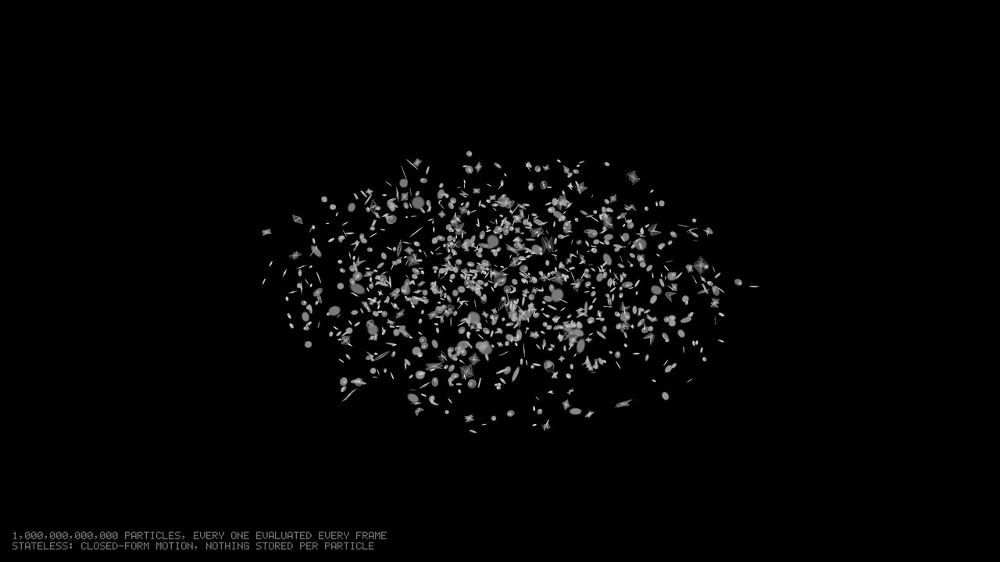](../../record/trillion-still-f0.png)

*`trillion-still-f0.png`, 28.9 s. 96% of the pixels are exactly black and the
cluster lights 4% of them. A lit pixel holds about 3 million hits on average.
The agent that measured it wrote that it "reads as grey confetti, not as a
trillion": most sheets are 20 to 60 px across.*

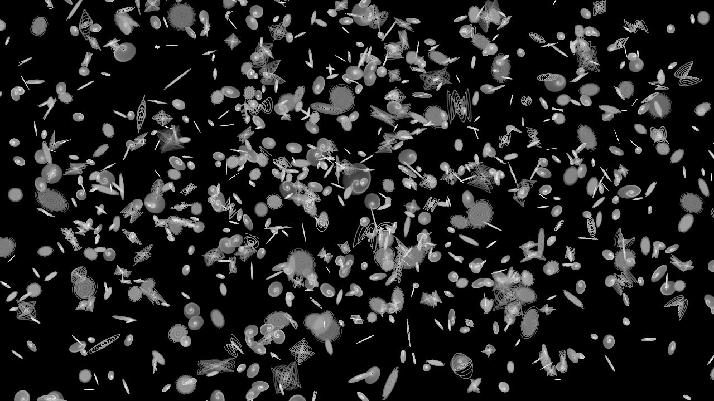

*The same frame at 100%: every sheet has real structure (spirals, rings, wire
figures) and no grain.*

### key1, the frame that opens the video

[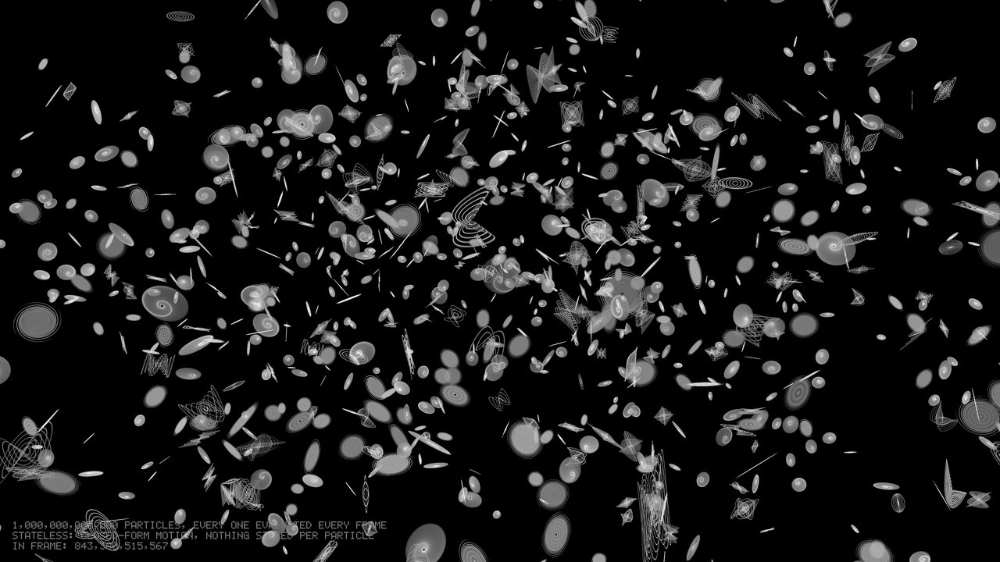](../../record/trillion-key1-f0.png)

*`trillion-key1-f0.png`, 52 s, about 843 billion in frame. Noah picked this
one to open the video (7:41 PM).*

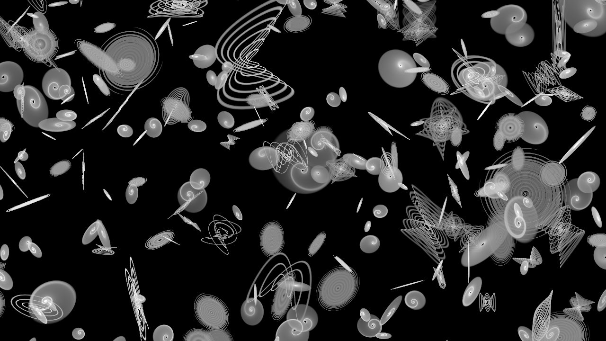

### key2

[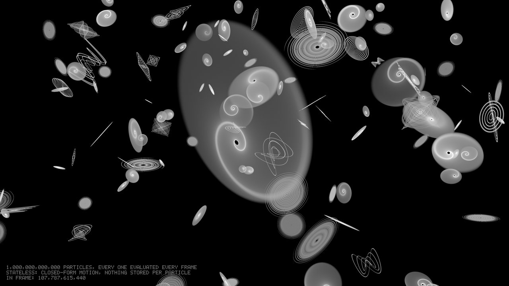](../../record/trillion-key2-f0.png)

*`trillion-key2-f0.png`, 26 s, 107,787,615,440 in frame. About 11% of the
trillion lands in view here, and the label says so. The other 89% were still
evaluated.*

### Composition A

[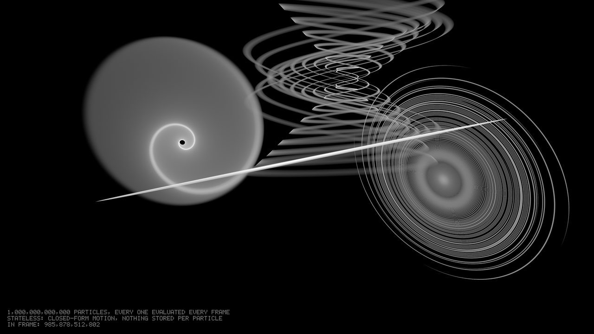](../../record/trillion-A.png)

*`trillion-A.png`, 172 s, default grade, 985,878,512,802 in frame.*

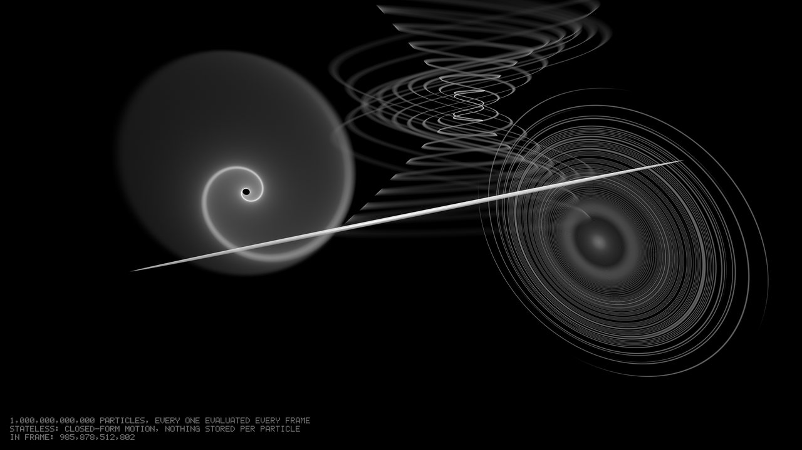

*`trillion256-A.png`, 205 s, contrast 256. Original in the project files.*

| spiral, 100% | ring sheet, 100% |
| --- | --- |
| 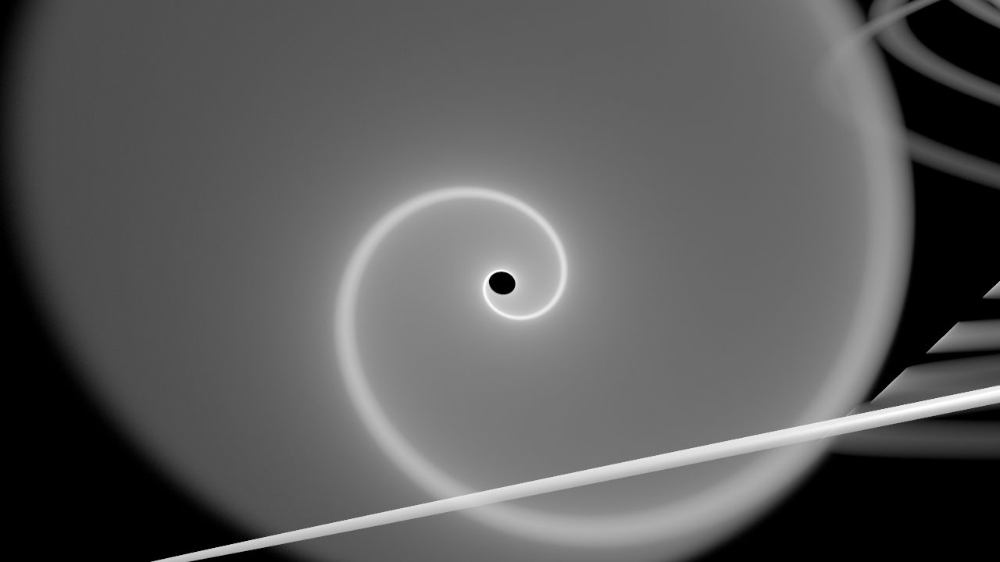 | 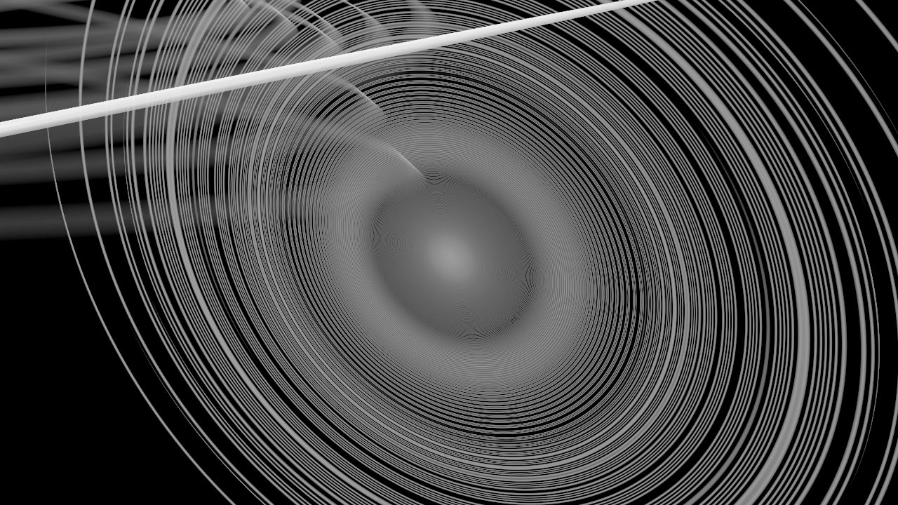 |

*Left: the spiral arm is clean, with no grain. Right: the inner rings are
finer than a pixel and beat against the pixel grid. That is the point splat.
The exact bilinear splat already existed and is the default for the hero
presets since [#67](https://github.com/Aptyll/Strata/pull/67).*

### Composition B

[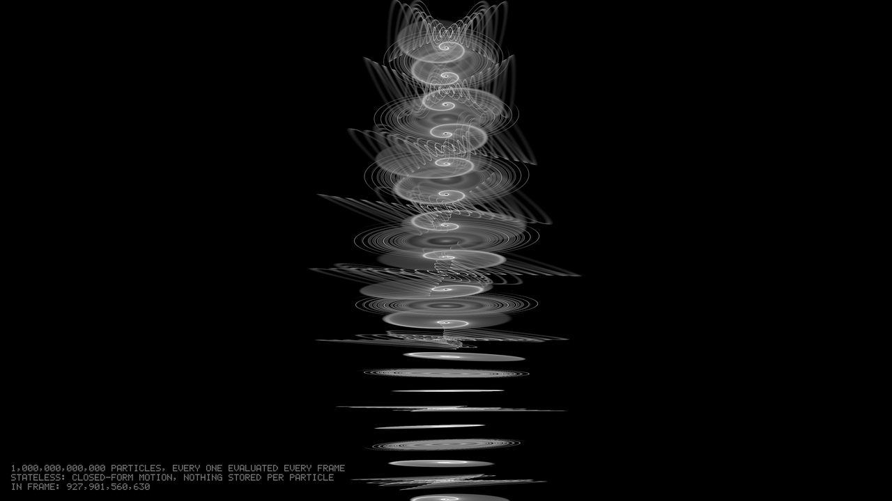](../../record/trillion-B.png)

*`trillion-B.png`, 59 s, contrast 256, 927,901,560,630 in frame.*

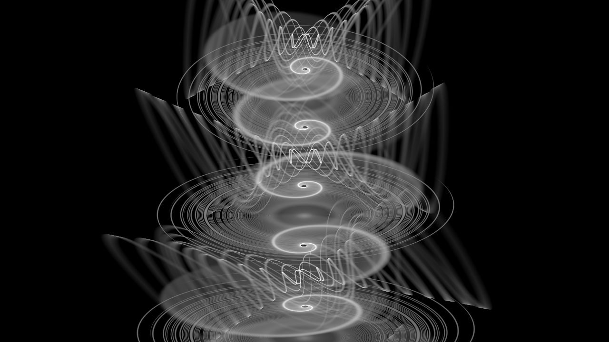

### Composition C

[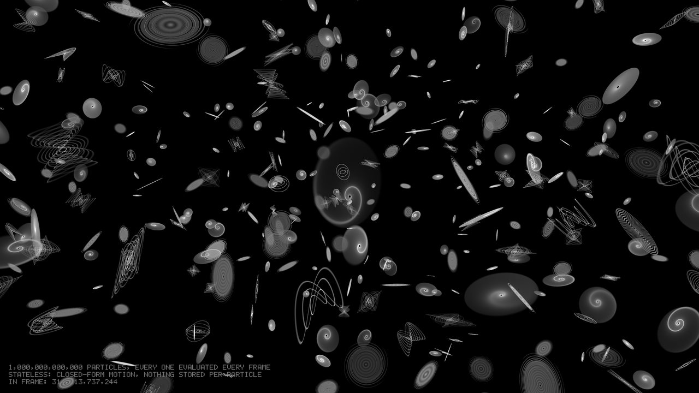](../../record/trillion-C.png)

*`trillion-C.png`, 48 s, contrast 256. About 31% of the trillion is in frame.
The rest is outside the view, and was still evaluated.*

### The far view at Noah's grade

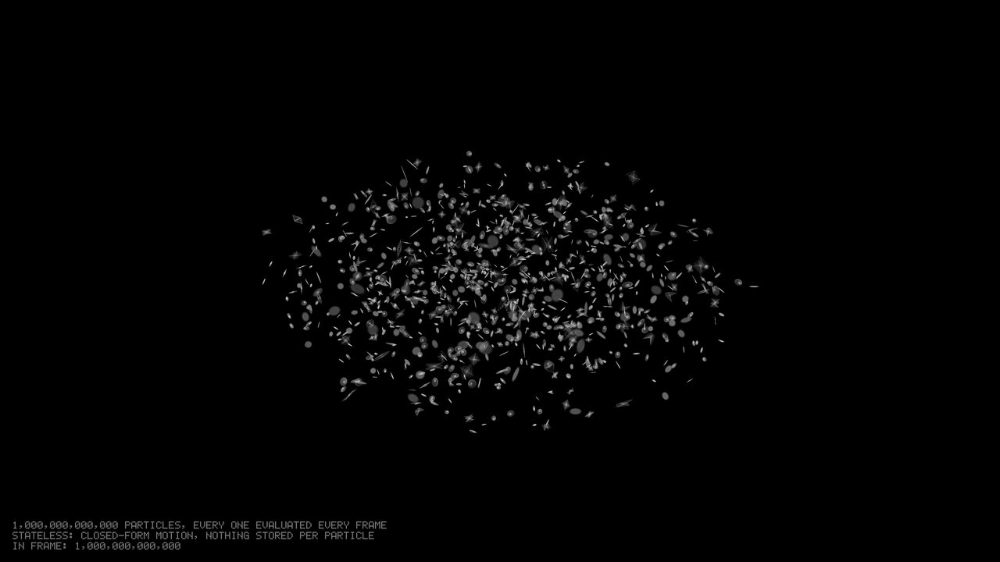

*`trillion256-K0.png`, contrast 256, in frame 1,000,000,000,000. Original in
the project files.*

### The first moving clip, 7:53 PM

*All 8 frames of `trillion-clip-k068.mp4`, downsized to 480 px and played
forward and back. The real clip is 3840x2160, 24 fps, one third of a second,
H.264, encoded in the browser. Each frame is its own trillion.*

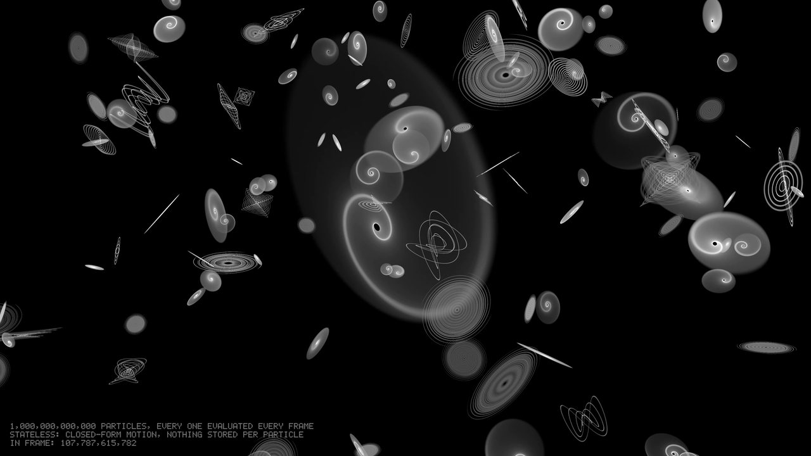

*Frame 0. The in-frame count on the label changes on every frame, from
107,787,615,782 to 107,743,038,598. Brightness holds steady across the 8
frames (mean between 17.8 and 18.1 of 255), so there is no flicker.*

## Pull requests

| PR | title | merged (Central) | state |
| --- | --- | --- | --- |
| [#69](https://github.com/Aptyll/Strata/pull/69) | Build story: confirm the first trillion frame's particle count | 7:40 PM | merged |
| [#70](https://github.com/Aptyll/Strata/pull/70) | Add the 1T record frames and correct the README's frame time | 7:40 PM | merged |
| [#73](https://github.com/Aptyll/Strata/pull/73) | CLAUDE.md: correct the 1T frame time to 26 to 52 seconds | 7:41 PM | merged |
| [#90](https://github.com/Aptyll/Strata/pull/90) | Add trillion record frames A, B and C to docs/record | 7:48 PM | merged |
| [#123](https://github.com/Aptyll/Strata/pull/123) | Say the trillion record stills used flux weighting, and give count-weighted frame times | 8:05 PM | merged |

The desktop cannot push to the repo, so the frames went to the project's
shared files first and were committed from there.

## Open

- The full 10 second 1T clip. The 8 frames are saved, so the clip can resume.
- A re-render of A with the bilinear splat, to remove the ring moiré.
- A manifest for these frames, which would settle the weighting and the
  commit questions above.
