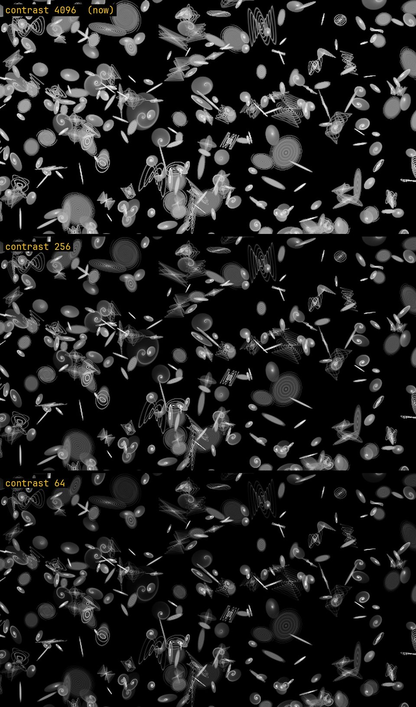
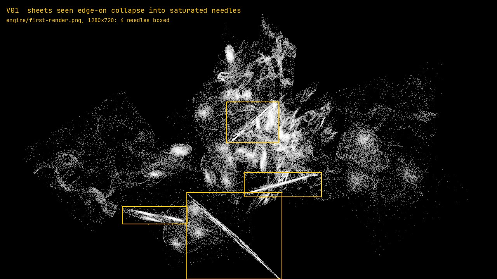
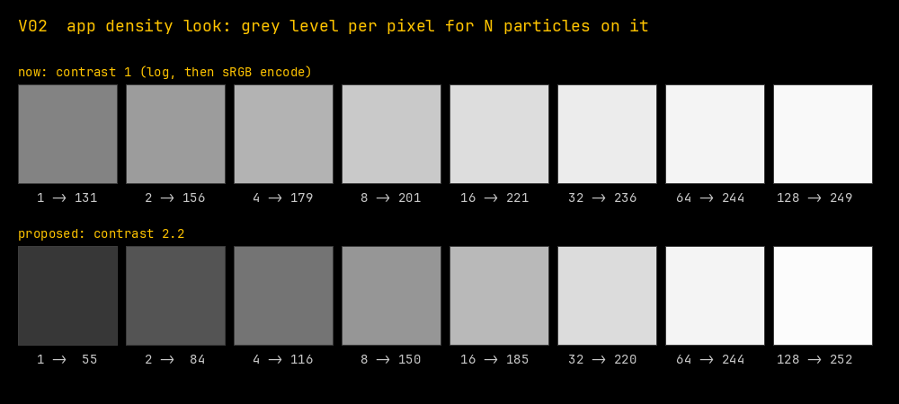
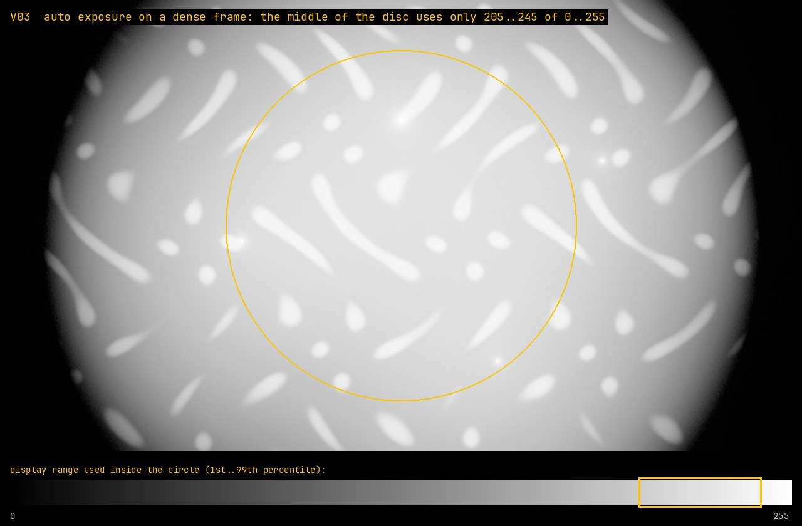
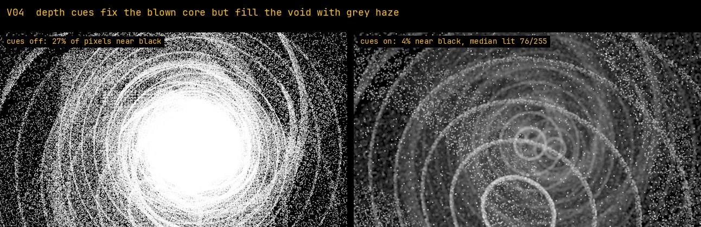
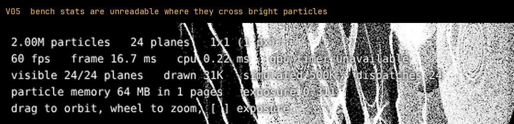
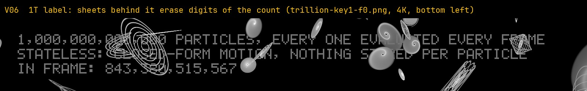

# 08. Visual review and open work

| | |
| --- | --- |
| Date | Nov 18, 2026 (US Central; Nov 19 in UTC) |
| Covers | 7:25 PM to 8:20 PM |
| Docs | [visual fix briefs](../../briefs/visual/README.md), [research briefs](../../briefs/README.md) |
| Status as of | 8:20 PM |

[Back to the rendering journal](README.md)

The pictures were looked at, measured and written up while the code was still
being built. This page records what the pictures showed was wrong, what Noah
decided, and what was still open on the rendering side when the journal was
written.

## How the review worked

- Every render, GIF and MP4 in the project files gets a `<name>.notes.md`
  beside it: what it shows, what works, what is wrong, the likely cause in
  code, and Noah's answers.
- A finding that needs code work becomes a brief in
  [`docs/briefs/visual/`](../../briefs/visual/README.md), with the file and
  line of the likely cause, a proposed fix, and how to confirm the fix by
  looking ([#95](https://github.com/Aptyll/Strata/pull/95)).
- Numbers come from `docs/briefs/visual/image-stats.py`: mean, median and 95th
  percentile of lit pixels, and the share of near-black and saturated pixels.
  The rule in the briefs is "measure instead of guessing".

## Noah's decisions

All of these were tap-to-answer decision cards.

| time (Central) | decision |
| --- | --- |
| 7:33 PM | A better hero still first, then a short 1T clip if time allows |
| 7:35 PM | Three hero compositions: A (close), B (cathedral), C (inside the cloud) |
| 7:39 PM | The grade for all 1T frames: **contrast 256** |
| 7:41 PM | **key1** opens the video |
| 7:48 PM | Render the short 1T clip now |
| 7:54 PM | Hold the full 10 second 1T clip until the faster kernel is ready |
| 7:59 PM | **Keep edge-on sheets bright**, as true density. Handle them with framing, not code |

## The grade: contrast 256

The first trillion frame came out flat: half of all lit pixels sat between
106 and 153 of 255, and the spirals inside each disc were only a few grey
levels brighter than the disc. The cause was the default grade, a 12-stop
curve (contrast 4096) that put sheet interiors in the middle of the range.
Re-grading needs no re-render, because the renderer keeps the counts.

*The preview Noah chose from: the same crop of `trillion-still-f0.png` at
contrast 4096 (the default then), 256 and 64. It was made from the 8-bit PNG,
so its darkest tones are coarse. Original:
`visual-notes/trillion-still-f0-regrade.jpg` in the project files.*

| frame | lit pixels, default grade | lit pixels, contrast 256 |
| --- | --- | --- |
| `trillion-still-f0.png` | median 125 | median 70 |
| `trillion-A.png` | median 99, 95th percentile 154 | median 45, 95th percentile 115 |

Contrast 256 became the default for record frames in
[#67](https://github.com/Aptyll/Strata/pull/67). Compare the two versions of
composition A on [page 07](2026-11-18-07-first-trillion-frames.md).

## The six visual briefs

| | finding | status at 8:20 PM |
| --- | --- | --- |
| V01 | Sheets seen edge-on collapse into saturated white needles | decided: keep true density, no code change ([#110](https://github.com/Aptyll/Strata/pull/110)) |
| V02 | The realtime tone curve lifts one particle to mid grey and squeezes dense structure | [#139](https://github.com/Aptyll/Strata/pull/139) made the default curve darker at 8:20 PM, so one particle is a dim dot. Still open: Challenge dense cores clip past about 1M particles |
| V03 | Dense frames come out flat because auto exposure has no black floor | the 1T part is done (contrast 256). The `CountToneMapper` floor is open |
| V04 | Depth cues fix the blown core but fill the void with grey haze | [#136](https://github.com/Aptyll/Strata/pull/136) made the default blur smaller for this; the brief index still said open |
| V05 | Bench stats are unreadable over bright particles | fixed in [#108](https://github.com/Aptyll/Strata/pull/108); the brief index still said open |
| V06 | The 1T label is erased where bright sheets sit behind it | fixed for later renders in [#67](https://github.com/Aptyll/Strata/pull/67), with a dark box behind the label |

| V01: edge-on needles | V02: tone steps |
| --- | --- |
|  |  |

| V03: flat disc | V04: depth haze |
| --- | --- |
|  |  |

| V05: bench overlay | V06: label overwritten |
| --- | --- |
|  |  |

*The annotated crops from the briefs themselves.*

One piece of evidence was added later for V02: in a Challenge mode clip made
on a software GPU, once the ramp passes about 1 million particles, 16 to 27%
of lit pixels clip ([#110](https://github.com/Aptyll/Strata/pull/110)).

## Reviewed and found fine

From the visual brief index:

- The ring moiré in `trillion-A.png` came from the point splat, used for
  speed. The exact bilinear splat already existed.
- The near-sheet whip in the 40M look-test clip is a camera path passing
  close to a sheet, not a clipping bug.
- The density demo's stripes, rings and their moiré are deliberate stress
  patterns.

## The research briefs

[#64](https://github.com/Aptyll/Strata/pull/64) distilled the rendering
research into six work orders in [`docs/briefs/`](../../briefs/README.md).
Their state at 8:20 PM, from the brief index:

| brief | state |
| --- | --- |
| [throughput-math-2070](../../briefs/throughput-math-2070.md) | the lever was built in `src/trillion`; first numbers on [page 05](2026-11-18-05-trillion-kernel.md) |
| [64-bit-ids](../../briefs/64-bit-ids.md) | done for every record path ([#45](https://github.com/Aptyll/Strata/pull/45), [#47](https://github.com/Aptyll/Strata/pull/47), [#58](https://github.com/Aptyll/Strata/pull/58)) |
| [honest-counting](../../briefs/honest-counting.md) | tallies, manifest and wording audit done |
| [video-scale-ladder](../../briefs/video-scale-ladder.md) | Node ladder, write combining, and the browser ladder and collapse shots done |
| [accumulation-and-tonemap](../../briefs/accumulation-and-tonemap.md) | with the cleanup threads |
| [unify-rasterizers](../../briefs/unify-rasterizers.md) | steps 2, 4 and 5 done ([#128](https://github.com/Aptyll/Strata/pull/128)); steps 1, 3 and 6 open |

## Pull requests

| PR | title | merged (Central) | state |
| --- | --- | --- | --- |
| [#64](https://github.com/Aptyll/Strata/pull/64) | Add agent briefs distilled from the rendering research | 7:39 PM | merged |
| [#75](https://github.com/Aptyll/Strata/pull/75) | Briefs: mark the ladder and write combining done, add the Chrome throughput number | 7:42 PM | merged |
| [#101](https://github.com/Aptyll/Strata/pull/101) | Code map: explain rendering, depth and the 1T path, and fix the counter layout rows | 7:55 PM | merged |
| [#95](https://github.com/Aptyll/Strata/pull/95) | Add visual fix briefs from the screenshots and 1T renders | 7:56 PM | merged |
| [#110](https://github.com/Aptyll/Strata/pull/110) | Briefs: Noah keeps edge-on sheets bright, and Challenge clipping evidence | 8:01 PM | merged |
| [#131](https://github.com/Aptyll/Strata/pull/131) | Add a contrast slider to the Esc menu's look settings, default look unchanged | 8:09 PM | merged |
| [#136](https://github.com/Aptyll/Strata/pull/136) | Depth mode: smaller default blur so out-of-focus sheets stop filling the void with grey | 8:11 PM | merged |
| [#138](https://github.com/Aptyll/Strata/pull/138) | Briefs: mark the browser ladder, collapse and wording audit done, and claim unify-rasterizers | 8:12 PM | merged |
| [#139](https://github.com/Aptyll/Strata/pull/139) | Darker default tone curve in the app and Challenge, so one particle is a dim dot and dense cores show steps | 8:20 PM | merged |

## Open on the rendering side at 8:20 PM

Collected from all the pages of this journal, most important for the video
first.

1. **The full 10 second 1T clip.** On hold for the faster kernel. The first
   numbers from that kernel (42 to 49 s per 1T 4K frame) do not show the
   speedup the hold was waiting for
   ([page 05](2026-11-18-05-trillion-kernel.md)).
2. **What the record stills can claim.** Weighting most likely flux, not
   confirmed. The first still almost certainly used the old 32-bit keys, and
   the first three stills most likely have no GPU count of evaluated
   particles. No manifest and no stats files in the repo
   ([page 04](2026-11-18-04-particle-keys-and-honest-counting.md),
   [page 07](2026-11-18-07-first-trillion-frames.md)). A re-render of the hero
   still on current main with a manifest would settle all three at once.
3. **Proof shots.** The count-up and loupe fixes merged at 8:18 PM and both
   shots need a fresh 1T render and a look. Five shots have not been rendered
   at 1T ([page 06](2026-11-18-06-record-entry-and-proof-shots.md)).
4. **Numbers not written into the reference docs yet.** The trillion kernel's
   bench, the four 200M profiling runs, and frame times for close-ups that
   fill the frame (about 3 minutes, outside the README's 26 to 52 seconds).
5. **Realtime look.** The darker default curve
   ([#139](https://github.com/Aptyll/Strata/pull/139)) has not been judged on
   the 2070, Challenge cores still clip, and the `CountToneMapper` black floor
   (V03) is open.
6. **Never run on the RTX 2070** when this was written: `?record` and its
   live preview, the per-sheet hue rasterizer, write combining before and
   after, the two kernels side by side, camera motion blur.
