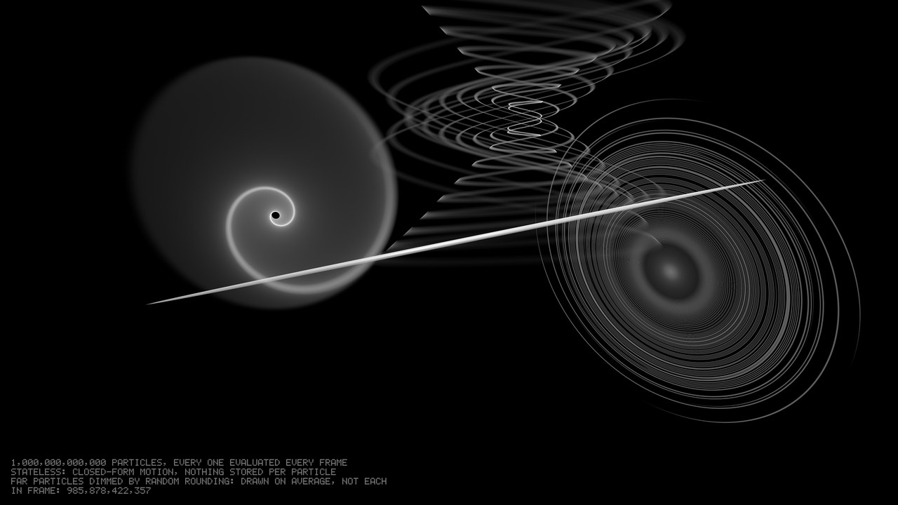
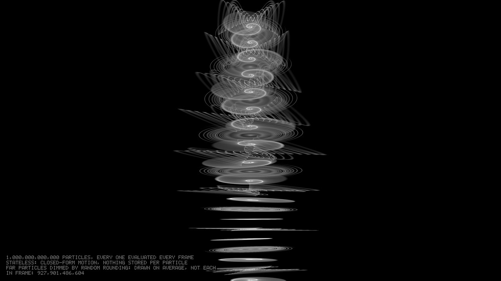
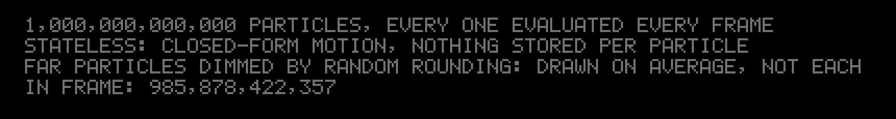
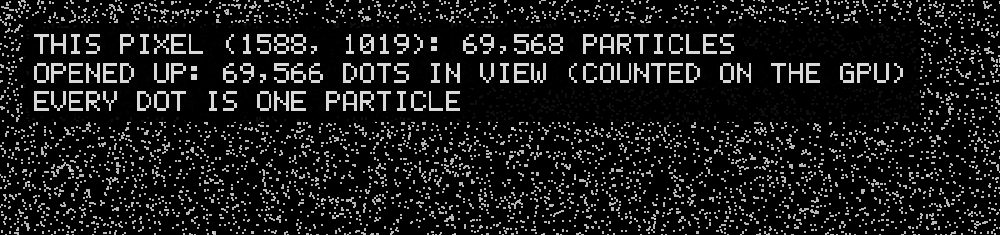
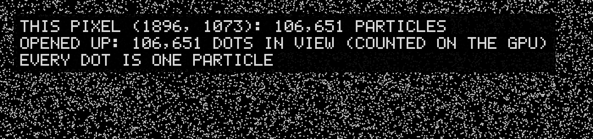
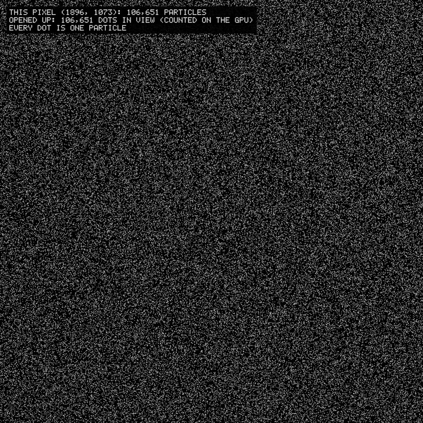
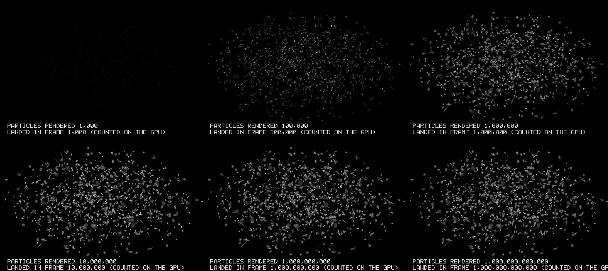
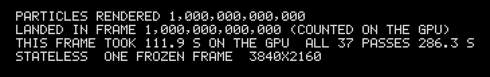
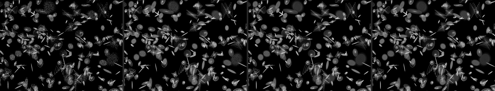

# 09. The key audit, 64-bit re-renders and proof shot reruns

| | |
| --- | --- |
| Date | Nov 18, 2026 (US Central; Nov 19 in UTC) |
| Covers | 8:20 PM to 8:40 PM |
| Machine | Noah's desktop: RTX 2070 (8 GB), driver 621.01, Windows 11, Chrome 157 |
| Code | [`src/offline`](../../../src/offline/README.md), [`src/stateless`](../../../src/stateless/README.md), [`src/manifest`](../../../src/manifest/README.md), [`src/proof`](../../../src/proof/README.md), [`src/trillion`](../../../src/trillion/README.md) |
| Reference docs | [docs/record](../../record/README.md), [docs/trillion.md](../../trillion.md) |
| Status as of | 8:40 PM |

[Back to the rendering journal](README.md)

Pages [04](2026-11-18-04-particle-keys-and-honest-counting.md) and
[07](2026-11-18-07-first-trillion-frames.md) ended on a question: which code
were the first trillion stills rendered with? In the twenty minutes after they
were written, the question was asked, answered and acted on. The answer is
that **every still and the first clip were rendered on the old 32-bit particle
keys**. This page records what that means for each frame, the two frames that
were rendered again with a manifest, and the proof shot reruns that came back
in the same twenty minutes.

## How it went

| time (Central) | what happened |
| --- | --- |
| 8:23 PM | The loupe rerun is back from the 2070: readable, the dots stand apart, and its two counts differ by 2 |
| 8:26 PM | The particle key is hardened ([#153](https://github.com/Aptyll/Strata/pull/153)), which moves every particle. The loupe gets an exact pixel test ([#155](https://github.com/Aptyll/Strata/pull/155)) |
| 8:28 PM | The question from pages 04 and 07 is put to the agent driving the desktop: which commit was checked out for each still? |
| 8:29 PM | The answer, from the desktop's git reflog: every still and the 8-frame clip were rendered at `c42ceda` or `41e853a`, both older than the 64-bit keys. The same agent reports that compositions A and B stack identical sheets, so on those keys they hold far fewer than a trillion distinct particles |
| 8:31 PM | docs/record marks A and B as not a trillion distinct particles, and the site's share card moves from A to key2 ([#163](https://github.com/Aptyll/Strata/pull/163)). The second loupe rerun and the count-up rerun arrive |
| 8:32 PM | The loupe's pick band is widened again ([#164](https://github.com/Aptyll/Strata/pull/164)) |
| 8:35 PM | **A and B are rendered again on 64-bit keys, each with a render manifest.** A second audit, from git history and the labels, pins each still to its commit |
| 8:36 PM | The trillion kernel is reworked after its first RTX 2070 numbers ([#171](https://github.com/Aptyll/Strata/pull/171)) |
| 8:37 PM | The 64-bit A and B and their manifests are in the repo. The 32-bit A and B move to `docs/record/retired/` ([#173](https://github.com/Aptyll/Strata/pull/173)) |

## What the audit found

Three kinds of evidence, and who checked each:

- **The desktop's git reflog.** Reported by the agent driving the desktop and
  relayed in the project chat. It was not seen for this page.
- **Git history.** Checked for this page: what the offline renderer contained
  at each commit.
- **The labels burned into the frames.** Checked for this page on the frames
  themselves.

What the offline renderer contained at each commit, from git:

| commit | on main at | particle key | label | "evaluated" in the label and stats |
| --- | --- | --- | --- | --- |
| `c42ceda` ([#41](https://github.com/Aptyll/Strata/pull/41)) | 7:27 PM | 32-bit: `pcg(pcg(index) + seed)` | two lines, no "In frame" line | the job's particle count, not a GPU count |
| `41e853a` ([#44](https://github.com/Aptyll/Strata/pull/44)) | 7:31 PM | 32-bit, the same | three lines, with "In frame" ([#43](https://github.com/Aptyll/Strata/pull/43)) | the job's particle count, not a GPU count |
| `dddbc3b` ([#47](https://github.com/Aptyll/Strata/pull/47)) and later | 7:33 PM | 64-bit `particleKey(index, seed)` | | |
| `10f26cd` ([#52](https://github.com/Aptyll/Strata/pull/52)) and later | 7:35 PM | | | counted on the GPU, and a frame that misses a particle is refused |
| `3fc5209` ([#153](https://github.com/Aptyll/Strata/pull/153)) and later | 8:26 PM | 64-bit, with the seed hashed first and a finer `tri()` | | |

Which frame was rendered at which commit:

| frame | rendered at | how that is known | keys | manifest |
| --- | --- | --- | --- | --- |
| `trillion-still-f0` | `c42ceda` | the reflog lists it, and the label has two lines, which only this commit writes | 32-bit | none |
| key1, key2, A, B, C, `trillion256-A`, `trillion256-K0`, the 8-frame clip | `41e853a` | the reflog shows no later commit before them, and their labels have the "In frame" line, which `c42ceda` does not write | 32-bit | none |
| count-up and loupe, first runs ([page 06](2026-11-18-06-record-entry-and-proof-shots.md)) | `19d14fd` ([#49](https://github.com/Aptyll/Strata/pull/49)) or later | the proof page does not exist before that commit, and that commit already has the 64-bit keys | 64-bit | none |
| `loupe148`, `countup148` (reruns, below) | `995707f` for the loupe, as reported. Not stated for the count-up | reported | 64-bit, before [#153](https://github.com/Aptyll/Strata/pull/153) | none |
| `loupe155` (rerun, below) | `1e7e66e` | reported | 64-bit, with [#153](https://github.com/Aptyll/Strata/pull/153) | none |
| `trillion64-A`, `trillion64-B` | `1e7e66e`, clean tree | their manifests | 64-bit, with [#153](https://github.com/Aptyll/Strata/pull/153) | yes |

So two things that pages 04 and 07 could only call likely are now settled:

- **Keys.** No still in `docs/record` before this page, and no frame of the
  first clip, used the 64-bit keys.
- **Evaluated.** None of them has a GPU count of evaluated particles. The
  "1,000,000,000,000 particles, every one evaluated every frame" line on their
  labels was written from the job's particle count. Every position was still
  computed, because that renderer has no culling, but the number was not
  counted.

The weighting of the 32-bit stills is still not confirmed. Both weightings
existed at both commits, and flux was the default.

## What "distinct" means for each kind of frame

**Inside one sheet, nothing repeats.** The old key is
`pcg(pcg(index) + seed)`. `pcg` maps 32 bits to 32 bits one to one, so for one
seed every index gets its own key. A sheet's index is 32 bits, so a sheet
holds fewer than 2^32 (about 4.29 billion) particles: 977 million each in the
1024-sheet cluster, 3.9 billion each in A and B.

**Across sheets the old keys repeat.** There are only 2^32 key values for
10^12 particles, so each key value is used about 233 times, each time on a
different sheet.

- **Cluster frames** (`trillion-still-f0`, key1, key2, C, `trillion256-K0`,
  the clip). Every sheet sits somewhere else, so a repeated key lands in a
  different place. All 10^12 positions were computed and they are spread over
  the world, but they are drawn from about 4.3 billion keys.
  [docs/record](../../record/README.md) now says: do not call these "10^12
  distinct particles", say "10^12 particles rendered". This is the case
  [page 04](2026-11-18-04-particle-keys-and-honest-counting.md) described as
  the 32-bit trap.
- **Compositions A and B** (retired). These put many sheets in the same place
  with the same parameters, which is presumably how a few large shapes were
  made to hold a trillion particles when one sheet cannot hold more than 4.29
  billion. On the old keys the same key on two such sheets is the same
  particle in the same spot. A has 4 shapes of 64 stacked sheets each, so at
  most 4 x 2^32, about **17.2 billion**, distinct particles, each drawn about
  58 times. B has 32 shapes of 8 stacked sheets, so at most about **137
  billion**, each drawn about 7 times. The label's 1,000,000,000,000 is the
  number of positions computed, not the number of different particles.

**The 64-bit key removes both.** `particleKey(index, seed)` is a one to one
map of the whole 64-bit word `(seed, index)`, and sheet seeds are unique, so a
trillion particles have a trillion different keys however the sheets are
placed.

Different keys are not quite the same as different paths.
[#153](https://github.com/Aptyll/Strata/pull/153) measured "twin
trajectories", pairs of particles whose motion is identical because the
random numbers that feed a law have limited resolution: about 23 million
pairs in the 1T preset before the change and 5.3 million after (CPU, with the
GPU's 32-bit float arithmetic modelled). Against 10^12 particles that is a few
thousandths of a percent before and about one thousandth of a percent after.
The distinctness audit that found this was still being written up when this
page was written, and the exact wording for the video was not settled.

## A and B again, on 64-bit keys

Both were rendered at commit `1e7e66e` and each has a render manifest
([page 04](2026-11-18-04-particle-keys-and-honest-counting.md)). These are the
first trillion frames in the repo with a recorded commit, a recorded weighting
and a GPU count of evaluated particles. Every number below is read from the
manifests:
[`trillion64-A.manifest.json`](../../record/trillion64-A.manifest.json) and
[`trillion64-B.manifest.json`](../../record/trillion64-B.manifest.json).

| | `trillion64-A` | `trillion64-B` |
| --- | ---: | ---: |
| Commit | `1e7e66e`, clean tree | `1e7e66e`, clean tree |
| Sheets | 256 of 3,906,250,000 particles: 4 shapes, 64 stacked sheets each | 256 of 3,906,250,000 particles: 32 shapes, 8 stacked sheets each |
| Seeds | 256, all different | 256, all different |
| Weighting and splat | flux, point | flux, point |
| Evaluated (GPU count) | 1,000,000,000,000 | 1,000,000,000,000 |
| In frame (GPU count) | 985,878,422,357 | 927,901,486,604 |
| Outside the frame | 14,121,577,643 | 72,098,513,396 |
| Light in the grid, in full-weight particles | 677,339,077,471 | 884,214,103,555 |
| Lit pixels | 2,521,079 (30.4% of the frame) | 1,006,464 (12.1%) |
| GPU seconds | 161.4 | 51.4 |
| Rate | 6.2 billion per second | 19.4 billion per second |
| Batches | 1,161 | 1,033 |

What these numbers add to the record:

- **In frame plus outside is exactly 10^12** in both. Nothing was skipped.
- **What flux weighting does, as a number.** In A, 985.9 billion positions are
  inside the frame, and the grid holds the light of 677.3 billion full-weight
  particles, 68.7% of that. In B it is 95.3%. The in-frame count is a count of
  positions. It is not a count of units of light, which is what the third line
  of the label says in words.
- **The weighting is on record** for these two frames: flux. For the 32-bit
  stills it is still "most likely flux".
- **The picture did not change to the eye.** The in-frame counts moved by
  90,445 (A) and 74,026 (B) out of about a trillion against the 32-bit
  renders, as expected when every particle gets a new key.
- **Frame times.** 161.4 s and 51.4 s, against 172 s and 205 s (A) and 59 s
  (B) reported for the 32-bit renders. This is not a like for like comparison:
  the code is an hour newer.

Three things the manifests do not do:

- The `grade` field is empty. That the PNGs are graded at contrast 256 is said
  in the manifest's `entry` line and in the report, not in a field.
- `imageSha256` is the hash of the frame PNG in the render folder on the
  desktop. The PNG in git is an 8-bit file with a different sha256 (checked
  for this page), so the picture in the repo cannot be checked against its
  manifest by hash.
- They say nothing about the 32-bit stills.

*`trillion64-A.png`: 161.4 s, 985,878,422,357 in frame. Click for the full
3840x2160 frame.*

*`trillion64-B.png`: 51.4 s, 927,901,486,604 in frame.*

*The label of `trillion64-A.png` at 100%. It is the first record frame with
the weighting line that [#117](https://github.com/Aptyll/Strata/pull/117)
added: "Far particles dimmed by random rounding: drawn on average, not each".
The in-frame number equals `landed` in the manifest.*

| 32-bit keys, retired | 64-bit keys |
| --- | --- |
|  |  |

*The same composition at the same grade. Left: `trillion256-A.png`, at most
about 17.2 billion different particles. Right: `trillion64-A.png`, a trillion
different keys. The ring moiré is in both, because both use the point splat.*

## Proof shot reruns on the RTX 2070

[Page 06](2026-11-18-06-record-entry-and-proof-shots.md) left two things open:
a loupe whose dots stand apart, and a count-up that changes through the whole
clip. Both came back in this window. The proof shots use count weighting and
point splats.

### Loupe

| | `loupe148-1T` | `loupe155-1T` |
| --- | --- | --- |
| Reported at | 8:23 PM | 8:31 PM |
| Code | `995707f`, with [#146](https://github.com/Aptyll/Strata/pull/146) and [#148](https://github.com/Aptyll/Strata/pull/148) | `1e7e66e`, with [#155](https://github.com/Aptyll/Strata/pull/155) |
| Format | 2160x2160, 30 fps, 5 s, 150 frames, H.264 | the same |
| The picked pixel | (1588, 1019), holding 69,568 particles | (1896, 1073), holding 106,651 particles |
| Dots counted in the opened-up view | 69,566 | 106,651 |
| Time | 139 s, as reported | not reported |

*`loupe148-1T`, top left corner at 100%. The label is readable on its box and
the dots stand apart. The two numbers differ by 2: the opened-up view did its
own projection, which rounds differently at the pixel's border.*

*`loupe155-1T`, the same corner. [#155](https://github.com/Aptyll/Strata/pull/155)
made the opened-up pass run the main frame's own pixel test in the same
shader, and the two GPU counts are now equal: 106,651 and 106,651.*

*The whole last frame of `loupe155-1T`, downsized from 2160 px. Each dot is
one particle of that one pixel, drawn as a 3x3 square.*

One thing was still off. The dice is meant to pick a pixel inside a sheet
that holds a moderate number of particles, and it says so when it has to fall
back to the nearest candidate. At 1T the inside of a sheet holds more than
100,000 particles per pixel, so the fallback note still showed on the second
rerun. [#164](https://github.com/Aptyll/Strata/pull/164) widened the band to
10,000 to 200,000. That had not been run on the 2070 when this page was
written.

### Count-up

| | |
| --- | --- |
| File | `countup148-1T.mp4` in the project files (9.9 MB), last frame `countup148-1T-last.png` |
| Format | 3840x2160, 30 fps, 14.8 s, 444 frames, H.264 |
| Passes | 37, from 1 particle to 1,000,000,000,000 |
| Label on the last frame | PARTICLES RENDERED 1,000,000,000,000 / LANDED IN FRAME 1,000,000,000,000 (COUNTED ON THE GPU) / THIS FRAME TOOK 111.9 S ON THE GPU   ALL 37 PASSES 286.3 S / STATELESS ONE FROZEN FRAME 3840X2160 |

*Six moments of the rerun, cropped to the cluster, each with its own
burned-in label. Left to right, top to bottom: 1,000, 100,000, 1 million,
10 million, 1 billion, 1 trillion.*

*The label of the last frame at 100%. The time line now gives the last pass
and the total separately, which the first run's label did not
([page 06](2026-11-18-06-record-entry-and-proof-shots.md)).*

Both count-up fixes show: the label, and the order of filling. The count now
takes the same share from every sheet
([#148](https://github.com/Aptyll/Strata/pull/148)), so the whole cluster is
there from the first thousand particles and gets denser, where the first run
showed one small sheet until the last second.

*The same region at 100%, at 1 million, 10 million, 1 billion and 1 trillion
particles.*

One observation from these frames, made for this page and not measured: the
picture stops changing early. At 100% the grain is gone by about a billion
particles, and the frames at a billion and at a trillion look the same,
because each pass is exposed for its own count. Downsized, the clip looks
finished from about 10 million on, which is its last 6 seconds. The report on the rerun said it
looks right. This is a note for whoever cuts the video, not a finding.

## Also merged in this window

- **Key hardening** ([#153](https://github.com/Aptyll/Strata/pull/153)). The
  seed is hashed before the Feistel rounds, which removes a weak spot where
  one seed bit flipped five of the key's bits with probability 0.42 (0.5 is
  ideal). `tri()` now has 24-bit resolution, where it had 131,071 values. The
  key is still one to one.
  Every particle moves, so every render made after this differs from every
  render made before it, with the same statistics.
- **Trillion kernel** ([#157](https://github.com/Aptyll/Strata/pull/157),
  [#171](https://github.com/Aptyll/Strata/pull/171)). #157 fixes an
  out-of-bounds tile on frames wider than the tile, reachable only at 8K.
  #171 is the answer to the first RTX 2070 numbers on
  [page 05](2026-11-18-05-trillion-kernel.md): the random splat picks one of
  four pixels per particle, so runs of hits on one pixel were under two
  particles long and merging them saved almost nothing. Runs are now merged
  over the splat's 2x2 block, per-particle work is trimmed, and the kernel
  gets camera motion blur. It also wrote the 2070 numbers and the diagnosis
  into [docs/trillion.md](../../trillion.md). The rework itself had not been
  measured on the 2070.
- **Compute rasterizer** ([#152](https://github.com/Aptyll/Strata/pull/152)).
  The app's default rasterizer moves to `src/raster` and gains sub-pixel
  splats and depth cues as options, still adding into the integer grid. Steps
  1, 3 and 6 of the unify-rasterizers brief, open on
  [page 08](2026-11-18-08-visual-review-and-open-work.md), are done with it.
- **Frame times by shot type** ([#159](https://github.com/Aptyll/Strata/pull/159)).
  The README no longer gives one "26 to 52 s" figure: flux with sheets
  covering part of the frame, flux with sheets filling it, and count weighting
  are given apart. This closes the gap noted on
  [page 07](2026-11-18-07-first-trillion-frames.md).
- **Share card wording** ([#172](https://github.com/Aptyll/Strata/pull/172)).
  Only the in-frame number on the card is a GPU count. The trillion on it is
  the job's particle count.

## Pull requests

| PR | title | merged (Central) | state |
| --- | --- | --- | --- |
| [#152](https://github.com/Aptyll/Strata/pull/152) | Compute rasterizer: sub-pixel splats and depth cues as options, on ?subpixel=1 and ?depth=1 | 8:24 PM | merged |
| [#153](https://github.com/Aptyll/Strata/pull/153) | Stateless keys: hash the seed before the Feistel rounds, and give tri() 24-bit resolution | 8:26 PM | merged |
| [#155](https://github.com/Aptyll/Strata/pull/155) | Loupe: exact pixel membership in the shader; widen the pick band to 100k | 8:26 PM | merged |
| [#154](https://github.com/Aptyll/Strata/pull/154) | Add a journal of the rendering work: what was built, measured and rendered, with pictures | 8:27 PM | merged |
| [#157](https://github.com/Aptyll/Strata/pull/157) | Trillion kernel: keep the partial tile inside its bins on very wide frames; compile the trillion kernels in verify | 8:27 PM | merged |
| [#159](https://github.com/Aptyll/Strata/pull/159) | Give 1T frame times per shot type and weighting | 8:29 PM | merged |
| [#162](https://github.com/Aptyll/Strata/pull/162) | Rendering journal: say that the first 1T stills have no GPU count of evaluated particles | 8:31 PM | merged |
| [#163](https://github.com/Aptyll/Strata/pull/163) | Label compositions A and B as not a trillion distinct particles; move the share card to key2 | 8:31 PM | merged |
| [#164](https://github.com/Aptyll/Strata/pull/164) | Loupe: widen the pixel band to 200k so 1T sheet interiors qualify | 8:32 PM | merged |
| [#171](https://github.com/Aptyll/Strata/pull/171) | Trillion kernel: keep runs long under the random splat, trim per-particle work, add camera blur | 8:36 PM | merged |
| [#172](https://github.com/Aptyll/Strata/pull/172) | Share card notes: say which of its two numbers the GPU counted | 8:36 PM | merged |
| [#173](https://github.com/Aptyll/Strata/pull/173) | Add 64-bit renders of compositions A and B; retire the 32-bit ones; say what the 32-bit cluster stills are | 8:37 PM | merged |

## Checked and not checked

Checked for this page:

- The key code, the label lines and the tallies at `c42ceda`, `41e853a`,
  `19d14fd`, `995707f` and `1e7e66e`, from git.
- The two manifests: every number in the table above, that in frame plus
  outside is 10^12, and how the 256 sheets group into shapes.
- That the in-frame number on each new label equals `landed` in its manifest.
- The proof shot labels, read from the last frames at 100%, and the clips'
  format.

Not checked for this page:

- The desktop's git reflog. It is reported.
- The job files of the 32-bit A and B. They stayed on the desktop. The
  "4 shapes of 64" and "32 shapes of 8" structure is read from the manifests
  of the re-renders, which the report says are the same compositions.
- The picture in git against the manifest's image hash. The two differ, as
  said above.

## Open

- **The cluster stills are still 32-bit**, and key1 is the frame picked to
  open the video. A decision card on rendering them again was in front of
  Noah at 8:29 PM. Its answer is not part of this page.
- **The first clip is 32-bit too**, and the full 10 second clip has not been
  rendered.
- **The weighting of the 32-bit stills** is still unconfirmed.
- **The wording for "distinct".** A trillion different keys is established for
  renders at `dddbc3b` or later. How to word the twin trajectories was open.
- **No manifest for the proof shots**, and the count-up rerun's commit was not
  stated.
- **The loupe with the 200,000 band** ([#164](https://github.com/Aptyll/Strata/pull/164))
  and **the reworked trillion kernel** ([#171](https://github.com/Aptyll/Strata/pull/171))
  had not been run on the 2070.
- **The image hash** in a manifest does not match the 8-bit PNG kept in git.
