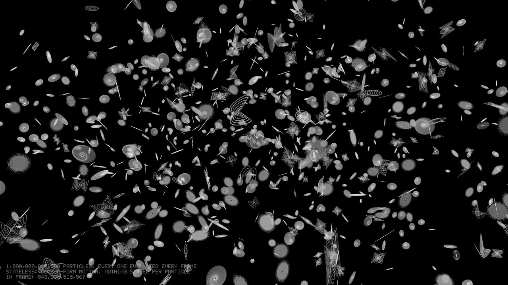

# Rendering journal

What was built on the rendering side of Strata, in the order it happened: the
density look, the compute rasterizer and the realtime numbers, depth cues, the
offline stateless renderer, 64-bit particle keys, the trillion splat kernel,
the record entry and proof shots, and the first frames with
1,000,000,000,000 rendered particles from Noah's RTX 2070.

Everything on these pages happened on the evening of **Nov 18, 2026, US
Central** (already Nov 19 in UTC), between 7:12 PM and about 8:20 PM. Times
are Central unless marked UTC. Conventions are in the
[journal index](../README.md).

*`trillion-key1-f0.png`, rendered on the RTX 2070 in 52 seconds. Click for the
full 3840x2160 frame.*

## Pages

| page | what it records |
| --- | --- |
| [01. Density look and depth cues](2026-11-18-01-density-look-and-depth-cues.md) | `src/render` and `src/depth`: splatting into a density buffer, trails, bloom, the log tone map, tone mapping from integer hit counters, depth cues, the rendering field guide |
| [02. Compute rasterizer and realtime numbers](2026-11-18-02-compute-raster-and-perf.md) | `src/perf` and `src/verify`: 8 bytes per particle, the atomic rasterizer, culling and LOD, and the RTX 2070 table (100M simulated at 111 fps, 800M at 15 fps) |
| [03. Offline stateless renderer](2026-11-18-03-offline-stateless-renderer.md) | `src/offline`: closed-form laws, the exact 64-bit grid, checkpoints, grade, the scale ladder, write combining, hero compositions, camera blur |
| [04. Particle keys and honest counting](2026-11-18-04-particle-keys-and-honest-counting.md) | `src/stateless` and `src/manifest`: the 32-bit key trap, the 64-bit Feistel key, the GPU tallies, what "in frame" means under each weighting, the render manifest |
| [05. Trillion splat kernel](2026-11-18-05-trillion-kernel.md) | `src/trillion`: shared memory tiles, coherent ids, and the first RTX 2070 numbers for it |
| [06. Record entry and proof shots](2026-11-18-06-record-entry-and-proof-shots.md) | `src/record` and `src/proof`: `?record`, the live preview, and the count-up and loupe shots rendered at 1T |
| [07. The first trillion frames](2026-11-18-07-first-trillion-frames.md) | every 1T frame from the RTX 2070: time, in-frame count, grade, picture |
| [08. Visual review and open work](2026-11-18-08-visual-review-and-open-work.md) | what the pictures showed was wrong, Noah's decisions, and what was still open at 8:20 PM |

## Timeline

| time (Central) | what happened | where |
| --- | --- | --- |
| 7:12 PM | Perf path merges: 8-byte particles, compute rasterizer, culling and LOD ([#8](https://github.com/Aptyll/Strata/pull/8)) | [02](2026-11-18-02-compute-raster-and-perf.md) |
| 7:16 PM | Depth cues ([#15](https://github.com/Aptyll/Strata/pull/15)), shader verify harness ([#18](https://github.com/Aptyll/Strata/pull/18)) and the density render pipeline ([#20](https://github.com/Aptyll/Strata/pull/20)) merge within 30 seconds of each other | [01](2026-11-18-01-density-look-and-depth-cues.md), [02](2026-11-18-02-compute-raster-and-perf.md) |
| 7:18 PM | The density tone mapper becomes the app's look ([#26](https://github.com/Aptyll/Strata/pull/26)) | [01](2026-11-18-01-density-look-and-depth-cues.md) |
| 7:21 PM | Rendering field guide explainer ([#31](https://github.com/Aptyll/Strata/pull/31)) | [01](2026-11-18-01-density-look-and-depth-cues.md) |
| 7:24 PM | `CountToneMapper`: tone mapping straight from integer hit counters ([#39](https://github.com/Aptyll/Strata/pull/39)) | [01](2026-11-18-01-density-look-and-depth-cues.md) |
| 7:27 PM | The offline stateless renderer merges ([#41](https://github.com/Aptyll/Strata/pull/41)) | [03](2026-11-18-03-offline-stateless-renderer.md) |
| 7:31 PM | RTX 2070 realtime numbers recorded ([#44](https://github.com/Aptyll/Strata/pull/44)). Offline bench in Chrome on the 2070: 3.3 billion particles per second on a frame-filling sheet | [02](2026-11-18-02-compute-raster-and-perf.md), [07](2026-11-18-07-first-trillion-frames.md) |
| 7:32 PM | 64-bit particle keys ([#45](https://github.com/Aptyll/Strata/pull/45)). **First 1T 4K still reported: 28.9 seconds** | [04](2026-11-18-04-particle-keys-and-honest-counting.md), [07](2026-11-18-07-first-trillion-frames.md) |
| 7:34 PM | `?record` ([#48](https://github.com/Aptyll/Strata/pull/48)), proof shots ([#49](https://github.com/Aptyll/Strata/pull/49)) and the trillion splat kernel ([#50](https://github.com/Aptyll/Strata/pull/50)) merge within 40 seconds | [05](2026-11-18-05-trillion-kernel.md), [06](2026-11-18-06-record-entry-and-proof-shots.md) |
| 7:35 PM | The GPU counts evaluated particles and the renderer refuses frames that miss any ([#52](https://github.com/Aptyll/Strata/pull/52)) | [04](2026-11-18-04-particle-keys-and-honest-counting.md) |
| 7:38 PM | Two more 1T stills (key1 in 52 s, key2 in 26 s). Scale ladder ([#59](https://github.com/Aptyll/Strata/pull/59)) | [07](2026-11-18-07-first-trillion-frames.md), [03](2026-11-18-03-offline-stateless-renderer.md) |
| 7:39 PM | Noah picks the grade: contrast 256. Write combining merges ([#65](https://github.com/Aptyll/Strata/pull/65)) | [08](2026-11-18-08-visual-review-and-open-work.md), [03](2026-11-18-03-offline-stateless-renderer.md) |
| 7:40 PM | The first three 1T frames are in the repo ([#70](https://github.com/Aptyll/Strata/pull/70)) | [07](2026-11-18-07-first-trillion-frames.md) |
| 7:41 PM | Noah picks key1 to open the video | [08](2026-11-18-08-visual-review-and-open-work.md) |
| 7:42 to 7:48 PM | Compositions A, C and B rendered at 1T on the 2070, then A again at contrast 256 | [07](2026-11-18-07-first-trillion-frames.md) |
| 7:53 PM | First moving 1T clip reported: 8 frames at 4K, about 32 s per frame | [07](2026-11-18-07-first-trillion-frames.md) |
| 7:56 PM | Coherent particle ids for the trillion kernel ([#82](https://github.com/Aptyll/Strata/pull/82)), the render manifest ([#94](https://github.com/Aptyll/Strata/pull/94)) and the visual fix briefs ([#95](https://github.com/Aptyll/Strata/pull/95)) | [05](2026-11-18-05-trillion-kernel.md), [04](2026-11-18-04-particle-keys-and-honest-counting.md), [08](2026-11-18-08-visual-review-and-open-work.md) |
| 7:58 to 7:59 PM | Hero compositions ([#67](https://github.com/Aptyll/Strata/pull/67)), the trillion kernel behind the offline renderer ([#80](https://github.com/Aptyll/Strata/pull/80)), camera motion blur ([#92](https://github.com/Aptyll/Strata/pull/92)). Noah decides edge-on sheets stay bright | [03](2026-11-18-03-offline-stateless-renderer.md), [08](2026-11-18-08-visual-review-and-open-work.md) |
| 8:02 PM | Count-up proof shot reported at 1T 4K | [06](2026-11-18-06-record-entry-and-proof-shots.md) |
| 8:05 PM | Docs corrected: the record stills were most likely flux weighted ([#123](https://github.com/Aptyll/Strata/pull/123)). `?record` gets a live preview ([#116](https://github.com/Aptyll/Strata/pull/116)) | [04](2026-11-18-04-particle-keys-and-honest-counting.md), [06](2026-11-18-06-record-entry-and-proof-shots.md) |
| 8:07 PM | Loupe proof shot reported: the count is exact, the picture reads as static. First RTX 2070 bench of the trillion kernel reported | [06](2026-11-18-06-record-entry-and-proof-shots.md), [05](2026-11-18-05-trillion-kernel.md) |
| 8:10 PM | Full 1T 4K frames on the trillion kernel reported: 42 to 49 s, with the coherent path about 3% ahead of the plain one | [05](2026-11-18-05-trillion-kernel.md) |
| 8:17 to 8:20 PM | Loupe and count-up fixes ([#146](https://github.com/Aptyll/Strata/pull/146), [#148](https://github.com/Aptyll/Strata/pull/148)), the trillion kernel's evaluated count read from the GPU ([#149](https://github.com/Aptyll/Strata/pull/149)), a darker default tone curve in the app ([#139](https://github.com/Aptyll/Strata/pull/139)) | [06](2026-11-18-06-record-entry-and-proof-shots.md), [04](2026-11-18-04-particle-keys-and-honest-counting.md), [08](2026-11-18-08-visual-review-and-open-work.md) |

## Numbers at a glance

Each number names where it came from. "Reported" means the agent driving
Noah's desktop said so in the project chat and the number was not yet in a
repo doc when this was written.

| what | number | kind | source |
| --- | --- | --- | --- |
| Realtime, simulated, brute force | 100M particles in 8.99 ms (about 111 fps), 800M in 68.25 ms (about 15 fps), 1920x1080 | measured, RTX 2070 | [docs/perf.md](../../perf.md) |
| Realtime, simulated, culling and LOD | 800M in 18.53 ms (54 fps) | measured, RTX 2070 | [docs/perf.md](../../perf.md) |
| Brute force rate | about 85 ps per particle, 11.6 billion particles per second | arithmetic from the table | [docs/perf.md](../../perf.md) |
| Offline renderer, frame-filling sheet, point splat | 3.3 billion particles per second in Chrome | reported, RTX 2070 | story doc, briefs |
| First 1T 4K frame | 28.9 s for 1,000,000,000,000 particles | reported, RTX 2070 | [story](../../story/how-it-was-built.md), [page 07](2026-11-18-07-first-trillion-frames.md) |
| 1T 4K cluster frames (far, key1, key2) | 29 s, 52 s, 26 s | reported, RTX 2070 | [docs/record](../../record/README.md) |
| 1T 4K close-up filling the frame (composition A) | 172 s, and 205 s on the second render | reported, RTX 2070 | project chat |
| 1T 4K frame with count weighting | about 160 to 193 s | reported, RTX 2070 | [README](../../../README.md), [#123](https://github.com/Aptyll/Strata/pull/123) |
| First 1T clip | 8 frames, about 32 s per frame | reported, RTX 2070 | project chat, clip notes |
| Trillion kernel four-mode bench | 15 to 21 billion per second with run merge and tile, 21 to 24 on its plain path | reported, RTX 2070, short runs, noise about 25% | [page 05](2026-11-18-05-trillion-kernel.md) |
| Trillion kernel, full 1T 4K frame | 42 to 49 s | reported, RTX 2070 | [page 05](2026-11-18-05-trillion-kernel.md) |
| Count-up proof shot, last pass (1T, count weighting) | about 193 s; all 37 passes 324.6 s | reported, RTX 2070 | [page 06](2026-11-18-06-record-entry-and-proof-shots.md) |
| Hits per pixel if 1T spread evenly over 4K | 120,563 | arithmetic (10^12 / 8,294,400) | |
| Planes needed for 1T | at least 233 | arithmetic (10^12 / 2^32 = 232.8) | [docs/trillion.md](../../trillion.md) |
| Coherent-id kernel target | 10 to 15 s per 1T frame | estimate, not confirmed by the first bench | [throughput brief](../../briefs/throughput-math-2070.md) |

## Where the pictures live

- `images/` in this folder holds small copies: 1280 px wide stills, 100%
  crops, contact sheets and one small GIF. About 3 MB in total.
- Full-size 1T frames that are in git are in [`docs/record/`](../../record/).
- Originals that are not in git are in the project's shared files folder
  (`/mnt/project-files/` for agents, the project Library for Noah). Each page
  names the file. Next to most of them is a `<name>.notes.md` with the visual
  review of that file.

## The machine

Noah's desktop: NVIDIA RTX 2070 (8 GB, 448 GB/s memory bandwidth, 4 MB L2
cache), Windows 11, Chrome 157. Windows Application Control blocks native
Node modules there, so the offline renderer ran in Chrome at
`/src/offline/web/`, not through the Node CLI.

Everything "checked" in the cloud ran on a software GPU (SwiftShader). Those
runs prove that shaders compile and counts are exact. They say nothing about
speed.
