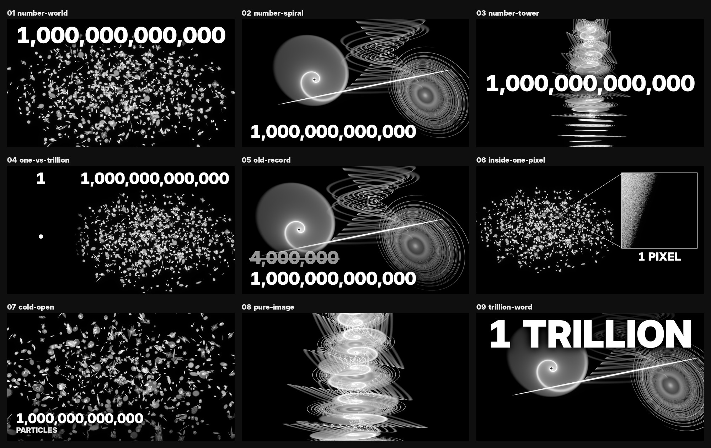

# Thumbnail and title lab

Nine thumbnail candidates for the trillion video, built around the title Noah
picked: **"I Rendered 1,000,000,000,000"**. Every picture area is a real frame
of the offline renderer. The 1T images are frames rendered on Noah's RTX 2070
([docs/record](../../record/README.md)): compositions A and B are the 64-bit
re-renders, a trillion distinct keys with GPU counts in their manifests; the
far opener and key1 are the first renders, on 32-bit keys, so they are a
trillion particles rendered but not a trillion distinct ones (see "Keys"
below). The one-pixel loupe is a 1T render of the far opener's world made in
the cloud.

- [contact-sheet.jpg](contact-sheet.jpg): all nine side by side
- [feed-dark.jpg](feed-dark.jpg) and [feed-light.jpg](feed-light.jpg): each
  candidate at 480, 320 and 168 px wide on YouTube's dark (#0F0F0F) and light
  backgrounds, between loud placeholder thumbnails, with a duration badge
- [manifest.json](manifest.json): sources, keys, counts, crop and brightness
  for each candidate
- `candidates/NN-name.jpg`: the uploads, 1280 x 720 JPEG, 115 to 265 kB



## The candidates

"In view" is how many of the trillion landed in the frame: the GPU count from
the frame's label or manifest (for the far opener, all of them; see
"Honesty"). "Crop keeps" is the share of the frame's light inside the crop.
The frames are flux weighted (a near particle adds more light than a far
one), so light share is close to particle share but not equal to it; for the
far opener, where a count-weighted render of the same view exists, the two
agree within 0.6 points. "Bright" is the share of the thumbnail above 25%
grey, type included.

| # | candidate | picture | in view | crop keeps | bright |
| --- | --- | --- | ---: | ---: | ---: |
| 01 | [number-world](candidates/01-number-world.jpg) | far opener, the whole cluster | all 10^12 | 97.1% | 22% |
| 02 | [number-spiral](candidates/02-number-spiral.jpg) | A: spiral disc, ribbon, ring sheet | 985,878,422,357 | 99.7% | 34% |
| 03 | [number-tower](candidates/03-number-tower.jpg) | B: the column of stacked sheets | 927,901,486,604 | 89.3% | 18% |
| 04 | [one-vs-trillion](candidates/04-one-vs-trillion.jpg) | far opener | all 10^12 | 99.3% | 14% |
| 05 | [old-record](candidates/05-old-record.jpg) | A | 985,878,422,357 | 99.9% | 38% |
| 06 | [inside-one-pixel](candidates/06-inside-one-pixel.jpg) | far opener plus the 1T loupe | all 10^12; 91,002 in the pixel | 99.5% | 13% |
| 07 | [cold-open](candidates/07-cold-open.jpg) | key1, the opening shot | about 843 billion | 92.8% | 21% |
| 08 | [pure-image](candidates/08-pure-image.jpg) | B, closer | 927,901,486,604 | 52.9% | 32% |
| 09 | [trillion-word](candidates/09-trillion-word.jpg) | A | 985,878,422,357 | 96.6% | 33% |

**01 number-world.** The number over the far opener, the one frame where every
particle of the trillion is in the picture. The most literal pairing with the
title: what the number says is what you see. At 168 px the cluster turns into
grey confetti, so it leans on the type.

**02 number-spiral.** The close-up of the big sheets, the number in the black
under them. Bold, smooth shapes that survive the feed. The edge-on sheet is
the brightest line in the frame (fix brief V01); a re-render from an angle
with no near sheet edge-on would remove it.

**03 number-tower.** The number cuts through the column of stacked sheets.
The strongest single silhouette in the set, and it stays readable at 168 px.
It is the darkest of the number candidates because the column is narrow.

**04 one-vs-trillion.** The packaging plan's concept A: a dot labelled "1"
against the whole cluster labelled with the number. The dot is a symbol, not a
render: one particle is one pixel of a 4K frame and vanishes at feed size.

**05 old-record.** The plan's concept B, carried by the digits: Noah's old
record "4,000,000" struck through above "1,000,000,000,000" at the same size,
so the length of the numbers is the comparison. The plan asked for a dim
inset of the old count instead. I rendered that inset (the far opener at
4,000,000 particles) and dropped it: graded on its own it looks the same as
the trillion even at 640 px wide, because 4M still puts about 15 particles in
each lit 4K pixel of this view, and graded at the trillion's exposure it is
black (250,000 times less light). Neither tells the story honestly; the digits
do. (The same holds for the video: the gap between 4M and 1T only shows in
views close enough that 4M particles separate.)

**06 inside-one-pixel.** Curiosity. One pixel of the far opener, (2096, 921),
opened up to 1024 x 1024 with src/proof's loupe at the full trillion: today's
renderer puts exactly 91,002 particles in that pixel, counted on the GPU, with
the edge of a Lissajous sheet passing through. Every dot in the loupe is one
particle (shrunk by block maximum so none disappears). The marker is a 12 px
square around a pixel that is 0.44 px wide at this size. The far opener
underneath is a 32-bit render, so its own particles in that pixel are a
different random draw from the same sheet (see "Honesty").

**07 cold-open.** A frame grab of the opening shot Noah chose (key1) with the
counter, as if paused on the first second. The thumbnail promises exactly the
first frame people will see. Busy at small sizes. The frame's label says
about 843 billion landed in view, and the crop keeps 93% of its light.

**08 pure-image.** The plan's concept C: the column of sheets alone, no type.
The control for Test & Compare, since it cannot repeat the title. It is a
detail, not the whole: the middle of the column, about half of the frame's
light.

**09 trillion-word.** "1 TRILLION" as large as it fits. The most legible
candidate at 168 px. It says the title's number again in words.

## Titles and pairings

Lead title (Noah's pick): **I Rendered 1,000,000,000,000**. Noah asked for the
thumbnails to be centered on that number, so seven of the nine carry it. The
packaging plan's rule for Test & Compare is that thumbnail text should not
repeat the title, so the trio I would test against the lead title is:

1. **05 old-record**: the number, plus the jump from 4,000,000 that the title
   does not say.
2. **03 number-tower**: the number on the strongest silhouette.
3. **06 inside-one-pixel**: the curiosity control, which does not repeat the
   title. Swap in **08 pure-image** for a no-text control.

Other titles, for title testing or the Shorts, each with the thumbnail that
complements it rather than repeats it:

| title | thumbnail | note |
| --- | --- | --- |
| 1 Trillion Particles on an 8-Year-Old GPU | 08 pure-image | The RTX 2070 came out in October 2018. |
| What 1 Trillion Particles Looks Like | 06 inside-one-pixel | A promise the image pays off at once: the whole cluster is all of the trillion, and one pixel of it opened up. Not 08, which shows half of its frame. |
| More Particles Than Stars in the Milky Way | 01 number-world | The Milky Way holds roughly 100 to 400 billion stars. |
| From 4 Million to 1 Trillion Particles | 03 number-tower | Not 05, which would say 4,000,000 twice. |
| A Trillion Particles, None of Them Stored | 06 inside-one-pixel | Honest form of the plan's "in 8 GB of VRAM", which implies they fit in memory. |

Every title says "rendered" or nothing at all about how the particles move,
never "simulated". None says "distinct": the far opener and key1 do not
qualify (see "Keys").

## Honesty

- **Real frames only.** The pictures are crops of the record frames (8-bit
  exports) and of one renderer frame (the loupe). Nothing is painted into
  them. The only drawn elements are type, thin outlines and the "1" dot of 04.
- **Keys.** A and B are `trillion64-A` and `trillion64-B`, rendered at commit
  `1e7e66e` on the 64-bit particle key: a trillion distinct keys, and their
  evaluated and in-view numbers are GPU counts from the manifests beside
  them. The far opener and key1 are the first renders (commit `41e853a` or
  `c42ceda`), on 32-bit keys: all 10^12 particles were rendered and no two
  coincide within a sheet, but they draw on only about 4.3 billion distinct
  keys, each reused on every sheet under that sheet's own transform. So they
  are "10^12 particles rendered", never "10^12 distinct particles"
  (docs/record/README.md), and their 10^12 evaluated is the job's count, from
  before the GPU counted evaluated particles. The first renders of A and B
  stacked identical sheets on those 32-bit keys, so their particles repeated
  about 58 and 7 times; they are retired and no candidate uses them.
  compose.py pins each frame by its hash and stops if one is replaced.
- **Re-graded, not retouched.** The exports store `L = log(1 + c r) / log(1 + c)`
  of light `r` (src/offline/core/grade.ts). compose.py inverts that curve to
  linear light and grades it again: +2 stops over the video's exposure (the
  plan allows +1 to +2) and a gentler toe so faint sheets read. The contrast
  `c` of each export (4096 or 256) is checked from the file itself. The
  inversion was checked on the first export of composition A: re-graded from
  contrast 4096 to 256, it matched that frame's contrast-256 export within one
  code value.
- **Labels are cropped away, never covered.** The burned-in label (bottom left)
  is outside every crop.
- **The number only where the trillion is.** The number appears only on crops
  of frames with at least 84% of the trillion in view, and each of those crops
  keeps 89% or more of its frame's light (the table above and manifest.json).
- **The far opener holds all of the trillion.** Its label predates the in-view
  count, so this is shown another way: bounded the way the loupe's cull bounds
  them, every one of its 1,000 sheets lies at least 472 px inside the frame,
  and a 400M-particle cloud render of the same job counts every particle in
  view.
- **The loupe is a cloud render of the same world**, the only picture not
  made on the 2070. The world and camera are rebuilt from `recordJob`
  (src/record), and the rebuild lines up with the 1T far opener pixel for
  pixel: 95% of lit pixels are shared, and a one-pixel shift drops that to
  84%. The loupe renders only the sheets whose bounds can reach that pixel
  (here one Lissajous sheet with 1,000,000,000 particles) at their full count;
  the rest cannot land there. At smaller counts the cull and the full
  1,000-sheet render of this pixel give byte-identical frames (checked at 400M
  and 4B). The loupe runs on today's 64-bit keys, and the far opener on the
  old 32-bit ones, so the two draw the sheet's particles differently: the same
  sheet edge crosses the pixel, but these are not the same 91,002 dots as in
  the 2070's frame, whose count there would differ by a few hundred (a random
  draw of about 91,000 spreads by about 300). The loupe is count weighted, so
  each particle is one dot; the frame is flux weighted, which draws far
  particles only on average.
- **Brightness.** The plan asks for at least a third of the frame clearly
  bright. 02 and 05 reach it (08 and 09 are close). The black void and the rule
  against painted light keep the rest lower; judge them in the feed sheets,
  where they still stand out on both backgrounds.

## Make them again

```sh
# The thumbnails (about 5 s). Needs numpy and Pillow (raqm for tabular digits).
python3 docs/youtube/thumbnails/tools/compose.py

# The 1T loupe (stills/loupe). In the cloud container, about 40 s:
cd src/offline
VK_ICD_FILENAMES=/opt/pw-browsers/chromium-1243/chrome-linux64/vk_swiftshader_icd.json \
  npx tsx ../../docs/youtube/thumbnails/tools/render-stills.mjs
```

On Noah's PC, where the Node runner cannot load Dawn, add `--plan --out <folder>`
to write the loupe's `job.json` only, then choose that folder in
`/src/offline/web/` and press render (a folder that holds a job continues it).
`--pixel x,y` opens another pixel; `--shots far --particles 4B` renders the far
opener at a stand-in count to pick one (its per-pixel counts are the trillion's
divided by 250). `--shots loupe,loupe-all --particles 400M` repeats the cull
check.

To use a new record frame, add it to `RECORDS` in compose.py with its hash,
exported contrast, keys and the wording docs/record allows for it. With a
render manifest beside it, the counts come from the manifest. The script warns
if the contrast looks wrong and stops if a file no longer matches its hash.

Font: Inter Display Black, SIL Open Font License ([fonts/OFL.txt](fonts/OFL.txt)).
